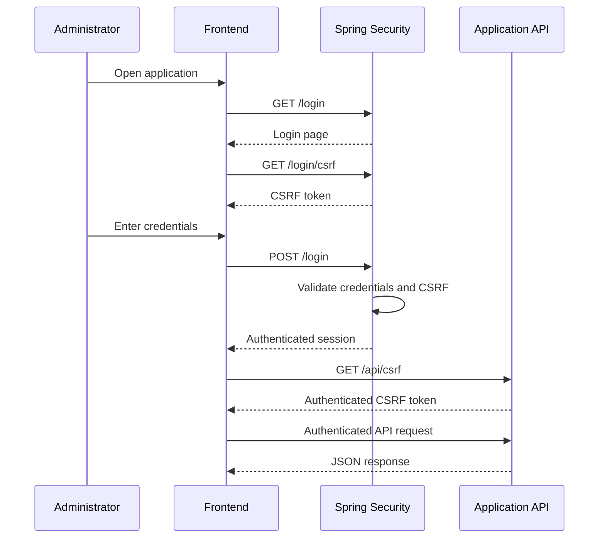
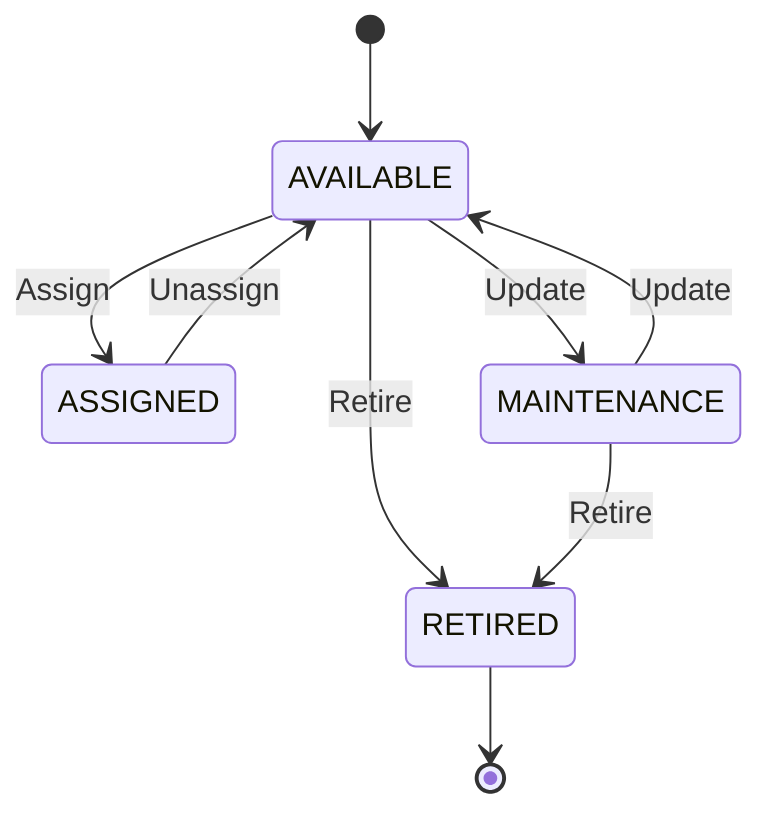
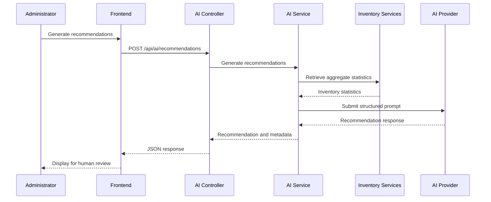

# REST API Documentation

AI-Powered IT Asset Management System

Version: 1.0.0 - Final Release

CMSC 495 - Computer Capstone Project

University of Maryland Global Campus

---

## 1. Overview

The AI-Powered IT Asset Management System exposes REST API endpoints
for asset management, employee management, equipment allocation,
operational statistics, and AI-assisted recommendations.

The API is implemented using Java 25, Spring Boot, Spring Security,
Spring Data JPA, and MySQL.

The application follows a layered architecture that separates
presentation, request processing, business logic, data persistence,
security, and AI integration.

### Base URL

http://localhost:8080

### API Base Path

http://localhost:8080/api

### Content Type

application/json

Authentication requests use form-encoded data instead of JSON.

### Release Information

| Property | Value |
|---|---|
| Application version | 1.0.0 |
| Release | Final Release |
| API architecture | REST |
| Authentication | Session-based |
| Authorization | Administrator role |
| Development database | MySQL |
| Automated testing database | H2 |
| Container database | MySQL 8.4 |
| Deployment | Docker Compose |
| CI/CD | GitHub Actions |

---

## 2. Authentication and Authorization

The application uses Spring Security with session-based
administrator authentication.

Administrator credentials are configured through environment
variables:

- ADMIN_USERNAME
- ADMIN_PASSWORD

Passwords are encoded using BCrypt.

Successful authentication establishes an HTTP session maintained
through a JSESSIONID cookie.

Application API endpoints require administrator authorization.

The login page, login resources, pre-authentication CSRF endpoint,
and application health endpoint are publicly accessible.

### 2.1 Authentication Endpoints

| Method | Endpoint | Description |
|---|---|---|
| GET | /login | Display administrator login page |
| GET | /login/csrf | Retrieve pre-authentication CSRF token |
| POST | /login | Authenticate administrator |
| POST | /logout | Terminate authenticated session |
| GET | /api/csrf | Retrieve authenticated CSRF token |

### 2.2 Login Process

The login endpoint accepts form-encoded credentials.

Required form fields:

- username
- password
- _csrf

Example content type:

```text
application/x-www-form-urlencoded
```

Authentication workflow:

1. Request the login page.
2. Retrieve a CSRF token from /login/csrf.
3. Preserve the associated session cookie.
4. Submit the administrator credentials and CSRF token.
5. Follow the successful authentication redirect.
6. Retrieve a new authenticated CSRF token from /api/csrf.
7. Use the authenticated session for subsequent API requests.

Successful authentication redirects the administrator to the
application dashboard.

Failed authentication redirects to:

```text
/login?error
```

Successful logout redirects to:

```text
/login?logout
```

Logout invalidates the authenticated session and clears the
security context.

### 2.3 CSRF Protection

State-changing requests require a valid Cross-Site Request
Forgery token.

After authentication, retrieve the token using:

```http
GET /api/csrf
```

Example response:

```json
{
  "headerName": "X-CSRF-TOKEN",
  "parameterName": "_csrf",
  "token": "generated-session-token"
}
```

Include the returned token in subsequent POST, PUT, and DELETE
requests.

Example request headers:

```text
Content-Type: application/json
X-CSRF-TOKEN: generated-session-token
Cookie: JSESSIONID=authenticated-session-id
```

The session identifier and CSRF token must belong to the
authenticated session.

Clients should use the headerName and parameterName returned
by the CSRF endpoint rather than assuming fixed values.

### 2.4 Authentication Sequence



### 2.5 Session Security

The application incorporates:

- BCrypt password encoding.
- Session fixation protection.
- HTTP-only session cookies.
- SameSite cookie configuration.
- Configurable secure cookies.
- Thirty-minute session inactivity timeout.
- Session invalidation during logout.
- Administrator role-based authorization.

Secure cookies should be enabled when deploying the application
through HTTPS.

Local development uses HTTP and must not be treated as a
production-grade encrypted deployment.

---

## 3. HTTP Status Codes

| Status | Meaning |
|---|---|
| 200 OK | Successful retrieval, update, or operation |
| 201 Created | Resource successfully created |
| 204 No Content | Resource successfully deleted |
| 400 Bad Request | Invalid input or request parameters |
| 401 Unauthorized | Authentication required |
| 403 Forbidden | Insufficient permissions or invalid CSRF token |
| 404 Not Found | Requested resource does not exist |
| 409 Conflict | Duplicate record or business rule conflict |
| 500 Internal Server Error | Unexpected application failure |
| 502 Bad Gateway | AI provider communication or response failure |
| 503 Service Unavailable | AI service disabled or incorrectly configured |

Browser requests for protected pages may redirect to the login page.

Unauthenticated GET requests to protected application APIs return
HTTP 401.

State-changing requests without a valid CSRF token may return
HTTP 403 before authentication or controller processing occurs.

---

## 4. API Endpoint Reference

### Asset Management

| Method | Endpoint | Success Status |
|---|---|---|
| GET | /api/assets | 200 |
| GET | /api/assets/{id} | 200 |
| POST | /api/assets | 201 |
| PUT | /api/assets/{id} | 200 |
| DELETE | /api/assets/{id} | 204 |
| POST | /api/assets/{id}/assign | 200 |
| POST | /api/assets/{id}/unassign | 200 |
| GET | /api/assets/statistics | 200 |

### Employee Management

| Method | Endpoint | Success Status |
|---|---|---|
| GET | /api/employees | 200 |
| GET | /api/employees/{id} | 200 |
| POST | /api/employees | 201 |
| PUT | /api/employees/{id} | 200 |
| DELETE | /api/employees/{id} | 204 |
| GET | /api/employees/departments | 200 |
| GET | /api/employees/statistics | 200 |

### AI Intelligence

| Method | Endpoint | Success Status |
|---|---|---|
| GET | /api/ai/status | 200 |
| POST | /api/ai/recommendations | 200 |

### Application Monitoring

| Method | Endpoint | Access |
|---|---|---|
| GET | /actuator/health | Public |
| GET | /actuator/info | Administrator |

---

## 5. Asset Management API

### 5.1 Retrieve Assets

```http
GET /api/assets
```

Returns a paginated collection of asset records.

Query parameters:

| Parameter | Type | Default | Description |
|---|---|---|---|
| keyword | String | None | Search name, category, or serial number |
| status | String | None | Filter by asset status |
| page | Integer | 0 | Zero-based page number |
| size | Integer | 10 | Records per page |

Page size must be between 1 and 100.

Example request:

```http
GET /api/assets?page=0&size=10
```

Example filtered request:

```http
GET /api/assets?keyword=Dell&status=AVAILABLE&page=0&size=10
```

Example response:

```json
{
  "content": [
    {
      "id": 1,
      "name": "Dell Latitude 5420",
      "category": "Laptop",
      "serialNumber": "DELL-001",
      "status": "AVAILABLE",
      "employeeId": null,
      "assignedTo": null
    }
  ],
  "totalElements": 1,
  "totalPages": 1,
  "size": 10,
  "number": 0,
  "first": true,
  "last": true
}
```

Success status: 200 OK.

The example shows the principal pagination fields. Additional
pagination metadata may be included by Spring Data.

### 5.2 Retrieve an Asset by ID

```http
GET /api/assets/{id}
```

Example request:

```http
GET /api/assets/1
```

Example response:

```json
{
  "id": 1,
  "name": "Dell Latitude 5420",
  "category": "Laptop",
  "serialNumber": "DELL-001",
  "status": "AVAILABLE",
  "employeeId": null,
  "assignedTo": null
}
```

Success status: 200 OK.

Possible errors:

- 400: Invalid identifier.
- 401: Authentication required.
- 404: Asset does not exist.

### 5.3 Register an Asset

```http
POST /api/assets
```

Example request body:

```json
{
  "name": "Dell Latitude 5420",
  "category": "Laptop",
  "serialNumber": "DELL-001",
  "status": "AVAILABLE"
}
```

Example response:

```json
{
  "id": 1,
  "name": "Dell Latitude 5420",
  "category": "Laptop",
  "serialNumber": "DELL-001",
  "status": "AVAILABLE",
  "employeeId": null,
  "assignedTo": null
}
```

Success status: 201 Created.

Location response header:

```text
/api/assets/1
```

Possible errors:

- 400: Missing or invalid fields.
- 401: Authentication required.
- 403: Invalid CSRF token or insufficient authorization.
- 404: Referenced employee does not exist.
- 409: Duplicate serial number.

### 5.4 Asset Request Validation

| Field | Required | Validation |
|---|---|---|
| name | Yes | Nonblank, maximum 150 characters |
| category | Yes | Nonblank, maximum 100 characters |
| serialNumber | Yes | Nonblank, maximum 100 characters, unique |
| status | Yes | Supported asset status |
| employeeId | Conditional | Positive employee identifier |

Serial numbers are normalized to uppercase.

Duplicate serial numbers are rejected.

An employee identifier is required when creating an asset with
ASSIGNED status.

An employee identifier must not be supplied for an asset with
a non-assigned status.

### 5.5 Supported Asset Statuses

| Status | Description |
|---|---|
| AVAILABLE | Asset is available for allocation |
| ASSIGNED | Asset is assigned to an employee |
| MAINTENANCE | Asset is undergoing maintenance |
| RETIRED | Asset has been removed from active service |

Status values must use the supported uppercase enumeration values.

### 5.6 Update an Asset

```http
PUT /api/assets/{id}
```

Example request:

```http
PUT /api/assets/1
```

Example request body:

```json
{
  "name": "Dell Latitude 5420 - Updated",
  "category": "Laptop",
  "serialNumber": "DELL-001",
  "status": "AVAILABLE"
}
```

Success status: 200 OK.

The response contains the updated asset record.

Possible errors:

- 400: Invalid request fields.
- 401: Authentication required.
- 403: Invalid CSRF token or insufficient authorization.
- 404: Asset or referenced employee does not exist.
- 409: Duplicate serial number or invalid retirement transition.

When updating an assigned asset, omitting employeeId while
retaining ASSIGNED status preserves the existing employee
association.

Changing an assigned asset to a non-assigned status removes
the employee association.

A retired asset cannot be returned to an active status through
the update operation.

### 5.7 Assignment Preservation

The Final Release addresses the assignment preservation defect
identified during Alpha Release peer review.

Example existing asset:

```json
{
  "id": 1,
  "name": "Dell Latitude 5420",
  "category": "Laptop",
  "serialNumber": "DELL-001",
  "status": "ASSIGNED",
  "employeeId": 1,
  "assignedTo": "John Smith"
}
```

Example update request:

```json
{
  "name": "Dell Latitude 5420 - Updated",
  "category": "Laptop",
  "serialNumber": "DELL-001",
  "status": "ASSIGNED"
}
```

Expected response:

```json
{
  "id": 1,
  "name": "Dell Latitude 5420 - Updated",
  "category": "Laptop",
  "serialNumber": "DELL-001",
  "status": "ASSIGNED",
  "employeeId": 1,
  "assignedTo": "John Smith"
}
```

The existing employee relationship is preserved when the asset
remains assigned and no replacement employee is provided.

Regression testing is included in the automated asset controller
test suite.

### 5.8 Delete an Asset

```http
DELETE /api/assets/{id}
```

Example request:

```http
DELETE /api/assets/1
```

Success status: 204 No Content.

Possible errors:

- 401: Authentication required.
- 403: Invalid CSRF token or insufficient authorization.
- 404: Asset does not exist.
- 409: Asset is currently assigned to an employee.

Assigned equipment must be unassigned before deletion.

---

## 6. Asset Allocation API

### 6.1 Assign an Asset

```http
POST /api/assets/{id}/assign
```

Example request:

```http
POST /api/assets/1/assign
```

Example request body:

```json
{
  "employeeId": 1
}
```

Example response:

```json
{
  "id": 1,
  "name": "Dell Latitude 5420",
  "category": "Laptop",
  "serialNumber": "DELL-001",
  "status": "ASSIGNED",
  "employeeId": 1,
  "assignedTo": "John Smith"
}
```

Success status: 200 OK.

Business rules:

- The asset must exist.
- The employee must exist.
- The asset must have AVAILABLE status.
- The employee identifier must be positive.
- The asset status changes to ASSIGNED.
- The employee relationship is stored in the database.

Possible errors:

- 400: Invalid employee identifier.
- 401: Authentication required.
- 403: Invalid CSRF token or insufficient authorization.
- 404: Asset or employee does not exist.
- 409: Asset is not available for assignment.

### 6.2 Unassign an Asset

```http
POST /api/assets/{id}/unassign
```

Example request:

```http
POST /api/assets/1/unassign
```

No request body is required.

Example response:

```json
{
  "id": 1,
  "name": "Dell Latitude 5420",
  "category": "Laptop",
  "serialNumber": "DELL-001",
  "status": "AVAILABLE",
  "employeeId": null,
  "assignedTo": null
}
```

Success status: 200 OK.

Business rules:

- The asset must exist.
- The asset must have ASSIGNED status.
- The employee association is removed.
- The asset status changes to AVAILABLE.

Possible errors:

- 401: Authentication required.
- 403: Invalid CSRF token or insufficient authorization.
- 404: Asset does not exist.
- 409: Asset is not currently assigned.

### 6.3 Asset Allocation Lifecycle



This diagram illustrates the standard operational workflow.

The general update endpoint supports additional valid status
changes subject to the service's business rules.

Retirement prevents an asset from returning to active service.
It does not automatically delete the database record.

---

## 7. Employee Management API

### 7.1 Retrieve Employees

```http
GET /api/employees
```

Query parameters:

| Parameter | Type | Default | Description |
|---|---|---|---|
| keyword | String | None | Search name, email, or department |
| department | String | None | Filter by department |
| page | Integer | 0 | Zero-based page number |
| size | Integer | 10 | Records per page |

Example request:

```http
GET /api/employees?page=0&size=10
```

Example filtered request:

```http
GET /api/employees?department=Cybersecurity&page=0&size=10
```

Example response:

```json
{
  "content": [
    {
      "id": 1,
      "name": "John Smith",
      "email": "john@example.com",
      "department": "Information Technology",
      "assignedAssetCount": 1
    }
  ],
  "totalElements": 1,
  "totalPages": 1,
  "size": 10,
  "number": 0,
  "first": true,
  "last": true
}
```

Success status: 200 OK.

### 7.2 Retrieve an Employee by ID

```http
GET /api/employees/{id}
```

Example request:

```http
GET /api/employees/1
```

Example response:

```json
{
  "id": 1,
  "name": "John Smith",
  "email": "john@example.com",
  "department": "Information Technology",
  "assignedAssetCount": 1
}
```

Success status: 200 OK.

Possible errors:

- 400: Invalid employee identifier.
- 401: Authentication required.
- 404: Employee does not exist.

### 7.3 Register an Employee

```http
POST /api/employees
```

Example request body:

```json
{
  "name": "John Smith",
  "email": "john@example.com",
  "department": "Information Technology"
}
```

Example response:

```json
{
  "id": 1,
  "name": "John Smith",
  "email": "john@example.com",
  "department": "Information Technology",
  "assignedAssetCount": 0
}
```

Success status: 201 Created.

Location response header:

```text
/api/employees/1
```

### 7.4 Employee Request Validation

| Field | Required | Validation |
|---|---|---|
| name | Yes | Nonblank, maximum 150 characters |
| email | Yes | Valid email format, maximum 254 characters, unique |
| department | Yes | Nonblank, maximum 100 characters |

Employee email addresses are normalized to lowercase.

Duplicate employee email addresses are rejected.

Possible errors:

- 400: Missing or invalid fields.
- 401: Authentication required.
- 403: Invalid CSRF token or insufficient authorization.
- 409: Duplicate employee email.

### 7.5 Update an Employee

```http
PUT /api/employees/{id}
```

Example request body:

```json
{
  "name": "John Smith",
  "email": "john@example.com",
  "department": "Cybersecurity"
}
```

Success status: 200 OK.

The response contains the updated employee record.

Existing asset relationships remain associated with the employee
identifier when employee information changes.

Employee names displayed in asset responses are derived from
the associated employee record.

Possible errors:

- 400: Invalid employee information.
- 401: Authentication required.
- 403: Invalid CSRF token or insufficient authorization.
- 404: Employee does not exist.
- 409: Duplicate employee email.

### 7.6 Delete an Employee

```http
DELETE /api/employees/{id}
```

Example request:

```http
DELETE /api/employees/1
```

Success status: 204 No Content.

Possible errors:

- 401: Authentication required.
- 403: Invalid CSRF token or insufficient authorization.
- 404: Employee does not exist.
- 409: Employee has assigned assets.

All assigned equipment must be returned before deleting the
employee record.

This restriction protects referential integrity and prevents
orphaned asset assignments.

### 7.7 Retrieve Departments

```http
GET /api/employees/departments
```

Example response:

```json
[
  "Cybersecurity",
  "Finance",
  "Information Technology",
  "Operations"
]
```

Success status: 200 OK.

Departments are derived from existing employee records.

---

## 8. Operational Statistics API

### 8.1 Asset Statistics

```http
GET /api/assets/statistics
```

Example response:

```json
{
  "totalAssets": 100,
  "availableAssets": 30,
  "assignedAssets": 55,
  "maintenanceAssets": 10,
  "retiredAssets": 5,
  "totalEmployees": 40,
  "assetsByStatus": {
    "AVAILABLE": 30,
    "ASSIGNED": 55,
    "MAINTENANCE": 10,
    "RETIRED": 5
  },
  "assetsByCategory": {
    "Laptop": 60,
    "Monitor": 25,
    "Desktop": 15
  }
}
```

Success status: 200 OK.

Statistics are derived from application database records.

### 8.2 Employee Statistics

```http
GET /api/employees/statistics
```

Example response:

```json
{
  "totalEmployees": 40,
  "totalDepartments": 4,
  "employeesByDepartment": {
    "Information Technology": 15,
    "Cybersecurity": 10,
    "Operations": 10,
    "Finance": 5
  }
}
```

Success status: 200 OK.

### 8.3 Asset Utilization

The frontend calculates asset utilization using the following
formula:

```text
Active Assets = Total Assets - Retired Assets

Utilization Percentage =
    (Assigned Assets / Active Assets) * 100
```

If there are no active assets, utilization is displayed as zero.

For the illustrative statistics above:

```text
Active Assets = 100 - 5 = 95

Utilization = (55 / 95) * 100

Utilization = 57.89%
```

The dashboard may round the displayed percentage.

These figures are documentation examples, not measured project
performance results.

---

## 9. AI Recommendation API

### 9.1 Retrieve AI Service Status

```http
GET /api/ai/status
```

Example configured response:

```json
{
  "enabled": true,
  "configured": true,
  "model": "configured-model-name",
  "humanReviewRequired": true
}
```

Example disabled response:

```json
{
  "enabled": false,
  "configured": false,
  "model": "Not configured",
  "humanReviewRequired": true
}
```

Success status: 200 OK.

The configured field indicates whether the required configuration
values are present and AI functionality is enabled.

It does not guarantee that the provider is reachable, that
credentials are valid, or that the selected model is available.

### 9.2 Generate AI Recommendations

```http
POST /api/ai/recommendations
```

No request body is required.

The application retrieves current asset and employee statistics,
prepares an aggregate inventory summary, and submits a structured
prompt to the configured AI provider.

The recommendation service supports operational analysis involving:

- Inventory utilization.
- Available equipment.
- Equipment allocation.
- Maintenance requirements.
- Retired equipment.
- Inventory management improvements.
- Potential operational risks.

Example response:

```json
{
  "recommendation": "Review maintenance requirements for the 10 assets currently under maintenance. Evaluate whether available equipment can meet upcoming allocation needs.",
  "model": "configured-model-name",
  "generatedAt": "2026-11-26T12:00:00Z",
  "responseTimeMs": 2450,
  "humanReviewRequired": true,
  "inventoryData": {
    "totalAssets": 100,
    "availableAssets": 30,
    "assignedAssets": 55,
    "maintenanceAssets": 10,
    "retiredAssets": 5,
    "totalEmployees": 40,
    "totalDepartments": 4
  }
}
```

Success status: 200 OK.

The recommendation, timestamp, model name, and response time above
are illustrative examples.

Possible errors:

- 401: Administrator authentication required.
- 403: Invalid CSRF token or insufficient authorization.
- 502: AI provider failure or invalid provider response.
- 503: AI service disabled or incorrectly configured.

### 9.3 AI Configuration

AI integration is configured using environment variables.

| Variable | Purpose |
|---|---|
| AI_ENABLED | Enables or disables AI functionality |
| AI_API_KEY | Provider authentication credential, when required |
| AI_MODEL | Configured AI model identifier |
| AI_BASE_URL | OpenAI-compatible provider base URL |

Sensitive configuration values must not be committed to the
GitHub repository.

The application supports an OpenAI-compatible provider interface.

### 9.4 AI Provider Communication

The application sends requests to the configured endpoint:

```http
POST {AI_BASE_URL}/chat/completions
```

The configured base URL should include the provider API version
path where required, such as /v1.

The request contains:

- Configured model identifier.
- System instructions.
- Aggregate inventory statistics.
- Non-streaming response configuration.

An authorization header is included when an API key is configured.

The AI integration is designed to reject invalid configuration
and handle provider communication failures without exposing
provider credentials to the frontend.

### 9.5 AI Request Lifecycle



### 9.6 AI Privacy Controls

The AI provider receives selected aggregate numerical statistics.

The request is designed to exclude:

- Employee names.
- Employee email addresses.
- Individual asset serial numbers.
- Individual employee assignments.
- Administrator credentials.

AI provider credentials are used for authentication when required
and are not included in the inventory prompt.

The AI service does not directly modify database records.

All recommendations require human review.

### 9.7 Responsible AI

The AI integration functions as a decision-support capability
rather than an autonomous decision-making system.

Administrators retain responsibility for:

- Reviewing generated recommendations.
- Confirming the accuracy of inventory statistics.
- Evaluating organizational requirements.
- Rejecting unsupported recommendations.
- Authorizing asset allocation decisions.

Generated recommendations may contain inaccuracies or unsupported
assumptions.

The application does not guarantee the correctness, fairness,
or completeness of every AI-generated recommendation.

### 9.8 Verified AI Execution

During local application execution on November 26, 2026,
the application logs recorded two successful AI recommendation
generation operations.

| Execution | Recorded Response Time |
|---|---:|
| AI recommendation 1 | 4,879 ms |
| AI recommendation 2 | 5,250 ms |
| Arithmetic mean | 5,064.5 ms |

These measurements represent two observed recommendation
generation operations.

They do not constitute a comprehensive AI performance benchmark
or establish performance under concurrent workloads.

Automated AI service tests use controlled provider responses
to verify integration behavior and failure handling.

The Docker deployment verification pipeline runs with AI disabled
to avoid requiring external provider credentials and to maintain
repeatable infrastructure verification.

Live AI execution and automated Docker deployment verification
are therefore separate forms of validation.

---

## 10. Application Monitoring API

### 10.1 Application Health

```http
GET /actuator/health
```

Authentication is not required.

Example healthy response:

```json
{
  "status": "UP"
}
```

The health endpoint may also include configured health groups.

The endpoint supports deployment verification and application
availability monitoring.

Detailed internal health information is not exposed publicly.

Example verification command:

```bash
curl -i http://localhost:8080/actuator/health
```

Expected successful status:

```text
HTTP/1.1 200
```

Expected application health:

```text
UP
```

The health endpoint returned HTTP 200 and status UP during
local Docker deployment verification.

The GitHub Actions deployment verification job also confirmed
application health status UP.

### 10.2 Application Information

```http
GET /actuator/info
```

Administrator authentication is required.

This endpoint exposes application information when configured
information contributors are enabled.

---

## 11. Error Response Format

Application-level errors are handled through a centralized
exception handler.

Example validation error:

```json
{
  "timestamp": "2026-11-26T12:00:00Z",
  "status": 400,
  "error": "Bad Request",
  "message": "Request validation failed",
  "path": "/api/assets",
  "validationErrors": {
    "name": "Asset name is required"
  }
}
```

Example conflict response:

```json
{
  "timestamp": "2026-11-26T12:00:00Z",
  "status": 409,
  "error": "Conflict",
  "message": "An asset with this serial number already exists",
  "path": "/api/assets",
  "validationErrors": {}
}
```

Exact error messages may vary according to the validation rule
or business operation.

Authentication and authorization failures handled directly by
Spring Security may use a different response format.

Clients should inspect the HTTP status code before processing
the response body.

Successful DELETE requests return HTTP 204 without a response body.

### Error Handling Principles

- Invalid requests are rejected before persistence.
- Missing resources return appropriate HTTP status codes.
- Business rule conflicts are communicated to the client.
- Database constraint violations are handled without exposing
  internal SQL statements.
- Provider communication failures are handled separately.
- Internal stack traces are not exposed through normal API errors.

---

## 12. Pagination and Search

Both asset and employee collection endpoints support pagination.

| Property | Value |
|---|---|
| Initial page | 0 |
| Default page size | 10 |
| Minimum page size | 1 |
| Maximum page size | 100 |

Example:

```http
GET /api/assets?page=0&size=20
```

The next page is requested using:

```http
GET /api/assets?page=1&size=20
```

Asset search supports:

- Asset name.
- Asset category.
- Serial number.
- Asset status filtering.

Employee search supports:

- Employee name.
- Employee email.
- Department.
- Department filtering.

Search matching is designed to be case-insensitive.

Asset results are ordered by identifier in descending order.

Employee results are ordered by name and then identifier in
ascending order.

Pagination reduces the number of records returned by collection
requests compared with the Alpha Release implementation.

The current implementation uses Spring Data pagination
serialization. An explicit, stable pagination response DTO
is recommended for future API compatibility.

---

## 13. Automated API Testing

The application includes automated tests using Spring Boot,
MockMvc, JUnit, Mockito, and an isolated H2 database.

Relevant test classes:

- AssetControllerTest
- EmployeeControllerTest
- SecurityTest
- AiRecommendationServiceTest
- AssetmanagementApplicationTests

The test suite covers application initialization, API operations,
business rules, validation, authorization, CSRF protection,
employee relationships, and AI integration behavior.

### 13.1 Execute Automated Tests

```bash
./mvnw clean test
```

### 13.2 Execute Build and Coverage Verification

```bash
./mvnw clean verify
```

### 13.3 Test Reports

```text
target/surefire-reports/
```

### 13.4 JaCoCo Coverage Reports

```text
target/site/jacoco/
```

Open the HTML coverage report on macOS:

```bash
open target/site/jacoco/index.html
```

### 13.5 Verified Automated Test Results

The following results were recorded by GitHub Actions during
Final Release verification on November 26, 2026.

| Metric | Verified Result |
|---|---:|
| Total automated tests | 138 |
| Passed | 138 |
| Failures | 0 |
| Errors | 0 |
| Skipped | 0 |
| Test pass rate | 100% |
| Reported test duration | 9.62 seconds |

All automated tests completed successfully.

### 13.6 Test Suite Expansion

| Release | Automated Tests |
|---|---:|
| Alpha Release | 8 |
| Final Release | 138 |
| Additional tests | 130 |

The Final Release contains 17.25 times the number of automated
tests included in the Alpha Release.

The expanded suite improves verification of security, business
rules, employee integration, asset allocation, and AI service
behavior.

Test quantity alone does not establish complete software quality.

### 13.7 Verified Code Coverage

The following JaCoCo results were generated during GitHub
Actions workflow run number 7.

| Coverage Metric | Verified Result |
|---|---:|
| Instruction coverage | 91.43% |
| Branch coverage | 70.83% |
| Line coverage | 91.32% |
| Complexity coverage | 71.37% |
| Method coverage | 92.03% |
| Class coverage | 100.00% |

These results describe instrumented Java code coverage.

They do not represent JavaScript or CSS coverage and do not
establish that every possible execution path has been tested.

Branch coverage identifies an opportunity for additional
conditional-path and edge-case testing.

---

## 14. CI/CD and Deployment Verification

The application uses GitHub Actions to automate compilation,
testing, coverage reporting, packaging, Docker deployment,
and application health verification.

Workflow configuration:

```text
.github/workflows/maven.yml
```

Workflow name:

```text
Spring Boot CI/CD
```

### 14.1 Verified Final Release Workflow

| Property | Verified Result |
|---|---|
| Workflow run | 7 |
| Commit | f85eb30 |
| Branch | main |
| Workflow status | Success |
| Total workflow duration | 1 minute 43 seconds |
| Build, Test and Code Coverage | Passed |
| Docker Deployment and Health Verification | Passed |
| Generated artifacts | 4 |

Workflow evidence:

https://github.com/ilerioluwaa/ai-it-asset-management-system/actions/runs/45769400901

### 14.2 Verified Deployment Results

| Verification | Result |
|---|---|
| Docker image build | Passed |
| MySQL-backed application startup | Passed |
| Application health | UP |
| Administrator login page | HTTP 200 |
| Protected asset API | HTTP 401 |
| Protected employee API | HTTP 401 |
| Protected AI API | HTTP 401 |

The HTTP 401 results are expected security responses confirming
that unauthenticated requests cannot access the protected APIs.

They are successful security verification results rather than
application failures.

### 14.3 Local Docker Verification

The application was also deployed locally using Docker Desktop
and Docker Compose.

Local verification demonstrated:

- Successful application image construction.
- Successful MySQL container initialization.
- Successful application container startup.
- Healthy application response.
- Accessible administrator login page.
- Successful administrator access to the dashboard.
- Asset registration through the containerized application.
- Continued application availability following container restart.

The local deployment uses a persistent MySQL Docker volume.

The Docker environment is separate from the native MySQL
development environment.

### 14.4 CI/CD Artifacts

The successful workflow generated the following artifacts:

| Artifact | Reported Size |
|---|---:|
| application-package | 54.1 MB |
| automated-test-reports | 25.7 KB |
| deployment-evidence | 3.69 KB |
| jacoco-coverage-report | 292 KB |

These artifacts provide reproducible evidence of the automated
build, test execution, coverage analysis, and deployment
verification.

### 14.5 Deployment Scope

The CI/CD workflow deploys the application into a temporary
Docker environment within the GitHub Actions runner.

This verifies that the application can be built, packaged,
started with MySQL, and accessed through its expected endpoints.

It does not represent a permanent public cloud deployment.

The verified workflow reported two non-blocking warnings
concerning deprecated Node.js 20-based GitHub Actions.

Both workflow jobs completed successfully.

Updating the affected GitHub Actions dependencies is recommended
as future maintenance.

---

## 15. API Security Considerations

The API incorporates:

- Session-based administrator authentication.
- BCrypt password encoding.
- Role-based authorization.
- CSRF protection.
- Server-side input validation.
- Database uniqueness constraints.
- Restricted error information.
- Security response headers.
- Transactional service operations.
- Limited AI data disclosure.
- Environment-based credential configuration.
- Session invalidation during logout.

### 15.1 Security Response Headers

The application includes security headers intended to reduce
common browser-based security risks.

These include:

- Content Security Policy.
- X-Content-Type-Options.
- X-Frame-Options.
- Cache-control protections for sensitive responses.

### 15.2 Credential Management

Sensitive values are supplied through environment variables.

The private .env file is excluded from version control.

The repository provides .env.example as a configuration template.

Actual administrator passwords, database passwords, and AI
provider credentials must not be committed to source control.

### 15.3 Remaining Security Enhancements

Production enhancements remain necessary for:

- Persistent identity management.
- Multiple administrator accounts.
- Granular role-based access control.
- Audit logging.
- Authentication rate limiting.
- AI request rate limiting.
- Concurrency controls.
- HTTPS deployment.
- Secret rotation.
- Dependency vulnerability scanning.
- Comprehensive security and penetration testing.

The implemented security controls improve the Alpha Release
security posture but do not constitute a formal security
certification.

---

## 16. API Versioning

Application version: 1.0.0.

The current API uses the /api base path.

Explicit URL-based API versioning, such as /api/v1, is reserved
for future development.

Changes from the Alpha Release include:

- Paginated collection responses.
- Uppercase asset status enumeration.
- Employee identifier-based assignment relationships.
- Standardized resource creation and deletion responses.
- Administrator authentication requirements.
- CSRF protection.
- Expanded validation and error handling.
- Operational statistics endpoints.
- AI recommendation endpoints.
- Application monitoring endpoints.
- Improved assignment preservation.
- Employee deletion safeguards.
- Expanded automated testing.
- Docker deployment verification.

Clients developed for the Alpha Release may require updates.

Existing Alpha Release databases may also require schema and
data migration before being used with the Final Release.

---

## 17. Known Limitations

The current release has the following limitations:

1. Authentication uses a configured administrator account rather
   than a persistent enterprise identity management system.

2. AI recommendations depend on provider availability and
   configuration.

3. AI output requires human review and is not guaranteed to be
   accurate or complete.

4. Automated integration tests primarily use H2, which does not
   reproduce every MySQL-specific database behavior.

5. The Docker verification pipeline confirms application startup,
   health, and selected endpoint behavior rather than exhaustive
   production workload performance.

6. Employee asset counts and employee selection workflows may
   require further query optimization for large inventories.

7. Explicit pagination response versioning remains a future
   improvement.

8. Comprehensive concurrent workload testing and long-duration
   reliability testing remain future activities.

9. Permanent public deployment, HTTPS infrastructure, and
   enterprise monitoring require additional configuration.

10. Java code coverage does not establish complete frontend
    or end-to-end browser test coverage.

These limitations are documented to support professional
transparency and continued system improvement.

---

## 18. Supporting Documentation

| Document | Purpose |
|---|---|
| README.md | Project overview and release information |
| API.md | REST API specification |
| INSTALLATION.md | Installation and deployment instructions |
| USER_MANUAL.md | Administrator operating instructions |
| TECHNICAL_DEBT.md | Technical debt and mitigation analysis |
| PERFORMANCE.md | Testing, coverage, and performance evaluation |

### Project Repository

https://github.com/ilerioluwaa/ai-it-asset-management-system

### GitHub Actions

https://github.com/ilerioluwaa/ai-it-asset-management-system/actions

### Final Release Verification

https://github.com/ilerioluwaa/ai-it-asset-management-system/actions/runs/45769400901

---

## 19. Documentation Verification

This document describes the version 1.0.0 Final Release API.

Request bodies, response examples, employee records, asset
records, and illustrative inventory statistics are provided
for documentation purposes.

Verified automated test results, code coverage measurements,
observed AI response times, and deployment verification results
are identified separately.

The Final Release verification evidence includes:

- 138 successful automated tests.
- Zero automated test failures.
- Zero automated test errors.
- 91.32% Java line coverage.
- Successful Docker image construction.
- Successful MySQL-backed application startup.
- Application health status UP.
- Successful administrator login page verification.
- Protected API authentication verification.
- Successful GitHub Actions CI/CD workflow.
- Four generated verification artifacts.
- Two recorded local AI recommendation generation operations.

These results establish successful verification within the
documented testing and deployment environments.

They do not imply that every production scenario has been
tested or that the application is free from all defects.

---

AI-Powered IT Asset Management System

Version 1.0.0 - Final Release

CMSC 495 - Computer Capstone Project

University of Maryland Global Campus

November 2026
