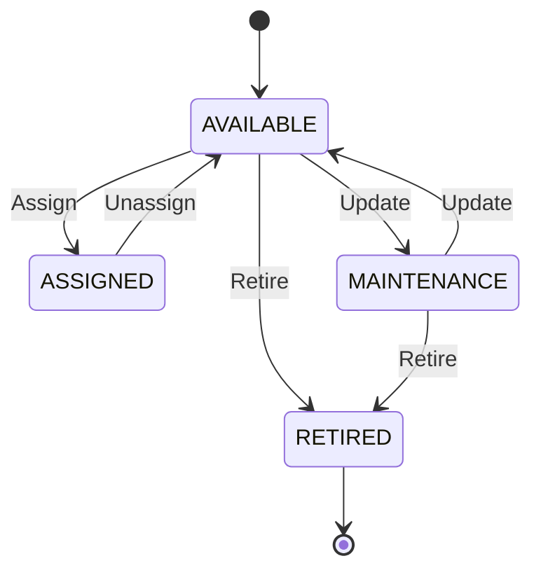
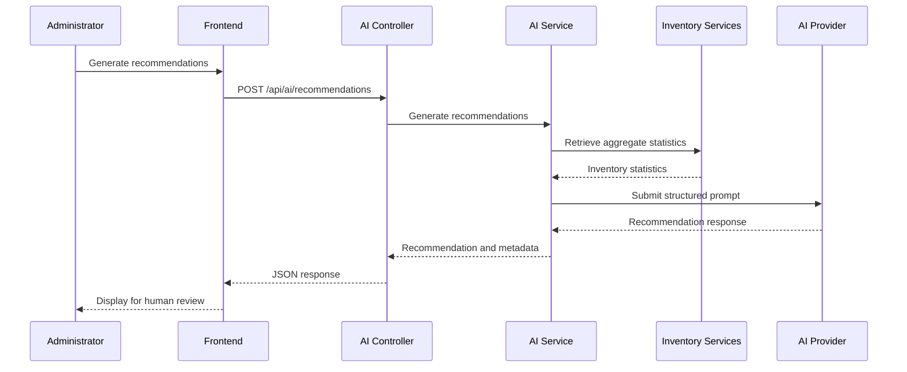

# REST API Documentation

AI-Powered IT Asset Management System

Version: 1.0.0 - Final Release Candidate

## 1. Overview

The application exposes REST API endpoints for asset management,
employee management, equipment allocation, operational statistics,
and AI-assisted recommendations.

The API uses JSON for application request and response bodies.

### Base URL

http://localhost:8080

### API Base Path

http://localhost:8080/api

### Content Type

application/json

## 2. Authentication and Authorization

The application uses Spring Security with session-based
administrator authentication.

Administrator credentials are configured through environment
variables.

- ADMIN_USERNAME
- ADMIN_PASSWORD

Successful authentication establishes an HTTP session.

The session identifier is maintained through a JSESSIONID cookie.

All application API endpoints require administrator authorization.

The login page and application health endpoint are publicly
accessible.

### Authentication Endpoints

| Method | Endpoint | Description |
|---|---|---|
| GET | /login | Display login page |
| POST | /login | Authenticate administrator |
| POST | /logout | Terminate authenticated session |
| GET | /api/csrf | Retrieve CSRF token |

The login endpoint accepts form-encoded credentials rather than
a JSON request body.

Required login fields:

- username
- password
- _csrf

### CSRF Protection

State-changing API requests require a valid CSRF token.

After authentication, retrieve the token using:

GET /api/csrf

Example response:

```json
{
  "headerName": "X-CSRF-TOKEN",
  "parameterName": "_csrf",
  "token": "generated-session-token"
}
```

Include the returned token in subsequent POST, PUT, and DELETE
requests.

Example request headers:

```text
Content-Type: application/json
X-CSRF-TOKEN: generated-session-token
Cookie: JSESSIONID=authenticated-session-id
```

The session identifier and CSRF token must belong to the
authenticated session.

## 3. HTTP Status Codes

| Status | Meaning |
|---|---|
| 200 OK | Successful retrieval or update |
| 201 Created | Resource successfully created |
| 204 No Content | Resource successfully deleted |
| 400 Bad Request | Invalid input or request parameters |
| 401 Unauthorized | Authentication required |
| 403 Forbidden | Insufficient permissions or invalid CSRF token |
| 404 Not Found | Requested resource does not exist |
| 409 Conflict | Duplicate record or business rule conflict |
| 500 Internal Server Error | Unexpected application failure |
| 502 Bad Gateway | AI provider communication or response failure |
| 503 Service Unavailable | AI service disabled or incorrectly configured |

Browser requests for protected pages may redirect to the login page.

## 4. Asset Management API

### 4.1 Retrieve Assets

GET /api/assets

Returns a paginated collection of asset records.

Query parameters:

| Parameter | Type | Default | Description |
|---|---|---|---|
| keyword | String | None | Search name, category, or serial number |
| status | String | None | Filter by asset status |
| page | Integer | 0 | Zero-based page number |
| size | Integer | 10 | Records per page |

Page size must be between 1 and 100.

Example request:

```http
GET /api/assets?page=0&size=10
```

Example filtered request:

```http
GET /api/assets?keyword=Dell&status=AVAILABLE&page=0&size=10
```

Example response:

```json
{
  "content": [
    {
      "id": 1,
      "name": "Dell Latitude 5420",
      "category": "Laptop",
      "serialNumber": "DELL-001",
      "status": "AVAILABLE",
      "employeeId": null,
      "assignedTo": null
    }
  ],
  "totalElements": 1,
  "totalPages": 1,
  "size": 10,
  "number": 0,
  "first": true,
  "last": true
}
```

Success status: 200 OK.

The example shows the principal pagination fields. Additional
pagination metadata may be included by Spring Data.

### 4.2 Retrieve an Asset by ID

GET /api/assets/{id}

Example request:

```http
GET /api/assets/1
```

Example response:

```json
{
  "id": 1,
  "name": "Dell Latitude 5420",
  "category": "Laptop",
  "serialNumber": "DELL-001",
  "status": "AVAILABLE",
  "employeeId": null,
  "assignedTo": null
}
```

Success status: 200 OK.

Possible errors:

- 400: Invalid identifier.
- 404: Asset does not exist.

### 4.3 Register an Asset

POST /api/assets

Example request body:

```json
{
  "name": "Dell Latitude 5420",
  "category": "Laptop",
  "serialNumber": "DELL-001",
  "status": "AVAILABLE"
}
```

Example response:

```json
{
  "id": 1,
  "name": "Dell Latitude 5420",
  "category": "Laptop",
  "serialNumber": "DELL-001",
  "status": "AVAILABLE",
  "employeeId": null,
  "assignedTo": null
}
```

Success status: 201 Created.

Location response header:

```text
/api/assets/1
```

Possible errors:

- 400: Missing or invalid fields.
- 403: Invalid CSRF token or insufficient authorization.
- 404: Referenced employee does not exist.
- 409: Duplicate serial number.

### Asset Request Validation

| Field | Required | Validation |
|---|---|---|
| name | Yes | Nonblank, maximum 150 characters |
| category | Yes | Nonblank, maximum 100 characters |
| serialNumber | Yes | Nonblank, maximum 100 characters, unique |
| status | Yes | Supported asset status |
| employeeId | Conditional | Positive employee identifier |

Serial numbers are normalized to uppercase.

An employee identifier is required when creating an asset with
ASSIGNED status.

An employee identifier must not be supplied for an asset with
a non-assigned status.

### Supported Asset Statuses

| Status | Description |
|---|---|
| AVAILABLE | Asset is available for allocation |
| ASSIGNED | Asset is assigned to an employee |
| MAINTENANCE | Asset is undergoing maintenance |
| RETIRED | Asset has been removed from active service |

Status values must use the supported uppercase enumeration values.

### 4.4 Update an Asset

PUT /api/assets/{id}

Example request:

```http
PUT /api/assets/1
```

Example request body:

```json
{
  "name": "Dell Latitude 5420 - Updated",
  "category": "Laptop",
  "serialNumber": "DELL-001",
  "status": "AVAILABLE"
}
```

Success status: 200 OK.

The response contains the updated asset record.

Possible errors:

- 400: Invalid request fields.
- 403: Invalid CSRF token or insufficient authorization.
- 404: Asset or referenced employee does not exist.
- 409: Duplicate serial number or invalid retirement transition.

When updating an assigned asset, omitting employeeId while
retaining ASSIGNED status preserves the existing employee
association.

Changing an assigned asset to a non-assigned status removes
the employee association.

A retired asset cannot be returned to an active status through
the update operation.

### 4.5 Delete an Asset

DELETE /api/assets/{id}

Example request:

```http
DELETE /api/assets/1
```

Success status: 204 No Content.

Possible errors:

- 403: Invalid CSRF token or insufficient authorization.
- 404: Asset does not exist.
- 409: Asset is currently assigned to an employee.

Assigned equipment must be unassigned before deletion.

## 5. Asset Allocation API

### 5.1 Assign an Asset

POST /api/assets/{id}/assign

Example request:

```http
POST /api/assets/1/assign
```

Example request body:

```json
{
  "employeeId": 1
}
```

Example response:

```json
{
  "id": 1,
  "name": "Dell Latitude 5420",
  "category": "Laptop",
  "serialNumber": "DELL-001",
  "status": "ASSIGNED",
  "employeeId": 1,
  "assignedTo": "John Smith"
}
```

Success status: 200 OK.

Business rules:

- The asset must exist.
- The employee must exist.
- The asset must have AVAILABLE status.
- The employee identifier must be positive.
- The asset status changes to ASSIGNED.
- The employee relationship is stored in the database.

Possible errors:

- 400: Invalid employee identifier.
- 403: Invalid CSRF token or insufficient authorization.
- 404: Asset or employee does not exist.
- 409: Asset is not available for assignment.

### 5.2 Unassign an Asset

POST /api/assets/{id}/unassign

Example request:

```http
POST /api/assets/1/unassign
```

No request body is required.

Example response:

```json
{
  "id": 1,
  "name": "Dell Latitude 5420",
  "category": "Laptop",
  "serialNumber": "DELL-001",
  "status": "AVAILABLE",
  "employeeId": null,
  "assignedTo": null
}
```

Success status: 200 OK.

Business rules:

- The asset must exist.
- The asset must have ASSIGNED status.
- The employee association is removed.
- The asset status changes to AVAILABLE.

Possible errors:

- 403: Invalid CSRF token or insufficient authorization.
- 404: Asset does not exist.
- 409: Asset is not currently assigned.

### Asset Allocation Lifecycle



This diagram illustrates the standard operational workflow.
The general update endpoint supports additional valid status
changes subject to the service's business rules.

## 6. Employee Management API

### 6.1 Retrieve Employees

GET /api/employees

Query parameters:

| Parameter | Type | Default | Description |
|---|---|---|---|
| keyword | String | None | Search name, email, or department |
| department | String | None | Filter by department |
| page | Integer | 0 | Zero-based page number |
| size | Integer | 10 | Records per page |

Example request:

```http
GET /api/employees?page=0&size=10
```

Example response:

```json
{
  "content": [
    {
      "id": 1,
      "name": "John Smith",
      "email": "john@example.com",
      "department": "Information Technology",
      "assignedAssetCount": 1
    }
  ],
  "totalElements": 1,
  "totalPages": 1,
  "size": 10,
  "number": 0,
  "first": true,
  "last": true
}
```

Success status: 200 OK.

### 6.2 Retrieve an Employee by ID

GET /api/employees/{id}

Example request:

```http
GET /api/employees/1
```

Example response:

```json
{
  "id": 1,
  "name": "John Smith",
  "email": "john@example.com",
  "department": "Information Technology",
  "assignedAssetCount": 1
}
```

Success status: 200 OK.

Possible errors:

- 400: Invalid employee identifier.
- 404: Employee does not exist.

### 6.3 Register an Employee

POST /api/employees

Example request body:

```json
{
  "name": "John Smith",
  "email": "john@example.com",
  "department": "Information Technology"
}
```

Example response:

```json
{
  "id": 1,
  "name": "John Smith",
  "email": "john@example.com",
  "department": "Information Technology",
  "assignedAssetCount": 0
}
```

Success status: 201 Created.

Location response header:

```text
/api/employees/1
```

### Employee Request Validation

| Field | Required | Validation |
|---|---|---|
| name | Yes | Nonblank, maximum 150 characters |
| email | Yes | Valid email format, maximum 254 characters, unique |
| department | Yes | Nonblank, maximum 100 characters |

Employee email addresses are normalized to lowercase.

Possible errors:

- 400: Missing or invalid fields.
- 403: Invalid CSRF token or insufficient authorization.
- 409: Duplicate employee email.

### 6.4 Update an Employee

PUT /api/employees/{id}

Example request body:

```json
{
  "name": "John Smith",
  "email": "john@example.com",
  "department": "Cybersecurity"
}
```

Success status: 200 OK.

The response contains the updated employee record.

Existing asset relationships remain associated with the employee
identifier when employee information changes.

Possible errors:

- 400: Invalid employee information.
- 403: Invalid CSRF token or insufficient authorization.
- 404: Employee does not exist.
- 409: Duplicate employee email.

### 6.5 Delete an Employee

DELETE /api/employees/{id}

Example request:

```http
DELETE /api/employees/1
```

Success status: 204 No Content.

Possible errors:

- 403: Invalid CSRF token or insufficient authorization.
- 404: Employee does not exist.
- 409: Employee has assigned assets.

All assigned equipment must be returned before deleting the
employee record.

### 6.6 Retrieve Departments

GET /api/employees/departments

Example response:

```json
[
  "Cybersecurity",
  "Finance",
  "Information Technology",
  "Operations"
]
```

Success status: 200 OK.

## 7. Operational Statistics API

### 7.1 Asset Statistics

GET /api/assets/statistics

Example response:

```json
{
  "totalAssets": 100,
  "availableAssets": 30,
  "assignedAssets": 55,
  "maintenanceAssets": 10,
  "retiredAssets": 5,
  "totalEmployees": 40,
  "assetsByStatus": {
    "AVAILABLE": 30,
    "ASSIGNED": 55,
    "MAINTENANCE": 10,
    "RETIRED": 5
  },
  "assetsByCategory": {
    "Laptop": 60,
    "Monitor": 25,
    "Desktop": 15
  }
}
```

Success status: 200 OK.

The statistics are derived from application database records.

### 7.2 Employee Statistics

GET /api/employees/statistics

Example response:

```json
{
  "totalEmployees": 40,
  "totalDepartments": 4,
  "employeesByDepartment": {
    "Information Technology": 15,
    "Cybersecurity": 10,
    "Operations": 10,
    "Finance": 5
  }
}
```

Success status: 200 OK.

### Asset Utilization

The frontend calculates asset utilization using the following
formula:

```text
Active Assets = Total Assets - Retired Assets

Utilization Percentage =
    (Assigned Assets / Active Assets) * 100
```

If there are no active assets, utilization is displayed as zero.

For the illustrative statistics above:

```text
Active Assets = 100 - 5 = 95

Utilization = (55 / 95) * 100

Utilization = 57.89%
```

These figures are documentation examples, not measured project
performance results.

## 8. AI Recommendation API

### 8.1 Retrieve AI Service Status

GET /api/ai/status

Example configured response:

```json
{
  "enabled": true,
  "configured": true,
  "model": "configured-model-name",
  "humanReviewRequired": true
}
```

Example disabled response:

```json
{
  "enabled": false,
  "configured": false,
  "model": "Not configured",
  "humanReviewRequired": true
}
```

Success status: 200 OK.

The configured field indicates whether the required configuration
values are present.

It does not guarantee that the external provider is reachable,
that credentials are valid, or that the selected model is available.

### 8.2 Generate AI Recommendations

POST /api/ai/recommendations

No request body is required.

The application retrieves current asset and employee statistics,
prepares an aggregate inventory summary, and submits a structured
prompt to the configured AI provider.

Example response:

```json
{
  "recommendation": "Review maintenance requirements for the 10 assets currently under maintenance. Evaluate whether available equipment can meet upcoming allocation needs.",
  "model": "configured-model-name",
  "generatedAt": "2026-11-25T12:00:00Z",
  "responseTimeMs": 2450,
  "humanReviewRequired": true,
  "inventoryData": {
    "totalAssets": 100,
    "availableAssets": 30,
    "assignedAssets": 55,
    "maintenanceAssets": 10,
    "retiredAssets": 5,
    "totalEmployees": 40,
    "totalDepartments": 4
  }
}
```

Success status: 200 OK.

The recommendation, timestamp, model name, and response time above
are illustrative examples rather than verified AI execution results.

Possible errors:

- 401: Administrator authentication required.
- 403: Invalid CSRF token or insufficient authorization.
- 502: AI provider failure or invalid provider response.
- 503: AI service disabled or incorrectly configured.

### AI Provider Communication

The application sends requests to an OpenAI-compatible endpoint.

```http
POST {AI_BASE_URL}/chat/completions
```

The configured base URL should include the provider API version
path where required, such as /v1.

The request contains:

- Configured model identifier.
- System instructions.
- Aggregate inventory statistics.
- Non-streaming response configuration.

An authorization header is included when an API key is configured.

### AI Request Lifecycle



### AI Privacy Controls

The AI provider receives selected aggregate numerical statistics.

The request is designed to exclude:

- Employee names.
- Employee email addresses.
- Individual asset serial numbers.
- Individual employee assignments.
- Administrator credentials.

AI provider credentials are used for authentication when required
and are not included in the inventory prompt.

The AI service does not directly modify database records.

All recommendations require human review.

## 9. Application Monitoring API

### 9.1 Application Health

GET /actuator/health

Authentication is not required.

Example healthy response:

```json
{
  "status": "UP"
}
```

The health endpoint supports deployment verification and application
availability monitoring.

Detailed internal health information is not exposed publicly.

### 9.2 Application Information

GET /actuator/info

Administrator authentication is required.

This endpoint exposes application information when configured
information contributors are enabled.

## 10. Error Response Format

Application-level errors are handled through a centralized
exception handler.

Example validation error:

```json
{
  "timestamp": "2026-11-25T12:00:00Z",
  "status": 400,
  "error": "Bad Request",
  "message": "Request validation failed",
  "path": "/api/assets",
  "validationErrors": {
    "name": "Asset name is required"
  }
}
```

Example conflict response:

```json
{
  "timestamp": "2026-11-25T12:00:00Z",
  "status": 409,
  "error": "Conflict",
  "message": "An asset with this serial number already exists",
  "path": "/api/assets",
  "validationErrors": {}
}
```

Exact error messages may vary according to the validation rule
or business operation.

Authentication and authorization failures handled directly by
Spring Security may use a different response format.

Clients should inspect the HTTP status code before processing
the response body.

Successful DELETE requests return HTTP 204 without a response body.

## 11. Pagination and Search

Both asset and employee collection endpoints support pagination.

Page numbering begins at zero.

Default page size: 10.

Maximum page size: 100.

Example:

```http
GET /api/assets?page=0&size=20
```

The next page is requested using:

```http
GET /api/assets?page=1&size=20
```

Asset search supports:

- Asset name.
- Asset category.
- Serial number.
- Asset status filtering.

Employee search supports:

- Employee name.
- Employee email.
- Department.
- Department filtering.

Search matching is designed to be case-insensitive.

Asset results are ordered by identifier in descending order.

Employee results are ordered by name and then identifier in
ascending order.

## 12. API Testing

The application API is covered by automated integration tests
using Spring Boot, MockMvc, JUnit, and an isolated H2 database.

Relevant test classes:

- AssetControllerTest
- EmployeeControllerTest
- SecurityTest
- AiRecommendationServiceTest
- AssetmanagementApplicationTests

Execute the test suite:

```bash
./mvnw clean test
```

Execute the build and generate coverage reports:

```bash
./mvnw clean verify
```

Test reports:

```text
target/surefire-reports/
```

Coverage reports:

```text
target/site/jacoco/
```

Final verification results must be obtained from actual test
execution.

## 13. API Security Considerations

The API incorporates:

- Session-based administrator authentication.
- Role-based authorization.
- CSRF protection.
- Server-side input validation.
- Database uniqueness constraints.
- Restricted error information.
- Security response headers.
- Transactional service operations.
- Limited AI data disclosure.

Production enhancements remain necessary for persistent identity
management, audit logging, rate limiting, concurrency controls,
HTTPS deployment, and comprehensive security testing.

## 14. API Versioning

Application version: 1.0.0.

The current API uses the /api base path.

Explicit URL-based API versioning, such as /api/v1, is reserved
for future development.

Changes from the Alpha Release include:

- Paginated collection responses.
- Uppercase asset status enumeration.
- Employee identifier-based assignment relationships.
- Standardized resource creation and deletion responses.
- Administrator authentication requirements.
- CSRF protection.
- Expanded validation and error handling.

Clients developed for the Alpha Release may require updates.

## 15. Documentation Verification

This document describes the Final Release Candidate API contract.

Request bodies, response examples, and statistical values are
illustrative unless explicitly identified as measured results.

The API documentation must be reviewed against actual application
responses following consolidated system verification.

---

AI-Powered IT Asset Management System

CMSC 495 - Computer Capstone Project

University of Maryland Global Campus
