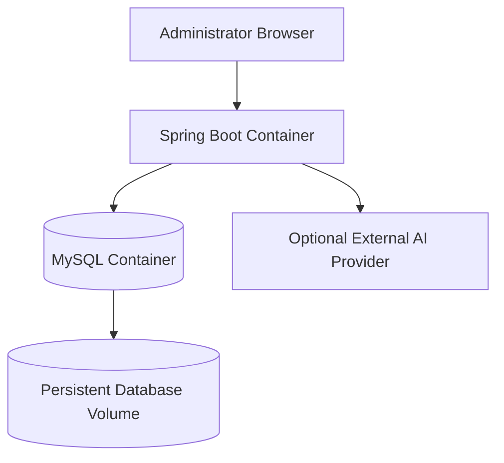
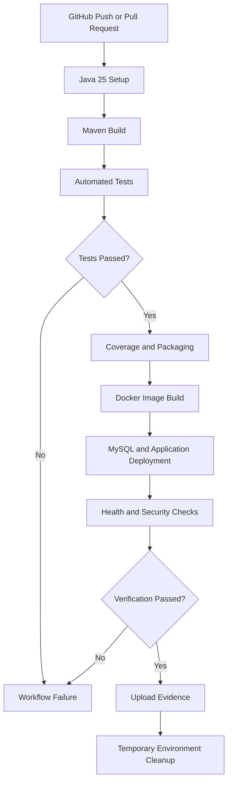

# Installation and Deployment Guide

AI-Powered IT Asset Management System

Version: 1.0.0 - Final Release

CMSC 495 - Computer Capstone Project

University of Maryland Global Campus

November 2026

---

## 1. Introduction

This guide provides instructions for installing, configuring,
testing, deploying, and maintaining the AI-Powered IT Asset
Management System.

The application supports two deployment methods:

- Local development using Java, Maven, and MySQL.
- Containerized deployment using Docker Compose.

Both deployment methods were exercised during Final Release
development and verification.

Docker Compose is recommended for reproducible installation
and independent system evaluation.

Native installation is recommended when demonstrating the
locally hosted Ollama AI integration.

### Final Release Verification Summary

| Verification | Result |
|---|---|
| Application compilation | Passed |
| Automated tests | 138 of 138 passed |
| Java line coverage | 91.32% |
| Native MySQL integration | Verified |
| Local AI recommendation generation | Verified |
| Docker image construction | Passed |
| Docker application deployment | Passed |
| Containerized MySQL startup | Passed |
| Application health | UP |
| Administrator authentication | Verified |
| Database persistence after restart | Verified |
| GitHub Actions CI/CD | Passed |

The application is suitable for controlled academic
demonstration and evaluation.

Permanent production hosting requires additional infrastructure
and security controls.

---

## 2. System Requirements

### 2.1 Local Development

| Component | Requirement |
|---|---|
| Operating System | macOS, Windows, or Linux |
| Java | JDK 25 |
| Application Framework | Spring Boot 4.0.9 |
| Database | MySQL Server |
| Build Tool | Included Maven Wrapper |
| Version Control | Git |
| Browser | Modern JavaScript-enabled browser |
| IDE | VS Code, IntelliJ IDEA, or equivalent |

### 2.2 Containerized Deployment

| Component | Requirement |
|---|---|
| Docker | Docker Engine or Docker Desktop |
| Docker Compose | Compose V2 |
| Database Image | MySQL 8.4 |
| Java Runtime | Eclipse Temurin Java 25 |
| Application Port | 8080 by default |
| Internet Access | Required for initial dependency and image downloads |

Java and MySQL do not need to be installed separately on the
host computer when using the Docker deployment method.

### 2.3 Local AI Requirements

| Component | Requirement |
|---|---|
| AI Provider | Ollama |
| Demonstrated Model | Llama 3.2 |
| Default Provider Port | 11434 |
| API Compatibility | OpenAI-compatible chat completions |
| Internet Access | Required for initial model download |

### 2.4 Recommended Development Resources

- 8 GB RAM or greater.
- 4 CPU cores or greater.
- 10 GB available disk space.
- Stable internet connection.

These are suggested development resources rather than
experimentally established minimum system requirements.

Running Docker and a local AI model simultaneously may
require additional memory and storage.

### 2.5 Verified Development Environment

The Final Release was developed and locally evaluated using:

- macOS.
- Visual Studio Code.
- Java 25.
- Maven Wrapper.
- MySQL.
- Docker Desktop.
- Docker Compose.
- Ollama with Llama 3.2.
- Git and GitHub.

Automated CI/CD verification was performed through GitHub
Actions using an Ubuntu runner.

Windows and other Linux installation instructions are
provided for portability but were not independently verified
across every supported platform.

---

## 3. Verify Prerequisites

### 3.1 Java

```bash
java -version
```

Verify that Java 25 is installed.

### 3.2 Git

```bash
git --version
```

### 3.3 MySQL

```bash
mysql --version
```

MySQL is required when running the application directly
on the host computer.

### 3.4 Docker

```bash
docker --version
```

### 3.5 Docker Compose

```bash
docker compose version
```

Verify that the Docker engine is available:

```bash
docker info
```

Docker Desktop must be running before executing container
deployment commands on macOS or Windows.

### 3.6 Ollama

Ollama is required only when using the local AI provider.

```bash
ollama --version
```

Verify that the required model is installed:

```bash
ollama list
```

---

## 4. Obtain the Source Code

Clone the GitHub repository:

```bash
git clone https://github.com/ilerioluwaa/ai-it-asset-management-system.git
```

Navigate to the project directory:

```bash
cd ai-it-asset-management-system
```

Verify the repository status:

```bash
git status
```

Inspect the latest commit:

```bash
git log -1 --oneline
```

Verify the Maven Wrapper:

```bash
chmod +x mvnw

./mvnw --version
```

Windows users can execute Maven Wrapper commands using
PowerShell:

```powershell
.\mvnw.cmd --version
```

The Maven Wrapper downloads the required Maven distribution
when necessary.

A separate global Maven installation is not required.

### Repository

https://github.com/ilerioluwaa/ai-it-asset-management-system

### Final Release CI/CD Evidence

https://github.com/ilerioluwaa/ai-it-asset-management-system/actions

---

## 5. Local Development Installation

This installation method runs Spring Boot and MySQL directly
on the host computer.

It is also the verified configuration for demonstrating
the local Ollama AI integration.

### Step 1: Start MySQL

Ensure that MySQL Server is installed and running.

For a Homebrew-managed MySQL installation on macOS,
inspect available services:

```bash
brew services list
```

Start the installed MySQL service using its actual
Homebrew formula name.

For example:

```bash
brew services start mysql
```

The service name may differ depending on the installed
MySQL version.

### Step 2: Connect to MySQL

```bash
mysql -u root -p
```

Enter the MySQL root password when prompted.

### Step 3: Create a New Application Database

Create a dedicated Final Release database:

```sql
CREATE DATABASE IF NOT EXISTS assetmanagement_final
CHARACTER SET utf8mb4
COLLATE utf8mb4_unicode_ci;
```

Create a dedicated application database user:

```sql
CREATE USER 'assetadmin'@'localhost'
IDENTIFIED BY 'REPLACE_WITH_STRONG_DATABASE_PASSWORD';
```

Replace the example password with a unique database password.

If the database user already exists, inspect and update
the existing account as appropriate instead of attempting
to create a duplicate user.

Grant permissions for the application database:

```sql
GRANT ALL PRIVILEGES
ON assetmanagement_final.*
TO 'assetadmin'@'localhost';
```

Verify the database:

```sql
SHOW DATABASES;
```

Exit MySQL:

```sql
EXIT;
```

Do not use the MySQL root account as the application's
regular database account.

### Step 4: Configure Environment Variables

For macOS or Linux:

```bash
export DB_URL="jdbc:mysql://localhost:3306/assetmanagement_final"

export DB_USERNAME="assetadmin"

export DB_PASSWORD="YOUR_DATABASE_PASSWORD"

export ADMIN_USERNAME="admin"

export ADMIN_PASSWORD="YOUR_STRONG_ADMIN_PASSWORD"

export PORT="8080"

export COOKIE_SECURE="false"

export AI_ENABLED="false"
```

For Windows PowerShell:

```powershell
$env:DB_URL="jdbc:mysql://localhost:3306/assetmanagement_final"

$env:DB_USERNAME="assetadmin"

$env:DB_PASSWORD="YOUR_DATABASE_PASSWORD"

$env:ADMIN_USERNAME="admin"

$env:ADMIN_PASSWORD="YOUR_STRONG_ADMIN_PASSWORD"

$env:PORT="8080"

$env:COOKIE_SECURE="false"

$env:AI_ENABLED="false"
```

Replace the example credential values before starting
the application.

For sensitive values, prefer secure environment injection
or a private configuration file rather than recording
actual credentials in shell history.

### Credential Explanation

| Credential | Purpose |
|---|---|
| DB_USERNAME | Application database account |
| DB_PASSWORD | Password for the application database account |
| ADMIN_USERNAME | Application website login username |
| ADMIN_PASSWORD | Application website login password |
| MYSQL_ROOT_PASSWORD | Docker MySQL administrative password |
| AI_API_KEY | Optional AI provider authentication credential |

The database password and website administrator password
serve different purposes.

Use separate, unique credentials.

The administrator password must contain at least 12
characters and must not exceed 72 UTF-8 bytes.

Environment variables must be available in the terminal
session used to launch the application.

The Maven Wrapper does not automatically load a Docker
.env configuration file.

Do not commit actual credentials to GitHub.

### Step 5: Build the Application

```bash
./mvnw clean verify
```

Windows:

```powershell
.\mvnw.cmd clean verify
```

The Maven build:

- Compiles the application.
- Executes the automated test suite.
- Packages the executable application.
- Generates Maven Surefire reports.
- Generates JaCoCo coverage reports.

The verified Final Release contains 138 automated tests.

### Step 6: Start the Application

```bash
./mvnw spring-boot:run
```

Windows:

```powershell
.\mvnw.cmd spring-boot:run
```

The application can also be started using its packaged
executable JAR.

Inspect the generated package:

```bash
ls target/*.jar
```

Run the executable Spring Boot JAR using its actual
generated filename:

```bash
java -jar target/GENERATED_APPLICATION.jar
```

Replace GENERATED_APPLICATION.jar with the actual
filename displayed in the target directory.

Keep the application terminal running.

### Step 7: Access the Application

Open the following address in a browser:

```text
http://localhost:8080
```

Unauthenticated users should be redirected to the
administrator login page.

Enter the administrator username and password configured
through the environment variables.

After successful authentication, the asset management
dashboard becomes accessible.

### Step 8: Verify Application Health

Open a separate terminal:

```bash
curl -i http://localhost:8080/actuator/health
```

Expected successful response:

```json
{
  "status": "UP"
}
```

The application health endpoint was successfully
exercised during Final Release verification.

An UP response indicates that the configured application
health indicators are reporting a healthy state.

It does not independently verify every business operation
or external AI provider connection.

---

## 6. Docker Compose Deployment

Docker Compose provides an isolated deployment environment
containing the Spring Boot application and MySQL database.

This is the recommended method for reproducible installation
and independent evaluation of core application functionality.

### 6.1 Deployment Architecture



The application container communicates with the database
through the configured Docker network.

The MySQL database is not directly published to the host
network.

### Step 1: Start Docker

Launch Docker Desktop or ensure Docker Engine is running.

Verify connectivity:

```bash
docker info
```

### Step 2: Check Application Port Availability

The default application port is 8080.

On macOS or Linux:

```bash
lsof -iTCP:8080 -sTCP:LISTEN
```

If a native Spring Boot application is already running
on port 8080, stop it before starting Docker deployment.

Press Ctrl+C in the terminal running the native application.

Alternatively, configure a different published Docker port.

### Step 3: Create Environment Configuration

Create a private environment file using the repository's
configuration template.

For a new installation:

```bash
cp .env.example .env
```

Do not overwrite an existing .env file containing valid
credentials.

Open the file in a text editor:

```bash
code .env
```

Example configuration:

```dotenv
DB_NAME=assetmanagement_final
DB_USERNAME=assetadmin
DB_PASSWORD=REPLACE_WITH_DATABASE_PASSWORD
MYSQL_ROOT_PASSWORD=REPLACE_WITH_ROOT_PASSWORD

ADMIN_USERNAME=admin
ADMIN_PASSWORD=REPLACE_WITH_ADMIN_PASSWORD

PORT=8080
COOKIE_SECURE=false

AI_ENABLED=false
AI_API_KEY=
AI_MODEL=
AI_BASE_URL=
```

Replace all example passwords with unique credentials.

Docker Compose supplies the database connection configuration
required for communication between the application and
database containers.

A native localhost database URL must not be used as the
database connection address inside the application container.

The .env file contains sensitive configuration and
must not be committed to version control.

Verify that Git ignores the file:

```bash
git check-ignore -v .env
```

Verify that it is not tracked:

```bash
git ls-files -- .env
```

The second command should produce no output.

On macOS or Linux, restrict local file permissions:

```bash
chmod 600 .env
```

### Step 4: Validate Docker Compose Configuration

```bash
docker compose config --quiet
```

This command validates the Compose configuration without
printing the resolved configuration.

To display a success message:

```bash
docker compose config --quiet && echo "Configuration valid"
```

Avoid publishing resolved configuration output because
it may contain credentials.

Docker Compose configuration validation completed
successfully during Final Release verification.

### Step 5: Build the Application Image

```bash
docker compose build
```

The Dockerfile uses a multi-stage build.

The first stage uses an Eclipse Temurin Java 25 JDK
to compile and package the application.

The second stage uses an Eclipse Temurin Java 25 JRE
to run the packaged application.

The runtime container uses a non-root operating system user.

Verify the generated image:

```bash
docker images ai-it-asset-management-system
```

Verified application image:

```text
ai-it-asset-management-system:1.0.0
```

### Recorded Local Docker Build

| Metric | Observed Result |
|---|---|
| Application version | 1.0.0 |
| Image build | Successful |
| Observed build duration | 25.9 seconds |
| Reported image disk usage | 649 MB |

Build duration and image disk usage may vary depending
on platform, caching, dependency versions, and Docker
storage behavior.

### Step 6: Start the Containers

For the initial deployment, keep AI disabled.

```bash
AI_ENABLED=false docker compose up -d
```

Alternatively, configure AI_ENABLED=false in the private
.env file and execute:

```bash
docker compose up -d
```

Docker Compose starts MySQL and waits for its configured
health check before starting the application.

Alternatively, build and start the containers together:

```bash
docker compose up -d --build
```

Initial startup may require additional time to download
the database image and initialize the database.

### Step 7: Inspect Container Status

```bash
docker compose ps
```

Expected services:

| Service | Purpose |
|---|---|
| database | MySQL relational database |
| application | Spring Boot web application |

The database should report a healthy state.

The application should report a running state.

Inspect the actual configured service names if necessary:

```bash
docker compose config --services
```

### Step 8: Inspect Application Logs

```bash
docker compose logs -f application
```

Inspect database logs:

```bash
docker compose logs -f database
```

Press Ctrl+C to exit log monitoring.

Exiting log monitoring does not stop the containers.

If the service names differ, use the names reported by
docker compose config --services.

### Step 9: Verify Application Availability

```bash
curl --fail http://localhost:8080/actuator/health
```

Expected response:

```json
{
  "status": "UP"
}
```

For HTTP response details:

```bash
curl -i http://localhost:8080/actuator/health
```

The local Docker deployment successfully returned
HTTP 200 and application health status UP.

Open the application:

```text
http://localhost:8080
```

Authenticate using the administrator credentials defined
in the private .env file.

### Step 10: Verify API Protection

Execute the following requests without authentication:

```bash
curl -i http://localhost:8080/api/assets
```

```bash
curl -i http://localhost:8080/api/employees
```

```bash
curl -i http://localhost:8080/api/ai/status
```

The expected response for each protected endpoint is:

```text
HTTP 401 Unauthorized
```

These checks do not require exposing administrator
credentials in command-line requests.

The automated GitHub Actions deployment verification
confirmed HTTP 401 responses for all three endpoints.

### Step 11: Verify Database Write Operations

Sign in to the containerized application.

Register the following demonstration asset:

| Field | Example Value |
|---|---|
| Asset Name | Docker Test Laptop |
| Category | Laptop |
| Serial Number | DOCKER-001 |
| Status | AVAILABLE |

Confirm that the asset appears in the inventory.

For a new, empty database, the expected dashboard
statistics are:

| Metric | Expected Value |
|---|---:|
| Total Assets | 1 |
| Available Assets | 1 |
| Assigned Assets | 0 |

If the database already contains records, verify the
appropriate increase in inventory counts instead.

Use a different unique serial number if DOCKER-001
already exists.

### Step 12: Verify Database Persistence

Restart the containers:

```bash
docker compose restart
```

Inspect container status:

```bash
docker compose ps
```

Wait until the application becomes available:

```bash
curl http://localhost:8080/actuator/health
```

Return to the application and sign in again if necessary.

Verify that the previously registered asset remains
in the inventory.

During Final Release verification, the Docker Test Laptop
record remained available after the container restart.

The verified record contained:

| Field | Observed Value |
|---|---|
| Asset ID | 1 |
| Asset Name | Docker Test Laptop |
| Category | Laptop |
| Serial Number | DOCKER-001 |
| Status | AVAILABLE |
| Assigned Employee | None |

This demonstrates database persistence across the
tested container restart.

It does not replace backup restoration or disaster
recovery testing.

### 6.2 Verified Docker Deployment Results

| Verification | Result |
|---|---|
| Compose configuration validation | Passed |
| Application image construction | Passed |
| MySQL container initialization | Passed |
| MySQL container health | Healthy |
| Application container startup | Passed |
| Application health endpoint | HTTP 200 |
| Application health status | UP |
| Administrator login interface | Accessible |
| Administrator authentication | Passed |
| Asset registration | Passed |
| Database persistence after restart | Passed |

AI was intentionally disabled during this local Docker
deployment verification.

Live AI functionality was verified separately through
native Spring Boot execution.

---

## 7. AI Provider Configuration

Core asset and employee management functionality can
operate without an AI provider.

The AI recommendation feature requires a compatible
chat completion service.

### 7.1 Configuration Variables

| Variable | Purpose |
|---|---|
| AI_ENABLED | Enables AI recommendations |
| AI_API_KEY | Provider authentication credential |
| AI_MODEL | Selected provider model |
| AI_BASE_URL | Provider API base URL |

The application submits selected aggregate inventory
statistics to the configured provider.

The AI provider does not receive direct database access.

Generated recommendations require administrator review.

### 7.2 Option A: Local AI Provider Using Ollama

This is the AI configuration demonstrated during
Final Release verification.

Install Ollama using its official installation instructions:

https://ollama.com/

Verify the installation:

```bash
ollama --version
```

Download the demonstrated model:

```bash
ollama pull llama3.2
```

Verify the installed models:

```bash
ollama list
```

Ensure that the Ollama service is running.

If it is not already running:

```bash
ollama serve
```

Do not start another Ollama server if an existing
instance is already listening on port 11434.

Verify provider availability:

```bash
curl http://localhost:11434/api/tags
```

The response should contain information about the
installed models.

### Test the Local Model Independently

Execute:

```bash
ollama run llama3.2
```

Enter a simple prompt:

```text
Explain the purpose of an IT asset management system.
```

Verify that the model returns a response.

Exit the interactive model session using:

```text
/bye
```

This verifies basic model execution independently of
the Spring Boot application.

### Configure Spring Boot for Ollama

Stop the existing native Spring Boot application
if it is running.

In the terminal containing the database and administrator
environment variables, configure:

```bash
export AI_ENABLED="true"

export AI_API_KEY=""

export AI_MODEL="llama3.2"

export AI_BASE_URL="http://localhost:11434/v1"
```

Start the application:

```bash
./mvnw spring-boot:run
```

For Windows PowerShell:

```powershell
$env:AI_ENABLED="true"

$env:AI_API_KEY=""

$env:AI_MODEL="llama3.2"

$env:AI_BASE_URL="http://localhost:11434/v1"

.\mvnw.cmd spring-boot:run
```

This configuration assumes that Spring Boot and Ollama
are running directly on the same host computer.

The local Ollama configuration does not require a
paid external API key.

### 7.3 Option B: External AI Provider

An external OpenAI-compatible provider may also be
configured.

Example configuration:

```bash
export AI_ENABLED="true"

export AI_API_KEY="YOUR_PROVIDER_API_KEY"

export AI_MODEL="YOUR_AVAILABLE_MODEL"

export AI_BASE_URL="https://api.openai.com/v1"
```

The selected model must be supported by the configured
provider and available to the user's account.

External API access may require separate billing.

A ChatGPT subscription does not automatically provide
paid OpenAI API credits.

For Docker deployment, configure the equivalent values
in the private .env file:

```dotenv
AI_ENABLED=true
AI_API_KEY=YOUR_PROVIDER_API_KEY
AI_MODEL=YOUR_AVAILABLE_MODEL
AI_BASE_URL=https://api.openai.com/v1
```

Recreate the application container after updating its
environment configuration:

```bash
docker compose up -d --force-recreate application
```

Use the actual application service name if it differs.

External provider configuration is supported by the
application design but was not the provider configuration
used for the recorded local AI demonstration.

### 7.4 Docker and Local AI Networking

A Spring Boot container cannot access the host's Ollama
service through its own localhost address.

Docker-to-host AI communication requires appropriate
networking and application URL validation configuration.

The verified Docker deployment uses AI_ENABLED=false.

The verified local AI demonstration uses native
Spring Boot and Ollama.

Containerized live AI connectivity is not established
by the successful Docker deployment results.

Do not weaken provider URL validation or expose Ollama
publicly merely to enable container connectivity.

### 7.5 Verify AI Functionality

1. Sign in to the application.
2. Register representative sample assets.
3. Register sample employees.
4. Assign selected assets to employees.
5. Open the AI Recommendations section.
6. Refresh the AI configuration status.
7. Select Generate Recommendations.
8. Wait for the provider response.
9. Review the generated recommendation.
10. Inspect the model identifier and response time.
11. Compare the recommendation with actual inventory data.
12. Confirm that no inventory records were automatically changed.

A configured AI status does not establish successful
provider connectivity or accurate recommendation output.

Live recommendation generation must be verified separately.

### 7.6 Verified AI Execution Results

The local Ollama integration successfully generated
recommendations during Final Release verification.

| Metric | Observed Result |
|---|---|
| AI provider | Ollama |
| Model | Llama 3.2 |
| Provider endpoint | Local OpenAI-compatible endpoint |
| Recommendation generation | Successful |
| Human review | Required |
| Recommendation request 1 | 4,879 ms |
| Recommendation request 2 | 5,250 ms |
| Mean observed response time | 5,064.5 ms |

The response times represent two recorded recommendation
generation operations.

They do not establish maximum throughput, concurrent
performance, or comprehensive AI output quality.

The AI integration is advisory and does not autonomously
modify organizational inventory.

---

## 8. Automated Testing

The automated test environment uses an isolated H2
in-memory database.

The application does not require a running MySQL server
for its H2-based automated tests.

AI provider communication is simulated during automated
AI service testing.

### 8.1 Execute All Tests

```bash
./mvnw clean test
```

Windows:

```powershell
.\mvnw.cmd clean test
```

### 8.2 Execute Individual Test Classes

Asset management tests:

```bash
./mvnw -Dtest=AssetControllerTest test
```

Employee management tests:

```bash
./mvnw -Dtest=EmployeeControllerTest test
```

AI recommendation service tests:

```bash
./mvnw -Dtest=AiRecommendationServiceTest test
```

Security tests:

```bash
./mvnw -Dtest=SecurityTest test
```

Application initialization tests:

```bash
./mvnw -Dtest=AssetmanagementApplicationTests test
```

### 8.3 Generate Code Coverage

```bash
./mvnw clean verify
```

### 8.4 Test Report Location

```text
target/surefire-reports/
```

### 8.5 Coverage Report Location

```text
target/site/jacoco/index.html
```

On macOS:

```bash
open target/site/jacoco/index.html
```

On Windows PowerShell:

```powershell
Start-Process target/site/jacoco/index.html
```

On Linux, open the report using an available browser
or desktop file-opening utility.

### 8.6 Verified Final Release Test Results

| Metric | Verified Result |
|---|---:|
| Automated tests | 138 |
| Passed | 138 |
| Failures | 0 |
| Errors | 0 |
| Skipped | 0 |
| Pass rate | 100% |
| Reported CI test duration | 9.62 seconds |

### 8.7 Verified JaCoCo Coverage

| Coverage Metric | Result |
|---|---:|
| Instruction coverage | 91.43% |
| Branch coverage | 70.83% |
| Line coverage | 91.32% |
| Complexity coverage | 71.37% |
| Method coverage | 92.03% |
| Class coverage | 100.00% |

These measurements were recorded during successful
Final Release GitHub Actions verification.

Coverage applies to instrumented Java code.

It does not establish complete frontend coverage or
guarantee that every possible execution path is correct.

The H2 test environment does not reproduce every
MySQL-specific database behavior.

MySQL-backed deployment was therefore verified separately.

---

## 9. Manual System Verification

After starting the application, perform the following
functional verification activities.

| Test | Expected Result |
|---|---|
| Open application without login | Redirect to login |
| Login with valid credentials | Dashboard opens |
| Login with invalid credentials | Authentication rejected |
| Register valid asset | Asset appears in inventory |
| Register duplicate serial number | Request rejected |
| Register valid employee | Employee appears in directory |
| Register invalid email | Validation error |
| Assign available asset | Status changes to ASSIGNED |
| Edit assigned asset | Employee association preserved |
| Rename assigned employee | Asset reflects updated employee name |
| Delete assigned asset | Operation rejected |
| Delete employee with assigned assets | Operation rejected |
| Unassign equipment | Status changes to AVAILABLE |
| Delete eligible asset | Asset removed |
| Search inventory | Matching records displayed |
| Navigate inventory pages | Correct page displayed |
| Refresh dashboard | Statistics reflect database records |
| Generate AI recommendations | Configured provider returns output |
| Logout | Authenticated session terminated |
| Restart Docker containers | Application becomes available again |
| Retrieve previously registered asset | Database record remains available |

These are reproducible verification procedures and
expected outcomes.

They should not be interpreted as a claim that every
listed operation was independently exercised through
every supported browser and deployment environment.

The Final Release automated test suite verifies relevant
business rules, security behavior, and API operations.

Recorded manual verification includes administrator
authentication, asset and employee management, equipment
allocation, live AI recommendation generation, and
containerized asset persistence.

Use representative demonstration records rather than
confidential organizational information.

---

## 10. Continuous Integration and Deployment

The GitHub Actions workflow is located at:

```text
.github/workflows/maven.yml
```

Workflow name:

```text
Spring Boot CI/CD
```

The workflow is configured to execute when:

- Changes are pushed to the main branch.
- Pull requests target the main branch.
- A workflow is manually triggered.

### 10.1 Continuous Integration Stage

The first stage performs:

- Repository checkout.
- Java 25 environment setup.
- Maven dependency management.
- Application compilation.
- Automated testing.
- JaCoCo coverage generation.
- Application packaging.
- Test artifact collection.

### 10.2 Deployment Verification Stage

The second stage performs:

- Docker Compose configuration validation.
- Application image construction.
- MySQL container startup.
- Spring Boot container startup.
- Application health verification.
- Authentication smoke testing.
- Deployment evidence collection.
- Temporary container cleanup.

### 10.3 CI/CD Architecture



### 10.4 Verified Final Release Workflow

| Property | Result |
|---|---|
| Workflow | Spring Boot CI/CD |
| Workflow run | 7 |
| Branch | main |
| Overall status | Success |
| Total duration | 1 minute 43 seconds |
| Build, Test and Code Coverage | Passed |
| Build and test job duration | 35 seconds |
| Docker Deployment and Health Verification | Passed |
| Deployment verification job duration | 64 seconds |
| Generated artifacts | 4 |

### 10.5 Automated Deployment Results

| Verification | Result |
|---|---|
| Docker image construction | Passed |
| MySQL-backed application startup | Passed |
| Application health | UP |
| Administrator login page | HTTP 200 |
| Protected asset API | HTTP 401 |
| Protected employee API | HTTP 401 |
| Protected AI API | HTTP 401 |

HTTP 401 responses are expected for unauthenticated
requests to protected application endpoints.

### 10.6 Workflow Artifacts

The successful workflow generated four downloadable
artifacts.

| Artifact | Purpose |
|---|---|
| automated-test-reports | Maven Surefire test evidence |
| jacoco-coverage-report | Java code coverage reports |
| application-package | Executable Spring Boot application |
| deployment-evidence | Container deployment verification |

### 10.7 View Workflow Results

Navigate to:

https://github.com/ilerioluwaa/ai-it-asset-management-system/actions

Select the Final Release workflow execution.

Review both workflow jobs and their execution summaries.

Download the available artifacts.

### 10.8 Deployment Scope

The workflow uses disposable test credentials and
temporary infrastructure.

AI functionality is disabled during automated
deployment verification.

This prevents automated infrastructure verification
from depending on external AI credentials, provider
availability, or API billing.

Successful deployment verification demonstrates
reproducible application deployment.

It does not establish permanent public production hosting.

### 10.9 Workflow Maintenance

The successful workflow reported two non-blocking
warnings concerning GitHub Actions components
originally targeting Node.js 20.

Both workflow jobs completed successfully.

Updating the affected workflow dependencies is
recommended as future maintenance.

---

## 11. Environment Variable Reference

| Variable | Default or Requirement |
|---|---|
| PORT | 8080 |
| DB_URL | jdbc:mysql://localhost:3306/assetmanagement |
| DB_NAME | Configurable Docker database name |
| DB_USERNAME | root locally; assetadmin in Compose |
| DB_PASSWORD | Required |
| MYSQL_ROOT_PASSWORD | Required for Docker database initialization |
| ADMIN_USERNAME | admin |
| ADMIN_PASSWORD | Required |
| COOKIE_SECURE | false |
| AI_ENABLED | false |
| AI_API_KEY | Empty unless required by provider |
| AI_MODEL | Empty until configured |
| AI_BASE_URL | Empty until configured |

A dedicated application database user is recommended
instead of the default root account.

The installation examples use assetmanagement_final
to separate Final Release data from the Alpha Release
database.

Production environments should use a dedicated
secrets management mechanism.

COOKIE_SECURE should be enabled when the application
is served over HTTPS.

Enabling secure cookies while using plain HTTP may
prevent authentication sessions from working correctly.

Changing environment variables generally requires
restarting the native application or recreating the
application container.

---

## 12. Database Management

### 12.1 Local Database Backup

```bash
mysqldump -u assetadmin -p --single-transaction --no-tablespaces assetmanagement_final > assetmanagement_backup.sql
```

Enter the database password when prompted.

### 12.2 Docker Database Backup

With the database container running:

```bash
docker compose exec -T database sh -c 'mysqldump -u"$MYSQL_USER" -p"$MYSQL_PASSWORD" --single-transaction --no-tablespaces "$MYSQL_DATABASE"' > assetmanagement_backup.sql
```

Use the actual database service name if it differs.

Store database backups securely.

Backups may contain employee and organizational
inventory information.

Do not commit database backups to GitHub.

The backup commands are maintenance procedures.

A complete backup restoration and disaster recovery
exercise was not part of the recorded Final Release
verification.

### 12.3 Database Persistence

Docker Compose stores MySQL records in a persistent
named volume.

Stopping or recreating the application container
does not normally remove database records.

Inspect Docker volumes:

```bash
docker volume ls
```

The Final Release persistence test confirmed that
the registered demonstration asset survived a
container restart.

Changing the Compose project name or database volume
configuration may cause the application to use a
different database volume.

### 12.4 Alpha Release Migration

The Final Release introduces database schema changes,
including:

- Enumerated asset status values.
- Unique serial number constraints.
- Unique employee email constraints.
- Employee foreign-key relationships.
- Updated field validation requirements.

The existing Alpha Release database may contain
incompatible records.

Before migrating an existing database:

1. Create a complete database backup.
2. Inspect existing records.
3. Identify duplicate serial numbers and emails.
4. Normalize asset status values.
5. Match existing employee names to employee identifiers.
6. Establish valid employee foreign-key relationships.
7. Verify migrated records in an isolated environment.
8. Validate application functionality.

A dedicated automated migration script is not included
in the Final Release.

Use a new database for initial Final Release testing.

The application's automatic schema update configuration
does not replace a controlled database migration process.

### 12.5 Existing Docker Database Credentials

MySQL initialization environment variables are applied
when a new database volume is initialized.

Changing MYSQL_ROOT_PASSWORD or DB_PASSWORD in the
.env file does not automatically update passwords
already stored in an existing database volume.

Existing database credentials must be changed through
appropriate MySQL administrative procedures.

Do not delete an existing database volume merely to
resolve a credential mismatch.

---

## 13. Application Maintenance

### 13.1 Stop Native Application

Press Ctrl+C in the terminal running Spring Boot.

### 13.2 Stop Docker Containers

```bash
docker compose stop
```

### 13.3 Start Existing Docker Containers

```bash
docker compose start
```

### 13.4 Restart Docker Containers

```bash
docker compose restart
```

### 13.5 Restart Application Service

```bash
docker compose restart application
```

### 13.6 Apply Environment Configuration Changes

```bash
docker compose up -d --force-recreate application
```

A simple container restart may not apply changed
environment configuration.

Recreate the application container when its environment
variables have changed.

### 13.7 Remove Containers While Preserving Data

```bash
docker compose down
```

This normally removes the Compose-managed containers
and networks while retaining named database volumes.

### 13.8 Rebuild After Source Code Changes

```bash
docker compose up -d --build
```

### 13.9 Remove Containers and Database Volume

WARNING: The following command deletes Compose-managed
database volumes and their stored records.

```bash
docker compose down --volumes
```

Use this command only for disposable environments
or when intentional data removal is required.

Never execute this command against important data
without an appropriate backup and recovery plan.

### 13.10 Update the Application

Retrieve repository changes:

```bash
git pull origin main
```

Review changes before applying them to an existing
database environment.

Execute automated verification:

```bash
./mvnw clean verify
```

For Docker deployment:

```bash
docker compose up -d --build
```

Verify application health after the update.

Database schema changes may require additional
migration procedures.

---

## 14. Troubleshooting

### 14.1 Java Version Mismatch

Symptom:

The Maven build fails because the installed Java
version is incompatible.

Resolution:

```bash
java -version

./mvnw --version
```

Ensure both commands report a compatible Java 25
environment.

Verify JAVA_HOME if Maven uses a different Java
installation from the terminal.

### 14.2 Maven Wrapper Permission Denied

Resolution:

```bash
chmod +x mvnw
```

### 14.3 MySQL Connection Refused

Possible causes:

- MySQL is not running.
- Incorrect database hostname.
- Incorrect database port.
- Database container initialization is incomplete.
- Native database connection settings are being used
  inside the application container.

Inspect MySQL service status and database logs.

For Docker:

```bash
docker compose ps

docker compose logs database
```

### 14.4 MySQL Access Denied

Possible causes:

- Incorrect database username.
- Incorrect database password.
- Missing database permissions.
- Existing Docker volume initialized with different credentials.

Verify database credentials and user permissions.

Do not expose actual credentials in troubleshooting
screenshots or public support requests.

### 14.5 Database Does Not Exist

Verify that the configured database exists:

```sql
SHOW DATABASES;
```

Ensure DB_URL references the correct database.

For Docker, verify the configured DB_NAME and existing
database volume initialization.

### 14.6 Application Port Already in Use

On macOS or Linux:

```bash
lsof -iTCP:8080 -sTCP:LISTEN
```

Identify the process using the port.

Stop the conflicting application if appropriate.

For native development, an alternative port can be used:

```bash
export PORT="8081"
```

For Docker Compose, change PORT in the private .env file:

```dotenv
PORT=8081
```

Recreate the relevant container and access the application
using the updated published port.

### 14.7 Administrator Password Rejected at Startup

Verify that ADMIN_PASSWORD is configured.

The password must contain at least 12 characters
and must not exceed 72 UTF-8 bytes.

Verify that the administrator username is not blank.

### 14.8 Login Failure

Verify:

- Administrator username.
- Administrator password.
- Browser cookie settings.
- COOKIE_SECURE configuration.
- Application restart after credential changes.
- Successful retrieval of the login CSRF token.

The website administrator password is not necessarily
the same as the MySQL database password.

### 14.9 Login Page Returns HTTP 404

Verify that the current source code includes:

```text
src/main/resources/static/login.html
src/main/resources/static/login.js
```

Verify that the Spring Security configuration includes
the custom login page mapping.

Rebuild the application if an outdated application
package or Docker image is running.

The custom login interface was successfully verified
during Final Release testing and Docker deployment.

### 14.10 HTTP 401 Unauthorized

The request requires administrator authentication.

Sign in again and verify that the session has not expired.

HTTP 401 is expected when accessing protected API
endpoints without authentication.

### 14.11 HTTP 403 Forbidden

Possible causes:

- Missing administrator authorization.
- Missing CSRF token.
- Invalid or expired CSRF token.

Refresh the authenticated session and retrieve a
new CSRF token where appropriate.

Refer to API.md for authentication and CSRF procedures.

### 14.12 HTTP 409 Conflict

Possible causes:

- Duplicate asset serial number.
- Duplicate employee email.
- Attempt to delete assigned equipment.
- Attempt to delete an employee with assigned equipment.
- Invalid asset status transition.

Review the application error message and correct
the conflicting operation.

### 14.13 AI Service Unavailable

Verify:

- AI_ENABLED is true.
- AI_MODEL is configured.
- AI_BASE_URL is configured.
- The selected model is installed or available.
- The AI provider is running.
- The API key is valid when required.
- The provider endpoint is reachable.

The configured base URL must include the appropriate
API version path, such as /v1.

For local Ollama:

```bash
ollama list
```

```bash
curl http://localhost:11434/api/tags
```

### 14.14 Ollama Address Already in Use

If starting Ollama reports that port 11434 is already
in use, an Ollama instance may already be running.

Verify the existing service:

```bash
curl http://localhost:11434/api/tags
```

On macOS or Linux:

```bash
lsof -iTCP:11434 -sTCP:LISTEN
```

If the existing Ollama instance is responding correctly,
use that instance rather than starting a second server.

### 14.15 AI Provider Communication Failure

An HTTP 502 response may indicate:

- Provider authentication failure.
- Provider rate limits.
- Network connection failure.
- Provider timeout.
- Invalid or empty provider response.

Review application logs without exposing credentials.

Local model response times depend on available
computational resources and model initialization.

### 14.16 Docker AI Configuration Failure

The container's localhost address refers to the
container itself rather than the host computer.

A native Ollama endpoint cannot automatically be
reused inside a Docker container.

Use the verified native Spring Boot and Ollama
configuration for the local AI demonstration.

Keep AI disabled during baseline Docker verification
unless a compatible container-accessible provider
has been configured and tested.

### 14.17 Docker Engine Unavailable

Verify that Docker Desktop or Docker Engine is running:

```bash
docker info
```

Wait until the Docker engine has completed startup.

### 14.18 Docker Deployment Failure

Inspect the containers:

```bash
docker compose ps -a
```

Inspect application logs:

```bash
docker compose logs application
```

Inspect database logs:

```bash
docker compose logs database
```

Verify Docker Compose configuration:

```bash
docker compose config --quiet
```

### 14.19 Empty Docker Dashboard

The native MySQL database and Docker MySQL database
are separate environments.

A newly initialized Docker database may contain
zero assets and zero employees.

This is expected behavior and does not indicate
that the original native database has been deleted.

Register demonstration records in the Docker
environment to verify database operations.

### 14.20 GitHub Actions Failure

Open the failed workflow execution.

Identify the first failed step.

Review compilation errors, test failures, container
logs, or deployment verification results.

Correct the underlying issue before rerunning the
workflow.

A previously successful workflow does not guarantee
that future source code changes will pass.

---

## 15. Security and Production Considerations

The current application is intended for controlled
development, evaluation, and deployment verification.

Implemented security controls include:

- Administrator authentication.
- BCrypt password encoding.
- Role-based authorization.
- CSRF protection.
- Server-side validation.
- Database uniqueness constraints.
- Restricted error information.
- Security response headers.
- Environment-based credential configuration.
- Non-root application container.
- Limited AI data disclosure.
- Human review of AI recommendations.

Before permanent production deployment, implement
or evaluate:

- HTTPS and TLS certificate management.
- Secure session cookies.
- Persistent identity management.
- Multi-factor authentication.
- Granular authorization.
- Application rate limiting.
- Security audit logging.
- Automated database migrations.
- Database backup and recovery procedures.
- Dependency vulnerability scanning.
- Container vulnerability scanning.
- Operational monitoring and alerting.
- AI provider privacy and retention requirements.
- Load testing and concurrency testing.

The Docker Compose configuration binds the application
to localhost by default.

The MySQL database is not directly published to
the host network.

The verified deployment is not a permanent public
production service.

### 15.1 Credential Protection

Before committing configuration changes, verify:

```bash
git check-ignore -v .env
```

```bash
git ls-files -- .env
```

Review staged filenames:

```bash
git diff --cached --name-only
```

Do not commit:

- Private .env files.
- Database passwords.
- Administrator passwords.
- AI provider API keys.
- Private cryptographic keys.
- Database backups.
- Session cookies or authentication tokens.

If a real credential is exposed in Git history,
rotate the affected credential.

Removing a credential from the latest commit does
not automatically remove it from earlier commits.

---

## 16. Final Release Verification Status

The following results were established during
Final Release development and verification.

### 16.1 Application Verification

| Verification | Result |
|---|---|
| Native application build | Passed |
| Native MySQL integration | Verified |
| Administrator authentication | Verified |
| Asset management functionality | Verified |
| Employee management functionality | Verified |
| Equipment allocation | Verified |
| Assignment preservation regression testing | Passed |
| Live Ollama recommendation generation | Verified |

### 16.2 Automated Quality Verification

| Verification | Result |
|---|---|
| Automated tests | 138 of 138 passed |
| Automated test failures | 0 |
| Automated test errors | 0 |
| Java line coverage | 91.32% |
| Java instruction coverage | 91.43% |
| Java branch coverage | 70.83% |
| Java class coverage | 100.00% |

### 16.3 Infrastructure Verification

| Verification | Result |
|---|---|
| Docker image construction | Passed |
| Docker Compose configuration | Valid |
| MySQL container health | Healthy |
| Spring Boot container startup | Passed |
| Application health | UP |
| Administrator login | Passed |
| Containerized database write | Passed |
| Database persistence after restart | Passed |

### 16.4 CI/CD Verification

| Verification | Result |
|---|---|
| GitHub Actions workflow | Passed |
| Continuous integration | Passed |
| Automated deployment verification | Passed |
| Workflow execution duration | 1 minute 43 seconds |
| Generated verification artifacts | 4 |

### 16.5 Recorded Local Performance Measurements

| Operation | Average Observed Response Time |
|---|---:|
| Application health endpoint | Not measured |
| Asset collection API | 3.957 ms |
| Employee collection API | 3.808 ms |
| Dashboard statistics API | 3.091 ms |
| AI recommendation generation | 5,064.5 ms |

These measurements represent the recorded local
development environment and test conditions.

The AI mean is calculated from two observed
recommendation generation operations.

See PERFORMANCE.md for benchmark procedures,
sample sizes, and interpretation.

The measurements do not establish performance under
production-scale concurrent workloads.

### 16.6 Remaining Limitations

The Final Release has successfully completed the
documented application and deployment verification
activities.

Remaining limitations include:

- Live AI connectivity inside Docker is not verified.
- Automated deployment runs in a temporary environment.
- Permanent public production hosting is not configured.
- Comprehensive production-scale load testing is incomplete.
- Database backup restoration has not been comprehensively tested.
- Automated database migration scripts are not included.
- Branch coverage remains below complete coverage.
- Cross-platform installation has not been exhaustively tested.
- GitHub Actions dependency warnings require future maintenance.

These limitations do not invalidate the successful
verification results.

They define the scope of the completed release and
identify areas requiring further engineering work.

---

## 17. Related Documentation

- [Project Overview](README.md)
- [REST API Documentation](API.md)
- [User Manual](USER_MANUAL.md)
- [Technical Debt Register](TECHNICAL_DEBT.md)
- [Performance Evaluation](PERFORMANCE.md)

### GitHub Repository

https://github.com/ilerioluwaa/ai-it-asset-management-system

### GitHub Actions

https://github.com/ilerioluwaa/ai-it-asset-management-system/actions

---

## 18. Official Technical Resources

Java and Eclipse Temurin:

https://adoptium.net/

Spring Boot:

https://spring.io/projects/spring-boot

Spring Security:

https://spring.io/projects/spring-security

MySQL:

https://dev.mysql.com/doc/

Docker:

https://docs.docker.com/

Maven:

https://maven.apache.org/

GitHub Actions:

https://docs.github.com/actions

JaCoCo:

https://www.jacoco.org/jacoco/

Ollama:

https://ollama.com/

---

AI-Powered IT Asset Management System

Version 1.0.0 - Final Release

CMSC 495 - Computer Capstone Project

University of Maryland Global Campus

November 2026
