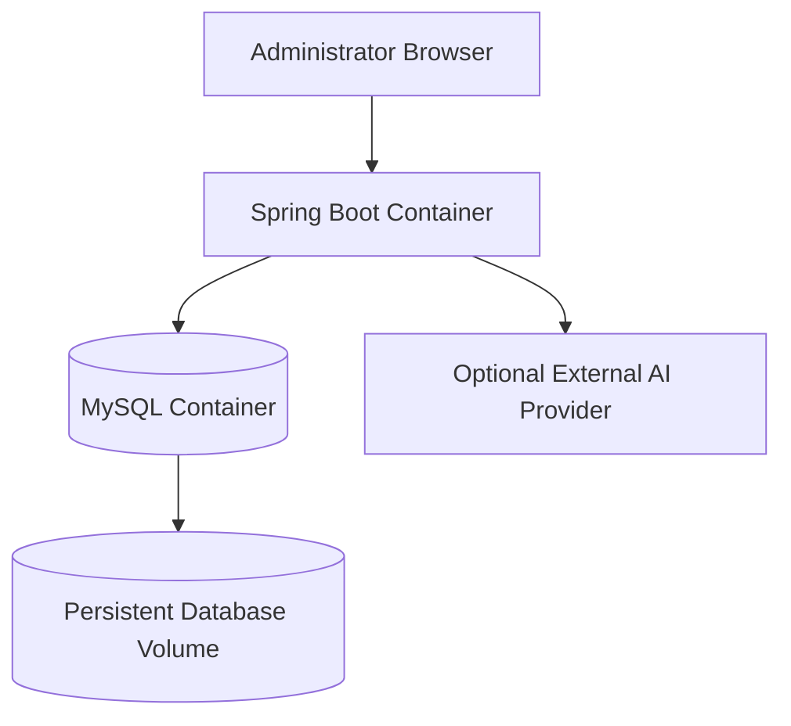

# Installation and Deployment Guide

AI-Powered IT Asset Management System

Version: 1.0.0 - Final Release Candidate

## 1. Introduction

This guide provides instructions for installing, configuring,
testing, and deploying the AI-Powered IT Asset Management System.

Two deployment methods are supported by the application design:

- Local development using Java, Maven, and MySQL.
- Containerized deployment using Docker Compose.

The Docker Compose method is recommended for reproducible
deployment and independent system evaluation.

## 2. System Requirements

### Local Development

| Component | Requirement |
|---|---|
| Operating System | macOS, Windows, or Linux |
| Java | JDK 25 |
| Database | MySQL Server |
| Build Tool | Included Maven Wrapper |
| Version Control | Git |
| Browser | Modern JavaScript-enabled browser |
| IDE | VS Code, IntelliJ IDEA, or equivalent |

### Containerized Deployment

| Component | Requirement |
|---|---|
| Docker | Docker Engine or Docker Desktop |
| Docker Compose | Compose V2 |
| Application Port | 8080 by default |
| Internet Access | Required for initial image downloads |

### Recommended Development Resources

- 8 GB RAM or greater.
- 4 CPU cores or greater.
- 10 GB available disk space.
- Stable internet connection.

These are suggested development resources rather than
experimentally established minimum system requirements.

Local AI models may require additional memory, storage,
and computational resources.

## 3. Verify Prerequisites

### Java

```bash
java -version
```

Verify that Java 25 is installed.

### Git

```bash
git --version
```

### MySQL

```bash
mysql --version
```

MySQL is required when running the application directly
on the host computer.

### Docker

```bash
docker --version
```

### Docker Compose

```bash
docker compose version
```

Docker Desktop must be running before executing container
deployment commands on macOS or Windows.

## 4. Obtain the Source Code

Clone the GitHub repository:

```bash
git clone https://github.com/ilerioluwaa/ai-it-asset-management-system.git
```

Navigate to the project directory:

```bash
cd ai-it-asset-management-system
```

Verify the repository status:

```bash
git status
```

Verify the Maven Wrapper:

```bash
chmod +x mvnw

./mvnw --version
```

Windows users can execute Maven Wrapper commands using:

```powershell
.\mvnw.cmd --version
```

## 5. Local Development Installation

### Step 1: Start MySQL

Ensure that the MySQL server is installed and running.

For a Homebrew-managed MySQL installation on macOS,
inspect available services:

```bash
brew services list
```

Start the installed MySQL service using its actual
Homebrew formula name.

For example:

```bash
brew services start mysql
```

The service name may differ depending on the installed
MySQL version.

### Step 2: Connect to MySQL

```bash
mysql -u root -p
```

Enter the MySQL root password when prompted.

### Step 3: Create a New Application Database

```sql
CREATE DATABASE IF NOT EXISTS assetmanagement_final
CHARACTER SET utf8mb4
COLLATE utf8mb4_unicode_ci;
```

Create a dedicated application database user:

```sql
CREATE USER 'assetadmin'@'localhost'
IDENTIFIED BY 'REPLACE_WITH_STRONG_DATABASE_PASSWORD';
```

Grant permissions for the application database:

```sql
GRANT ALL PRIVILEGES
ON assetmanagement_final.*
TO 'assetadmin'@'localhost';
```

Verify the database:

```sql
SHOW DATABASES;
```

Exit MySQL:

```sql
EXIT;
```

Replace the example password with a unique password.

Do not use the MySQL root account as the application's
regular database account.

### Step 4: Configure Environment Variables

For macOS or Linux:

```bash
export DB_URL="jdbc:mysql://localhost:3306/assetmanagement_final"

export DB_USERNAME="assetadmin"

export DB_PASSWORD="YOUR_DATABASE_PASSWORD"

export ADMIN_USERNAME="admin"

export ADMIN_PASSWORD="YOUR_STRONG_ADMIN_PASSWORD"

export PORT="8080"

export COOKIE_SECURE="false"

export AI_ENABLED="false"
```

For Windows PowerShell:

```powershell
$env:DB_URL="jdbc:mysql://localhost:3306/assetmanagement_final"

$env:DB_USERNAME="assetadmin"

$env:DB_PASSWORD="YOUR_DATABASE_PASSWORD"

$env:ADMIN_USERNAME="admin"

$env:ADMIN_PASSWORD="YOUR_STRONG_ADMIN_PASSWORD"

$env:PORT="8080"

$env:COOKIE_SECURE="false"

$env:AI_ENABLED="false"
```

The administrator password must contain at least 12
characters and must not exceed 72 UTF-8 bytes.

Environment variables must be available in the terminal
session used to launch the application.

Do not commit actual passwords or credentials to GitHub.

### Step 5: Build the Application

```bash
./mvnw clean verify
```

Windows:

```powershell
.\mvnw.cmd clean verify
```

The Maven build compiles the application, executes the
automated test suite, packages the executable JAR,
and generates code coverage reports.

### Step 6: Start the Application

```bash
./mvnw spring-boot:run
```

Windows:

```powershell
.\mvnw.cmd spring-boot:run
```

The application can also be started using the packaged
executable JAR.

Inspect the generated package:

```bash
ls target/*.jar
```

Run the executable Spring Boot JAR using its actual
generated filename:

```bash
java -jar target/GENERATED_APPLICATION.jar
```

### Step 7: Access the Application

Open the following address in a browser:

```text
http://localhost:8080
```

The application should redirect unauthenticated users
to the administrator login page.

Enter the administrator username and password configured
through the environment variables.

### Step 8: Verify Application Health

```bash
curl http://localhost:8080/actuator/health
```

Expected healthy response:

```json
{
  "status": "UP"
}
```

This response is an expected verification result,
not a recorded deployment outcome.

## 6. Docker Compose Deployment

Docker Compose provides an isolated environment containing
the Spring Boot application and MySQL database.

### Deployment Architecture



### Step 1: Start Docker

Launch Docker Desktop or ensure Docker Engine is running.

Verify connectivity:

```bash
docker info
```

### Step 2: Create Environment Configuration

Create a file named .env in the project root.

```bash
touch .env
```

Open the file in a text editor.

```bash
code .env
```

Add the following configuration:

```dotenv
DB_NAME=assetmanagement
DB_USERNAME=assetadmin
DB_PASSWORD=REPLACE_WITH_DATABASE_PASSWORD
MYSQL_ROOT_PASSWORD=REPLACE_WITH_ROOT_PASSWORD

ADMIN_USERNAME=admin
ADMIN_PASSWORD=REPLACE_WITH_ADMIN_PASSWORD

PORT=8080
COOKIE_SECURE=false

AI_ENABLED=false
AI_API_KEY=
AI_MODEL=
AI_BASE_URL=
```

Replace all example passwords with unique credentials.

The .env file contains sensitive configuration and
must not be committed to version control.

Verify that Git ignores the file:

```bash
git check-ignore .env
```

On macOS or Linux, restrict local file permissions:

```bash
chmod 600 .env
```

### Step 3: Validate Docker Compose Configuration

```bash
docker compose config --quiet
```

This command validates the Compose configuration without
printing the resolved configuration.

Avoid publishing resolved configuration output because
it may contain credentials.

### Step 4: Build the Application Image

```bash
docker compose build
```

The Dockerfile uses a multi-stage build.

The first stage compiles and packages the Java application.

The second stage runs the packaged application using a
Java 25 runtime and a non-root operating system user.

### Step 5: Start the Containers

```bash
docker compose up -d
```

Docker Compose starts the MySQL database and waits for
its health check before starting the application.

Alternatively, build and start the containers together:

```bash
docker compose up -d --build
```

### Step 6: Inspect Container Status

```bash
docker compose ps
```

Expected services:

| Service | Purpose |
|---|---|
| database | MySQL relational database |
| application | Spring Boot web application |

### Step 7: Inspect Application Logs

```bash
docker compose logs -f application
```

Inspect database logs:

```bash
docker compose logs -f database
```

Press Ctrl+C to exit log monitoring.

Exiting log monitoring does not stop the containers.

### Step 8: Verify Application Availability

```bash
curl --fail http://localhost:8080/actuator/health
```

Expected response:

```json
{
  "status": "UP"
}
```

Open the application:

```text
http://localhost:8080
```

Authenticate using the administrator credentials defined
in the .env file.

### Step 9: Verify API Protection

```bash
curl -i http://localhost:8080/api/assets
```

An unauthenticated request is expected to return:

```text
HTTP 401 Unauthorized
```

Verify employee API protection:

```bash
curl -i http://localhost:8080/api/employees
```

Verify AI API protection:

```bash
curl -i http://localhost:8080/api/ai/status
```

These checks do not require exposing administrator
credentials in command-line requests.

## 7. AI Provider Configuration

Core asset and employee management functionality can
operate without an AI provider.

The AI recommendation feature requires a compatible
chat completion service.

### Configuration Variables

| Variable | Purpose |
|---|---|
| AI_ENABLED | Enables AI recommendations |
| AI_API_KEY | Provider authentication credential |
| AI_MODEL | Selected provider model |
| AI_BASE_URL | Provider API base URL |

### Option A: External AI Provider

Configure the following environment variables:

```bash
export AI_ENABLED="true"

export AI_API_KEY="YOUR_PROVIDER_API_KEY"

export AI_MODEL="YOUR_AVAILABLE_MODEL"

export AI_BASE_URL="https://api.openai.com/v1"
```

The selected model must be supported by the configured
provider and available to the user's account.

API access may require separate billing.

A ChatGPT subscription does not automatically provide
paid OpenAI API credits.

For Docker deployment, configure the equivalent values
in the local .env file:

```dotenv
AI_ENABLED=true
AI_API_KEY=YOUR_PROVIDER_API_KEY
AI_MODEL=YOUR_AVAILABLE_MODEL
AI_BASE_URL=https://api.openai.com/v1
```

Recreate the application container after updating its
environment configuration:

```bash
docker compose up -d --force-recreate application
```

### Option B: Local AI Provider

A locally hosted OpenAI-compatible provider such as
Ollama may be used for local development.

Install Ollama using its official installation instructions:

https://ollama.com/

Verify the installation:

```bash
ollama --version
```

Download a model appropriate for the available hardware.

For example:

```bash
ollama pull llama3.2
```

Ensure that the Ollama service is running.

If it is not already running:

```bash
ollama serve
```

Verify the installed models:

```bash
ollama list
```

Configure the Spring Boot application:

```bash
export AI_ENABLED="true"

export AI_API_KEY=""

export AI_MODEL="llama3.2"

export AI_BASE_URL="http://localhost:11434/v1"
```

Restart Spring Boot from the terminal containing these
environment variables.

This configuration assumes both Spring Boot and Ollama
are running directly on the host computer.

A Spring Boot container cannot access the host's Ollama
service through its own localhost address.

Docker-to-host AI communication requires additional
networking and application URL validation configuration.

### Verify AI Functionality

1. Sign in to the application.
2. Register representative sample assets.
3. Register sample employees.
4. Assign selected assets to employees.
5. Open the AI Recommendations section.
6. Refresh the AI configuration status.
7. Select Generate Recommendations.
8. Verify that a recommendation is returned.
9. Review the model identifier and response time.
10. Compare the recommendation with actual inventory data.

A configured AI status does not establish successful
provider connectivity or accurate recommendation output.

Live recommendation generation must be independently
verified.

## 8. Automated Testing

The automated test environment uses an isolated H2
in-memory database.

The application does not require a running MySQL
server for its H2-based automated tests.

External AI provider communication is simulated
during automated AI service testing.

### Execute All Tests

```bash
./mvnw clean test
```

### Execute Individual Test Classes

Asset management tests:

```bash
./mvnw -Dtest=AssetControllerTest test
```

Employee management tests:

```bash
./mvnw -Dtest=EmployeeControllerTest test
```

AI recommendation service tests:

```bash
./mvnw -Dtest=AiRecommendationServiceTest test
```

Security tests:

```bash
./mvnw -Dtest=SecurityTest test
```

Application initialization tests:

```bash
./mvnw -Dtest=AssetmanagementApplicationTests test
```

### Generate Code Coverage

```bash
./mvnw clean verify
```

### Test Report Location

```text
target/surefire-reports/
```

### Coverage Report Location

```text
target/site/jacoco/index.html
```

On macOS, open the coverage report:

```bash
open target/site/jacoco/index.html
```

On Windows PowerShell:

```powershell
Start-Process target/site/jacoco/index.html
```

Record actual test counts, failures, errors, skipped
tests, execution duration, and coverage percentages.

Do not substitute planned test counts for measured results.

## 9. Manual System Verification

After starting the application, perform the following
functional verification activities.

| Test | Expected Result |
|---|---|
| Open application without login | Redirect to login |
| Login with valid credentials | Dashboard opens |
| Login with invalid credentials | Authentication rejected |
| Register valid asset | Asset appears in inventory |
| Register duplicate serial number | Request rejected |
| Register valid employee | Employee appears in directory |
| Register invalid email | Validation error |
| Assign available asset | Status changes to ASSIGNED |
| Edit assigned asset | Employee association preserved |
| Rename assigned employee | Asset reflects updated employee name |
| Delete assigned asset | Operation rejected |
| Delete employee with assigned assets | Operation rejected |
| Unassign equipment | Status changes to AVAILABLE |
| Delete eligible asset | Asset removed |
| Search inventory | Matching records displayed |
| Navigate inventory pages | Correct page displayed |
| Refresh dashboard | Statistics reflect database records |
| Generate AI recommendations | Configured provider returns output |
| Logout | Authenticated session terminated |

These are expected outcomes.

Actual results must be documented during system
verification.

## 10. Continuous Integration and Deployment

The GitHub Actions workflow is located at:

```text
.github/workflows/maven.yml
```

The workflow is configured to execute when:

- Changes are pushed to the main branch.
- Pull requests target the main branch.
- A workflow is manually triggered.

### Continuous Integration Stage

The first stage performs:

- Java 25 environment setup.
- Maven compilation.
- Automated testing.
- JaCoCo coverage generation.
- Application packaging.
- Test artifact collection.

### Deployment Verification Stage

The second stage performs:

- Docker Compose configuration validation.
- Application image construction.
- MySQL container startup.
- Spring Boot container startup.
- Application health verification.
- Authentication smoke testing.
- Deployment evidence collection.
- Temporary container cleanup.

### View Workflow Results

Navigate to:

https://github.com/ilerioluwaa/ai-it-asset-management-system/actions

Select the relevant workflow execution.

Review the build and deployment verification jobs.

Download the available artifacts:

- automated-test-reports
- jacoco-coverage-report
- application-package
- deployment-evidence

The workflow uses disposable test credentials and
temporary infrastructure.

Successful deployment verification does not establish
permanent public production hosting.

## 11. Environment Variable Reference

| Variable | Default or Requirement |
|---|---|
| PORT | 8080 |
| DB_URL | jdbc:mysql://localhost:3306/assetmanagement |
| DB_NAME | assetmanagement for Docker Compose |
| DB_USERNAME | root locally; assetadmin in Compose |
| DB_PASSWORD | Required |
| MYSQL_ROOT_PASSWORD | Required for Docker database |
| ADMIN_USERNAME | admin |
| ADMIN_PASSWORD | Required |
| COOKIE_SECURE | false |
| AI_ENABLED | false |
| AI_API_KEY | Empty unless required by provider |
| AI_MODEL | Empty until configured |
| AI_BASE_URL | Empty until configured |

Production environments should use a dedicated
secrets management mechanism.

COOKIE_SECURE should be enabled when the application
is served over HTTPS.

Enabling secure cookies while using plain HTTP may
prevent authentication sessions from working correctly.

## 12. Database Management

### Local Database Backup

```bash
mysqldump -u assetadmin -p assetmanagement_final > assetmanagement_backup.sql
```

Enter the database password when prompted.

### Docker Database Backup

With the database container running:

```bash
docker compose exec -T database sh -c 'mysqldump -u"$MYSQL_USER" -p"$MYSQL_PASSWORD" --single-transaction --no-tablespaces "$MYSQL_DATABASE"' > assetmanagement_backup.sql
```

Store database backups securely.

Backups may contain employee and organizational
inventory information.

Do not commit database backups to GitHub.

### Database Persistence

Docker Compose stores MySQL records in the
mysql-data named volume.

Stopping or recreating the application container
does not normally remove database records.

### Alpha Release Migration

The Final Release introduces changes to the database
schema, including:

- Enumerated asset status values.
- Unique serial number constraints.
- Unique employee email constraints.
- Employee foreign-key relationships.
- Updated field validation requirements.

The existing Alpha Release database may contain
incompatible records.

Before migrating an existing database:

1. Create a complete database backup.
2. Inspect existing records.
3. Identify duplicate serial numbers and emails.
4. Normalize asset status values.
5. Match existing employee names to employee identifiers.
6. Establish valid employee foreign-key relationships.
7. Verify migrated records in an isolated environment.
8. Validate application functionality.

A dedicated automated migration script is not included
in the current release candidate.

Use a new database for initial Final Release testing.

## 13. Application Maintenance

### Stop Local Application

Press Ctrl+C in the terminal running Spring Boot.

### Stop Docker Containers

```bash
docker compose stop
```

### Restart Docker Containers

```bash
docker compose start
```

### Restart Application Service

```bash
docker compose restart application
```

### Remove Containers While Preserving Data

```bash
docker compose down
```

### Rebuild After Source Code Changes

```bash
docker compose up -d --build
```

### Remove Containers and Database Volume

```bash
docker compose down --volumes
```

WARNING:

The --volumes option deletes the Compose-managed
database volume and its stored records.

Use this command only for disposable environments
or when intentional data removal is required.

## 14. Troubleshooting

### Java Version Mismatch

Symptom:

The Maven build fails because the installed Java
version is incompatible.

Resolution:

```bash
java -version

./mvnw --version
```

Ensure both commands report a compatible Java 25
environment.

### Maven Wrapper Permission Denied

Resolution:

```bash
chmod +x mvnw
```

### MySQL Connection Refused

Possible causes:

- MySQL is not running.
- Incorrect database hostname.
- Incorrect database port.
- Database container has not completed initialization.

Inspect MySQL service status and database logs.

### MySQL Access Denied

Possible causes:

- Incorrect database username.
- Incorrect database password.
- Missing database permissions.
- Existing Docker volume initialized with different credentials.

Verify the database credentials and user permissions.

Changing MySQL initialization variables does not
automatically change credentials stored in an existing
database volume.

### Database Does Not Exist

Verify that the configured database exists:

```sql
SHOW DATABASES;
```

Ensure DB_URL references the correct database.

### Application Port Already in Use

On macOS or Linux:

```bash
lsof -i :8080
```

Identify the process using the port.

Stop the conflicting application if appropriate or
configure an alternative application port.

For local development:

```bash
export PORT="8081"
```

For Docker Compose, change PORT in the .env file:

```dotenv
PORT=8081
```

Access the application using the updated port.

### Administrator Password Rejected at Startup

Verify that ADMIN_PASSWORD is configured.

The password must contain at least 12 characters
and must not exceed 72 UTF-8 bytes.

### Login Failure

Verify:

- Administrator username.
- Administrator password.
- Browser cookie settings.
- COOKIE_SECURE configuration.
- Application restart after credential changes.

### HTTP 401 Unauthorized

The request requires administrator authentication.

Sign in again and verify the session has not expired.

### HTTP 403 Forbidden

Possible causes:

- Missing administrator authorization.
- Missing CSRF token.
- Invalid or expired CSRF token.

Refresh the authenticated session and retrieve a
new CSRF token where appropriate.

### HTTP 409 Conflict

Possible causes:

- Duplicate asset serial number.
- Duplicate employee email.
- Attempt to delete assigned equipment.
- Attempt to delete an employee with assigned equipment.
- Invalid asset status transition.

Review the application error message and correct
the conflicting operation.

### AI Service Unavailable

Verify:

- AI_ENABLED is true.
- AI_MODEL is configured.
- AI_BASE_URL is configured.
- The selected model is available.
- The AI provider is running.
- The API key is valid when required.
- The provider endpoint is reachable.

The configured base URL must include the appropriate
API version path, such as /v1.

### AI Provider Communication Failure

An HTTP 502 response may indicate:

- Provider authentication failure.
- Provider rate limits.
- Network connection failure.
- Provider timeout.
- Invalid or empty provider response.

Review application logs without exposing credentials.

### Docker Deployment Failure

Inspect the containers:

```bash
docker compose ps -a
```

Inspect application logs:

```bash
docker compose logs application
```

Inspect database logs:

```bash
docker compose logs database
```

Verify Docker Compose configuration:

```bash
docker compose config --quiet
```

### GitHub Actions Failure

Open the failed workflow execution.

Identify the first failed step.

Review compilation errors, test failures, container
logs, or deployment verification results.

Correct the underlying issue before rerunning the
workflow.

## 15. Security and Production Considerations

The current application is intended for controlled
development, evaluation, and deployment verification.

Before permanent production deployment, implement
or evaluate:

- HTTPS and TLS certificate management.
- Secure session cookies.
- Persistent identity management.
- Multi-factor authentication.
- Granular authorization.
- Application rate limiting.
- Security audit logging.
- Automated database migrations.
- Database backup and recovery procedures.
- Dependency vulnerability scanning.
- Container vulnerability scanning.
- Operational monitoring and alerting.
- AI provider privacy and retention requirements.
- Load testing and concurrency testing.

The Docker Compose configuration binds the application
to localhost by default.

The MySQL database is not directly published to
the host network.

## 16. Verification Status

This guide documents the intended installation and
deployment procedures for the Final Release Candidate.

The following evidence must be collected before
declaring the release fully verified:

- Successful local application build.
- Actual automated test results.
- Actual JaCoCo coverage results.
- Successful MySQL-backed application startup.
- Manual functional verification.
- Live AI recommendation generation.
- Successful GitHub Actions workflow.
- Successful Docker deployment verification.
- Measured application performance results.

Installation instructions and expected outcomes must
be updated if consolidated verification identifies
configuration or compatibility issues.

## 17. Related Documentation

- [Project Overview](README.md)
- [REST API Documentation](API.md)
- [User Manual](USER_MANUAL.md)
- [Technical Debt Register](TECHNICAL_DEBT.md)
- [Performance Evaluation](PERFORMANCE.md)

## 18. Official Technical Resources

Java:

https://adoptium.net/

Spring Boot:

https://spring.io/projects/spring-boot

MySQL:

https://dev.mysql.com/doc/

Docker:

https://docs.docker.com/

Maven:

https://maven.apache.org/

GitHub Actions:

https://docs.github.com/actions

JaCoCo:

https://www.jacoco.org/jacoco/

Ollama:

https://ollama.com/

---

AI-Powered IT Asset Management System

CMSC 495 - Computer Capstone Project

University of Maryland Global Campus
