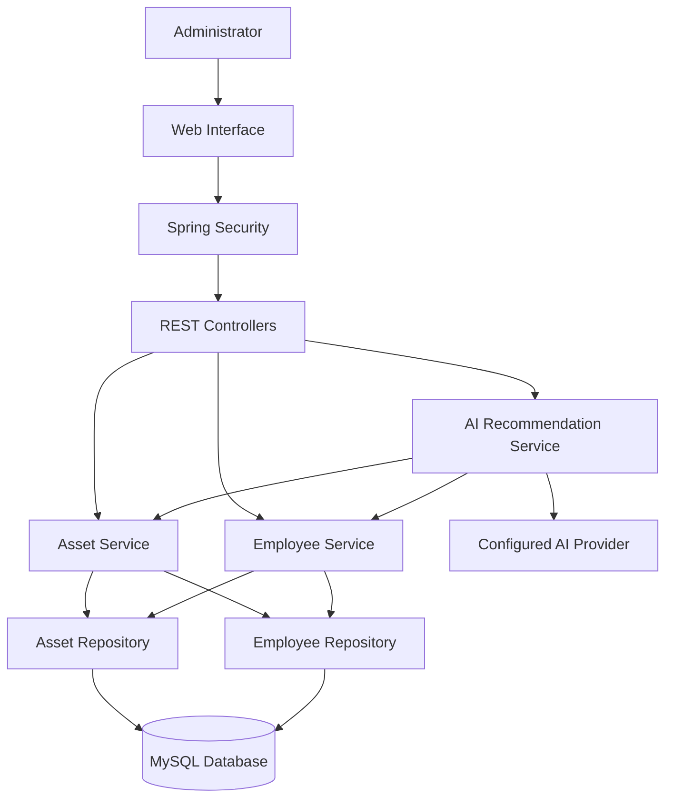
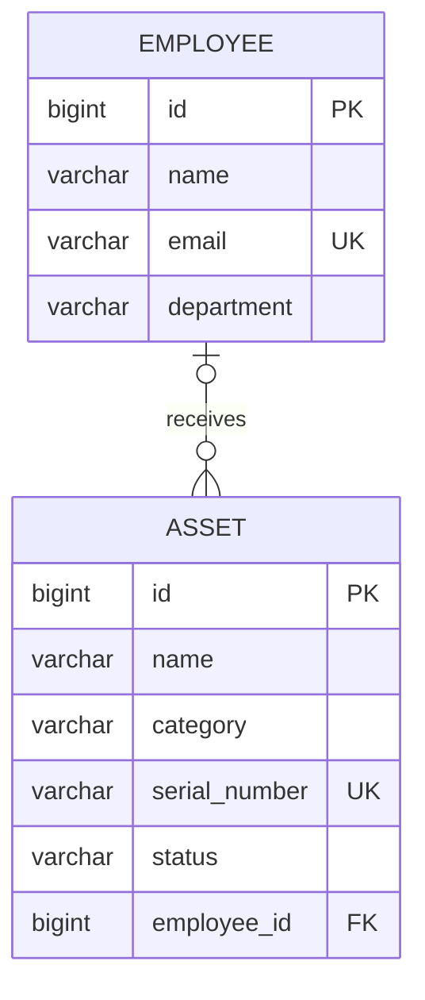
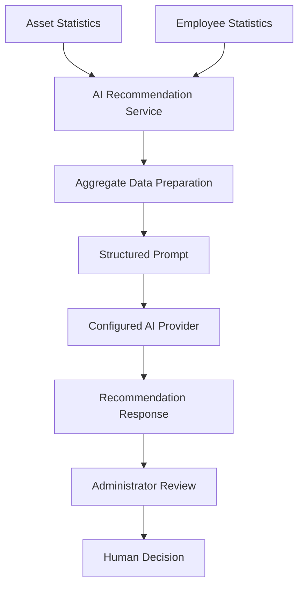
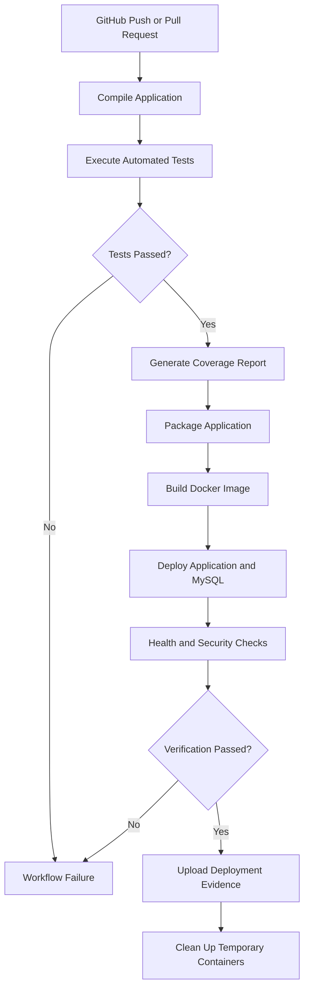

# AI-Powered IT Asset Management System


[](https://github.com/ilerioluwaa/ai-it-asset-management-system/actions/workflows/maven.yml)

## 1. Project Overview

The AI-Powered IT Asset Management System is a web-based application designed to help organizations manage technology assets, employee equipment assignments, inventory availability, and operational decision-making.

The application combines traditional asset management functionality with an AI recommendation service that analyzes aggregated inventory statistics and provides operational recommendations for human review.

The system was developed as part of the CMSC 495 Computer Capstone Project at the University of Maryland Global Campus (UMGC).

Version 1.0.0 represents the verified Final Release implementation, incorporating expanded functionality, application security, automated testing, AI integration, and reproducible container deployment.

### Final Release Summary

| Metric | Result |
|---|---:|
| Application version | 1.0.0 |
| Automated tests | 138 |
| Tests passed | 138 |
| Test pass rate | 100% |
| Line coverage | 91.32% |
| Instruction coverage | 91.43% |
| Successful GitHub workflow runs at release | 7 |
| Final CI/CD execution duration | 1 minute 43 seconds |
| Docker deployment verification | Passed |
| MySQL integration | Verified |
| Application health | UP |

## 2. Problem Statement

Organizations frequently manage technology assets through spreadsheets, disconnected applications, and manual administrative processes.

These approaches can introduce several operational challenges:

- Inaccurate inventory records.
- Duplicate asset registrations.
- Untracked employee equipment assignments.
- Limited visibility into equipment availability.
- Inefficient maintenance planning.
- Unauthorized modification of organizational records.
- Limited analytical support for inventory decisions.

This application addresses these challenges through centralized inventory management, relational database integration, automated validation, administrator authentication, operational analytics, and AI-assisted recommendations.

## 3. Project Objectives

- Centralize organizational IT asset records.
- Maintain accurate employee equipment assignments.
- Reduce duplicate and invalid records.
- Improve inventory visibility and accountability.
- Protect administrative operations.
- Provide AI-assisted operational recommendations.
- Support automated testing and reproducible deployment.
- Establish a maintainable and extensible software architecture.
- Apply peer review feedback to reduce technical debt.
- Demonstrate professional software engineering practices.

## 4. Core Features

### Asset Management

- Register new technology assets.
- View and search asset inventory.
- Update existing asset records.
- Delete eligible assets.
- Prevent duplicate serial numbers.
- Filter assets by operational status.
- Navigate paginated inventory results.
- Assign and unassign equipment.
- Prevent deletion of assigned assets.
- Prevent retired assets from being reactivated.

Supported asset statuses:

- AVAILABLE
- ASSIGNED
- MAINTENANCE
- RETIRED

### Employee Management

- Register employees.
- View employee records.
- Update employee information.
- Delete employees without assigned equipment.
- Validate employee email addresses.
- Prevent duplicate employee emails.
- Search employees by name, email, or department.
- Filter employees by department.
- Display assigned asset counts.

### Asset Allocation

The asset and employee modules are integrated through a relational database association.

The system supports:

- Assigning available assets to registered employees.
- Returning assigned equipment to available inventory.
- Preserving employee assignments during unrelated asset updates.
- Maintaining assignment relationships when employee names change.
- Preventing deletion of employees with assigned assets.
- Validating employee references before equipment allocation.

### Operational Dashboard

The dashboard displays:

- Total assets.
- Available assets.
- Assigned assets.
- Assets under maintenance.
- Retired assets.
- Total employees.
- Asset utilization percentage.
- Asset category distribution.
- Employee department distribution.
- AI service configuration status.

### AI Recommendation Service

The AI recommendation service analyzes aggregated operational statistics and generates natural-language recommendations.

Potential recommendations include:

- Equipment availability improvements.
- Inventory utilization opportunities.
- Maintenance prioritization.
- Equipment allocation considerations.
- Procurement planning considerations.

The AI service requires a configured OpenAI-compatible chat completion provider.

AI recommendations are advisory and require human review. The AI service does not independently modify inventory records or assign equipment.

The interface displays generated recommendations, provider model information, generation timestamps, and response latency.

### Administrator Security

The application includes a dedicated administrator login interface with:

- Username and password authentication.
- BCrypt password hashing.
- Role-based access restrictions.
- Session management.
- CSRF protection.
- Secure logout.
- Restricted API access.

## 5. Technology Stack

| Technology | Purpose |
|---|---|
| Java 25 | Backend programming language |
| Spring Boot 4.0.9 | Application framework |
| Spring MVC | REST API development |
| Spring Data JPA | Database persistence |
| Hibernate | Object-relational mapping |
| MySQL 8.4 | Application database |
| H2 | Isolated automated test database |
| Spring Security | Authentication and authorization |
| Jakarta Bean Validation | Input validation |
| Spring Boot Actuator | Application health monitoring |
| HTML5 | Frontend structure |
| CSS3 | Frontend styling |
| JavaScript | Client-side application logic |
| Bootstrap 5.3.3 | Responsive interface components |
| Maven | Build and dependency management |
| JUnit 5 | Automated testing |
| Mockito | Test dependency simulation |
| MockMvc | HTTP integration testing |
| JaCoCo | Code coverage reporting |
| Docker | Application containerization |
| Docker Compose | Multi-container deployment |
| GitHub Actions | Automated CI/CD verification |
| Git | Version control |
| REST API | Application and AI provider communication |

## 6. System Architecture

The application follows a layered architecture that separates presentation, request handling, business logic, persistence, security, and external AI integration.



### Presentation Layer

The presentation layer consists of HTML, CSS, Bootstrap, and JavaScript.

It provides:

- Administrator login.
- Asset dashboard.
- Asset inventory management.
- Employee directory management.
- Equipment allocation.
- Operational analytics.
- AI recommendation interface.

### Controller Layer

REST controllers receive HTTP requests, validate incoming request data, and return structured responses.

Primary controllers:

- AssetController
- EmployeeController
- AiController

### Service Layer

The service layer contains business rules, validation logic, assignment management, operational statistics, and AI provider communication.

Primary services:

- AssetService
- EmployeeService
- AiRecommendationService

Separating business logic from HTTP request handling improves maintainability and supports independent testing.

### Persistence Layer

Spring Data JPA repositories provide database access and query functionality.

Primary repositories:

- AssetRepository
- EmployeeRepository

The persistence layer supports relational associations, database constraints, pagination, filtering, and aggregate queries.

### Security Layer

Spring Security protects application resources through administrator authentication, authorization, session management, CSRF protection, and security response headers.

### Exception Handling

The GlobalExceptionHandler provides centralized handling of application validation errors, missing resources, invalid requests, and database constraint violations.

Error responses are designed to provide useful information without unnecessarily exposing internal application details.

## 7. Database Design

The application uses two primary relational database entities.

### Asset Entity

| Field | Description |
|---|---|
| id | Unique asset identifier |
| name | Asset name |
| category | Equipment category |
| serial_number | Unique serial number |
| status | Operational status |
| employee_id | Assigned employee reference |

### Employee Entity

| Field | Description |
|---|---|
| id | Unique employee identifier |
| name | Employee name |
| email | Unique employee email |
| department | Organizational department |

### Entity Relationship Diagram



An employee may have multiple assigned assets. An asset may be unassigned or associated with one employee.

The employee relationship uses a foreign key rather than storing an independent employee name within the asset record.

This design improves referential integrity and prevents employee name changes from invalidating existing assignment relationships.

## 8. Project Structure

```text
ai-it-asset-management-system/
|
|-- .github/
|   `-- workflows/
|       `-- maven.yml
|
|-- .mvn/
|
|-- src/
|   |-- main/
|   |   |-- java/com/cmsc495/assetmanagement/
|   |   |   |-- config/
|   |   |   |   `-- SecurityConfig.java
|   |   |   |-- controller/
|   |   |   |   |-- AssetController.java
|   |   |   |   |-- EmployeeController.java
|   |   |   |   `-- AiController.java
|   |   |   |-- dto/
|   |   |   |   |-- AssetRequest.java
|   |   |   |   `-- EmployeeRequest.java
|   |   |   |-- exception/
|   |   |   |   `-- GlobalExceptionHandler.java
|   |   |   |-- model/
|   |   |   |   |-- Asset.java
|   |   |   |   |-- Employee.java
|   |   |   |   `-- AssetStatus.java
|   |   |   |-- repository/
|   |   |   |   |-- AssetRepository.java
|   |   |   |   `-- EmployeeRepository.java
|   |   |   |-- service/
|   |   |   |   |-- AssetService.java
|   |   |   |   |-- EmployeeService.java
|   |   |   |   `-- AiRecommendationService.java
|   |   |   `-- AssetmanagementApplication.java
|   |   |
|   |   `-- resources/
|   |       |-- static/
|   |       |   |-- index.html
|   |       |   |-- login.html
|   |       |   |-- login.js
|   |       |   |-- script.js
|   |       |   `-- style.css
|   |       `-- application.properties
|   |
|   `-- test/
|       |-- java/com/cmsc495/assetmanagement/
|       |   |-- controller/
|       |   |   |-- AssetControllerTest.java
|       |   |   `-- EmployeeControllerTest.java
|       |   |-- security/
|       |   |   `-- SecurityTest.java
|       |   |-- service/
|       |   |   `-- AiRecommendationServiceTest.java
|       |   `-- AssetmanagementApplicationTests.java
|       `-- resources/
|           `-- application-test.properties
|
|-- Dockerfile
|-- compose.yaml
|-- .dockerignore
|-- .gitignore
|-- .env.example
|-- mvnw
|-- mvnw.cmd
|-- pom.xml
|-- README.md
|-- API.md
|-- INSTALLATION.md
|-- USER_MANUAL.md
|-- TECHNICAL_DEBT.md
`-- PERFORMANCE.md
```

## 9. Installation and Setup

### Prerequisites

For local development:

- Java Development Kit 25.
- MySQL Server.
- Git.
- Internet access for initial dependency downloads.

For container deployment:

- Docker.
- Docker Compose.
- Git.

An AI provider is optional for core asset and employee management functionality.

### Clone the Repository

```bash
git clone https://github.com/ilerioluwaa/ai-it-asset-management-system.git

cd ai-it-asset-management-system
```

### Option A: Docker Deployment (Recommended)

Docker deployment provides a reproducible application and database environment without requiring a separately installed Java or MySQL development environment.

Create a private environment configuration file:

```bash
cp .env.example .env
```

Configure the environment variables using a text editor.

Example configuration:

```dotenv
DB_NAME=assetmanagement_final
DB_USERNAME=assetadmin
DB_PASSWORD=replace_with_database_password
MYSQL_ROOT_PASSWORD=replace_with_root_password

ADMIN_USERNAME=admin
ADMIN_PASSWORD=replace_with_strong_admin_password

PORT=8080
COOKIE_SECURE=false

AI_ENABLED=false
AI_API_KEY=
AI_MODEL=
AI_BASE_URL=
```

Replace all example passwords before deployment.

The administrator password must contain at least 12 characters and must not exceed 72 UTF-8 bytes.

Do not commit the private `.env` file to version control.

Validate the Docker Compose configuration:

```bash
docker compose config --quiet
```

Build and start the application:

```bash
docker compose up -d --build
```

Inspect the deployment:

```bash
docker compose ps
```

Check application health:

```bash
curl http://localhost:8080/actuator/health
```

The health response should include:

```json
{
  "status": "UP"
}
```

Open the application:

```text
http://localhost:8080
```

Authenticate using the administrator credentials configured in `.env`.

Stop the deployment while preserving database records:

```bash
docker compose down
```

Do not use the `--volumes` option unless permanent deletion of the container database volume is intended.

### Option B: Local Development

Create a new MySQL database:

```sql
CREATE DATABASE assetmanagement_final;
```

Configure the application environment variables:

```bash
export DB_URL="jdbc:mysql://localhost:3306/assetmanagement_final"

export DB_USERNAME="your_database_username"

export DB_PASSWORD="your_database_password"

export ADMIN_USERNAME="admin"

export ADMIN_PASSWORD="your_strong_admin_password"

export AI_ENABLED="false"
```

The configured database user must have appropriate permissions for the new database.

Start the application:

```bash
chmod +x mvnw

./mvnw spring-boot:run
```

Open the application:

```text
http://localhost:8080
```

Authenticate using the configured administrator credentials.

### Database Migration Notice

The Final Release introduces an employee foreign-key relationship and enumerated asset statuses.

An existing Alpha Release database must be backed up and migrated before use with the revised application.

A new database is recommended for initial Final Release deployment.

Automatic schema updates do not replace a controlled database migration process.

For detailed installation instructions, see [INSTALLATION.md](INSTALLATION.md).

## 10. AI Configuration

The AI service supports a configurable OpenAI-compatible chat completion endpoint.

The following environment variables control AI functionality:

| Variable | Description |
|---|---|
| AI_ENABLED | Enables or disables the AI service |
| AI_API_KEY | Provider API credential, if required |
| AI_MODEL | Provider-specific model identifier |
| AI_BASE_URL | Provider API base URL |

### External AI Provider

Example configuration:

```bash
export AI_ENABLED="true"

export AI_API_KEY="your_provider_api_key"

export AI_MODEL="your_provider_model"

export AI_BASE_URL="https://api.openai.com/v1"
```

The model must be available to the configured provider account.

External AI providers may require separate billing and account configuration.

API credentials must never be embedded in source code, frontend JavaScript, screenshots, or public repository documentation.

### Local AI Provider

For local development, an OpenAI-compatible provider such as Ollama may be configured.

```bash
export AI_ENABLED="true"

export AI_API_KEY=""

export AI_MODEL="your_installed_model"

export AI_BASE_URL="http://localhost:11434/v1"
```

The local model must be installed and the provider must be running before generating recommendations.

This localhost configuration assumes Spring Boot is running directly on the host computer rather than inside a Docker container.

Containerized AI integration requires a provider endpoint that is reachable from the application container and permitted by the application's URL validation rules.

### AI Data Flow



### AI Privacy and Governance

The AI provider receives selected aggregate inventory statistics rather than individual employee records.

The AI integration is designed to exclude:

- Employee names.
- Employee email addresses.
- Individual asset serial numbers.
- Individual employee equipment assignments.

The AI service does not receive direct database access or tools for modifying inventory.

Generated recommendations must be reviewed by an authorized administrator before operational decisions are made.

AI output may contain inaccuracies and must not be treated as authoritative without verification.

### AI Verification

Automated tests verify AI provider communication, configuration validation, response processing, privacy safeguards, and provider failure handling.

Live recommendation generation was also exercised during local application execution.

Observed recommendation generation durations included:

| Observation | Response Time |
|---|---:|
| Recommendation request 1 | 4,879 ms |
| Recommendation request 2 | 5,250 ms |

These observations demonstrate successful recommendation generation but do not constitute a comprehensive AI performance or output-quality evaluation.

The automated Docker deployment workflow runs with external AI functionality disabled to avoid dependence on external credentials, provider availability, and API billing.

## 11. REST API Overview

Application API endpoints require administrator authentication.

State-changing requests also require a valid CSRF token.

### Asset Endpoints

| Method | Endpoint | Purpose |
|---|---|---|
| GET | /api/assets | Retrieve paginated assets |
| GET | /api/assets/{id} | Retrieve an asset |
| POST | /api/assets | Register an asset |
| PUT | /api/assets/{id} | Update an asset |
| DELETE | /api/assets/{id} | Delete an eligible asset |
| POST | /api/assets/{id}/assign | Assign equipment |
| POST | /api/assets/{id}/unassign | Return equipment |
| GET | /api/assets/statistics | Retrieve inventory statistics |

### Employee Endpoints

| Method | Endpoint | Purpose |
|---|---|---|
| GET | /api/employees | Retrieve paginated employees |
| GET | /api/employees/{id} | Retrieve an employee |
| POST | /api/employees | Register an employee |
| PUT | /api/employees/{id} | Update an employee |
| DELETE | /api/employees/{id} | Delete an eligible employee |
| GET | /api/employees/departments | Retrieve departments |
| GET | /api/employees/statistics | Retrieve employee statistics |

### AI Endpoints

| Method | Endpoint | Purpose |
|---|---|---|
| GET | /api/ai/status | Retrieve AI configuration status |
| POST | /api/ai/recommendations | Generate AI recommendations |

### Security and Monitoring Endpoints

| Method | Endpoint | Purpose |
|---|---|---|
| GET | /login | Administrator login page |
| GET | /login/csrf | Retrieve login CSRF token |
| POST | /login | Authenticate administrator |
| POST | /logout | Terminate authenticated session |
| GET | /api/csrf | Retrieve authenticated CSRF token |
| GET | /actuator/health | Application health status |
| GET | /actuator/info | Protected application information |

For detailed request examples, response formats, and HTTP status codes, see [API.md](API.md).

## 12. Security Implementation

The application incorporates security controls intended to reduce common web application risks.

### Authentication and Authorization

- Administrator authentication.
- Role-based access restrictions.
- BCrypt password hashing.
- Session-based authentication.
- Session fixation protection.
- Logout and session invalidation.

### Input Validation

- Required-field validation.
- Maximum input lengths.
- Employee email validation.
- Asset status validation.
- Duplicate serial number prevention.
- Duplicate employee email prevention.
- Employee relationship validation.

### Web Application Security

- CSRF protection.
- Content Security Policy.
- Clickjacking protection.
- Content-type sniffing protection.
- Restricted error information.
- HTTP-only session cookies.
- Configurable secure-cookie behavior.
- Safe rendering of application and AI response data.

### Infrastructure Security

- Environment-based credential configuration.
- Non-root application container.
- Private database network.
- No directly published MySQL port.
- Localhost application binding by default.
- Exclusion of private environment configuration from version control.

### Security Verification

The automated security test suite completed 38 tests successfully.

GitHub Actions deployment verification additionally confirmed that unauthenticated requests to protected asset, employee, and AI endpoints return HTTP 401.

The current implementation is intended for controlled deployment and evaluation.

Production deployment would require additional controls, including HTTPS, persistent identity management, rate limiting, audit logging, database migration management, vulnerability scanning, and operational monitoring.

## 13. Automated Testing

The automated test suite is organized into five primary test classes.

| Test Class | Testing Focus |
|---|---|
| AssetControllerTest | Asset CRUD, validation, allocation, and regression testing |
| EmployeeControllerTest | Employee CRUD, validation, and cross-module integration |
| AiRecommendationServiceTest | AI provider communication, privacy, and failure handling |
| SecurityTest | Authentication, authorization, CSRF, and security headers |
| AssetmanagementApplicationTests | Application initialization and database connectivity |

The test environment uses an isolated H2 in-memory database.

External AI responses are simulated during automated AI service testing to provide repeatable results without requiring paid API access.

MySQL-backed application deployment is verified separately through Docker and GitHub Actions.

### Execute Automated Tests

```bash
./mvnw clean test
```

### Execute Build and Coverage Verification

```bash
./mvnw clean verify
```

### Test Reports

Maven Surefire reports are generated in:

```text
target/surefire-reports/
```

JaCoCo coverage reports are generated in:

```text
target/site/jacoco/
```

Open the HTML coverage report:

```text
target/site/jacoco/index.html
```

### Final Automated Test Results

The Final Release automated test suite was successfully executed through GitHub Actions workflow run number 7.

| Metric | Result |
|---|---:|
| Total tests | 138 |
| Passed | 138 |
| Failures | 0 |
| Errors | 0 |
| Skipped | 0 |
| Pass rate | 100% |
| Reported test duration | 9.62 seconds |

### Code Coverage Results

| Coverage Metric | Result |
|---|---:|
| Instruction coverage | 91.43% |
| Branch coverage | 70.83% |
| Line coverage | 91.32% |
| Complexity coverage | 71.37% |
| Method coverage | 92.03% |
| Class coverage | 100.00% |

### Alpha and Final Release Comparison

| Metric | Alpha Release | Final Release |
|---|---:|---:|
| Automated tests | 8 | 138 |
| Passing tests | 8 | 138 |
| Test pass rate | 100% | 100% |
| Automated deployment verification | Not implemented | Passed |
| Code coverage reporting | Not established | Implemented |

The automated test suite expanded from 8 to 138 tests, representing 130 additional tests and a 1,625% increase in test count.

The expanded test suite provides broader coverage of business rules, security controls, cross-module integration, and failure scenarios.

Coverage measurements do not establish that all possible defects have been eliminated.

Simulated AI provider tests do not replace live AI functionality and output-quality evaluation.

## 14. Continuous Integration and Deployment

The GitHub Actions workflow automates:

1. Repository checkout.
2. Java 25 environment configuration.
3. Maven dependency management.
4. Application compilation.
5. Automated test execution.
6. JaCoCo coverage generation.
7. Application packaging.
8. Docker image construction.
9. MySQL-backed container deployment.
10. Application health verification.
11. Authentication smoke testing.
12. Deployment evidence collection.

### CI/CD Pipeline



### Final Release Workflow Results

| Property | Result |
|---|---|
| Workflow | Spring Boot CI/CD |
| Workflow run | 7 |
| Commit | f85eb30 |
| Branch | main |
| Overall status | Success |
| Total duration | 1 minute 43 seconds |
| Build, Test and Code Coverage | Passed |
| Docker Deployment and Health Verification | Passed |
| Generated artifacts | 4 |

### Deployment Verification Results

| Verification | Result |
|---|---|
| Docker build | Passed |
| MySQL-backed application startup | Passed |
| Application health | UP |
| Login page | HTTP 200 |
| Protected asset API | HTTP 401 |
| Protected employee API | HTTP 401 |
| Protected AI API | HTTP 401 |

HTTP 401 responses are expected for unauthenticated requests to protected application endpoints.

### Workflow Artifacts

The successful Final Release workflow generated four artifacts.

| Artifact | Purpose |
|---|---|
| application-package | Packaged executable application |
| automated-test-reports | Maven Surefire test results |
| deployment-evidence | Container deployment and health verification evidence |
| jacoco-coverage-report | Detailed code coverage reports |

### Verification Links

- [GitHub Actions Workflow History](https://github.com/ilerioluwaa/ai-it-asset-management-system/actions)
- [Final Release CI/CD Run](https://github.com/ilerioluwaa/ai-it-asset-management-system/actions/runs/45769400901)
- [Final Release Implementation Commit](https://github.com/ilerioluwaa/ai-it-asset-management-system/commit/f85eb30)

### Local Docker Verification

The application and MySQL database were also deployed locally using Docker Compose.

Local verification included:

- Successful Docker Compose configuration validation.
- Application container startup.
- MySQL container health verification.
- Application health endpoint verification.
- Administrator login through the browser.
- Asset registration through the web interface.
- Inventory retrieval.
- Container restart.
- Verification that the registered asset remained available following restart.

This provides evidence of functional container deployment and database persistence during a container restart.

### Deployment Scope

Deployment verification takes place in an isolated GitHub Actions environment and a local Docker environment.

This demonstrates automated deployment and reproducibility but does not constitute permanent public production hosting.

### Workflow Maintenance

The successful workflow reported two non-blocking warnings concerning GitHub Actions components originally targeting Node.js 20.

These warnings did not prevent successful build, testing, artifact generation, or deployment verification.

Updating the affected workflow dependencies is recorded as future maintenance work.

## 15. Technical Debt and Refinement

The Final Release incorporates improvements identified during development and peer review.

### Major Refinement Areas

- Server-side asset validation.
- Employee information validation.
- Duplicate record prevention.
- Relational employee assignments.
- Preservation of existing asset assignments.
- Employee deletion safeguards.
- Paginated inventory retrieval.
- Administrator authentication.
- Expanded automated testing.
- AI provider integration.
- Container deployment verification.

### Assignment Preservation Regression

A peer review identified a defect in which editing an asset could unintentionally remove its existing employee assignment.

The defect was reproduced through a failing Alpha Release regression test.

The original implementation replaced the existing assignment with the value supplied in the update request, even when the assignment field was omitted.

The revised implementation uses a relational employee association and preserves the existing employee relationship when an assigned asset is updated without a replacement employee identifier.

The expanded test suite includes a regression test for this behavior.

The revised test suite subsequently passed all 138 automated tests.

### Refinement Summary

| Identified Issue | Final Release Improvement |
|---|---|
| Missing server-side validation | Validated request objects and service rules |
| Duplicate asset registrations | Unique serial number constraints |
| Duplicate employee records | Unique email constraints |
| Assignment data loss | Relational assignment preservation |
| Invalid employee references | Employee existence validation |
| Unsafe employee deletion | Assigned equipment deletion safeguards |
| Unrestricted administrative operations | Spring Security authentication |
| Full inventory retrieval | Paginated API queries |
| Limited automated testing | Expanded 138-test suite |
| Missing coverage reporting | JaCoCo integration |
| Manual deployment | Docker and automated deployment verification |

For the complete technical debt register, see [TECHNICAL_DEBT.md](TECHNICAL_DEBT.md).

## 16. Performance and Scalability

The application incorporates several design measures intended to support maintainability and scalability:

- Paginated asset retrieval.
- Paginated employee retrieval.
- Database indexes.
- Unique database constraints.
- Connection pooling.
- Transactional service operations.
- Aggregate database queries.
- AI provider connection and response timeouts.
- Container-aware JVM memory configuration.

### Verified Execution Metrics

| Metric | Result |
|---|---:|
| Automated test duration in CI | 9.62 seconds |
| Build, Test and Code Coverage job | 35 seconds |
| Docker Deployment and Health Verification job | 64 seconds |
| Complete CI/CD workflow | 103 seconds |
| Observed AI recommendation request 1 | 4,879 ms |
| Observed AI recommendation request 2 | 5,250 ms |

These results represent observations from the development and continuous integration environments.

The application has not undergone comprehensive production-scale load testing.

Local response latency measurements should be interpreted in the context of the test dataset, hardware, request conditions, and sample size.

See [PERFORMANCE.md](PERFORMANCE.md) for benchmark procedures, measurements, and limitations.

## 17. Ethical and Responsible Computing

The application follows responsible computing principles through:

- Protection of organizational information.
- Limited disclosure of employee data.
- Human oversight of AI-generated recommendations.
- Transparent documentation of AI limitations.
- Separation of AI recommendations from administrative actions.
- Accurate reporting of testing and deployment results.

AI recommendations must not be used to make discriminatory employee decisions or unsupported assumptions about individual performance.

Administrators remain responsible for verifying recommendations and approving operational changes.

The system is intended to support human decision-making rather than replace human accountability.

## 18. Known Limitations

The current release has the following limitations:

- Administrator accounts use in-memory identity management.
- Production-grade audit logging is not implemented.
- Application-level rate limiting is not implemented.
- Permanent public hosting is not configured.
- Database migrations require additional management.
- Concurrent asset assignment behavior requires further evaluation.
- Employee assignment counts may introduce additional database queries.
- Employee selection currently retrieves the available employee directory across multiple pages.
- AI output quality depends on the configured provider and model.
- AI recommendations require human verification.
- Live AI availability depends on provider configuration and connectivity.
- Automated CI deployment does not exercise a live external AI provider.
- Branch coverage remains below complete coverage.
- Comprehensive production-scale load testing has not been performed.
- GitHub Actions dependency deprecation warnings require future maintenance.
- Spring Data pagination response serialization should be standardized for long-term API compatibility.
- Automated coverage reports do not guarantee the absence of software defects.

These limitations represent opportunities for future refinement.

## 19. Documentation

| Document | Description |
|---|---|
| [README.md](README.md) | Project overview and architecture |
| [API.md](API.md) | REST API reference |
| [INSTALLATION.md](INSTALLATION.md) | Installation and deployment guide |
| [USER_MANUAL.md](USER_MANUAL.md) | Application usage instructions |
| [TECHNICAL_DEBT.md](TECHNICAL_DEBT.md) | Technical debt and refinement register |
| [PERFORMANCE.md](PERFORMANCE.md) | Performance testing and benchmark results |

## 20. Development Roadmap

Potential future improvements include:

### Short-Term Improvements

- Update deprecated GitHub Actions dependencies.
- Expand branch and failure-path test coverage.
- Standardize paginated API response structures.
- Improve automated database migration management.
- Introduce automated dependency vulnerability scanning.
- Expand AI recommendation quality evaluation.

### Medium-Term Improvements

- Persistent administrator and employee accounts.
- Granular role-based access control.
- Multi-factor authentication.
- Comprehensive audit logging.
- Application-level rate limiting.
- Advanced inventory reporting.
- Asset maintenance scheduling.
- Barcode and QR code integration.

### Long-Term Improvements

- AI-assisted inventory forecasting.
- Improved recommendation evaluation.
- Concurrency and production-scale load testing.
- Production monitoring and alerting.
- Secure cloud deployment.
- Enterprise identity provider integration.
- Automated disaster recovery procedures.

## 21. Version History

| Version | Release | Description |
|---|---|---|
| 0.1.0 | Initial Development | Core project setup |
| 0.5.0 | Alpha Release | Asset management and initial automated testing |
| 1.0.0 | Final Release | Expanded integration, security, AI, testing, and verified container deployment |

### Final Release Verification

Version 1.0.0 successfully completed consolidated automated testing and GitHub Actions deployment verification.

The implementation is suitable for controlled academic demonstration and evaluation.

Additional engineering and operational controls would be required before deployment as an enterprise production service.

## 22. Project Contributors

### Shalom Olukunle

University of Maryland Global Campus

CMSC 495 - Computer Capstone Project

Primary development contributions:

- System architecture and implementation.
- Backend REST API development.
- Database integration.
- Frontend application development.
- Asset and employee module integration.
- AI recommendation service integration.
- Application security implementation.
- Automated testing and regression testing.
- Technical debt remediation.
- Performance evaluation.
- CI/CD configuration.
- Container deployment configuration.
- Technical documentation.
- Final Release verification.

### Peer Review Acknowledgment

Jose Rodriguez-Stahr provided Alpha Release peer review feedback concerning assignment preservation, validation, authorization, scalability, and documentation.

The feedback informed the Final Release refinement process.

## 23. Academic and Professional Integrity

This project was developed for academic evaluation and professional software engineering development.

AI-assisted development tools were used to support implementation, documentation, test design, and technical problem-solving.

Generated material requires developer review, testing, and verification.

Testing results, performance measurements, deployment outcomes, and contribution records must accurately reflect completed and verified work.

The project distinguishes between:

- Implemented application functionality.
- Automated test verification.
- Live AI recommendation generation.
- Local container deployment.
- Automated CI deployment verification.
- Proposed future improvements.

No claim of permanent production hosting or complete elimination of software defects is made.

## 24. Repository

GitHub Repository:

https://github.com/ilerioluwaa/ai-it-asset-management-system

GitHub Actions:

https://github.com/ilerioluwaa/ai-it-asset-management-system/actions

Final Release Verification:

https://github.com/ilerioluwaa/ai-it-asset-management-system/actions/runs/45769400901

---

AI-Powered IT Asset Management System

CMSC 495 - Computer Capstone Project

University of Maryland Global Campus

Version 1.0.0 - Final Release
