# Technical Debt and Refinement Register

AI-Powered IT Asset Management System

Version: 1.0.0 - Final Release

CMSC 495 - Computer Capstone Project

University of Maryland Global Campus

November 2026

---

## 1. Purpose

This document identifies, evaluates, prioritizes, and tracks
technical debt associated with the development of the
AI-Powered IT Asset Management System.

Technical debt refers to implementation decisions, architectural
limitations, incomplete functionality, and deferred engineering
activities that may increase future maintenance costs or introduce
operational risks.

The purpose of this register is to:

- Identify technical weaknesses.
- Document root causes and operational consequences.
- Establish risk-based remediation priorities.
- Record corrective engineering actions.
- Define measurable acceptance criteria.
- Establish verification traceability.
- Evaluate improvements between the Alpha and Final Releases.
- Maintain transparency regarding unresolved limitations.
- Support continuous software quality improvement.

The register distinguishes implemented improvements from
verified outcomes and deferred production enhancements.

---

## 2. Executive Summary

The Alpha Release established the initial application
foundation but contained limitations in assignment integrity,
server-side validation, security, module integration,
automated testing, and deployment verification.

Peer review, regression testing, and architectural analysis
were used to identify and prioritize these limitations.

The Final Release introduces:

- Relational employee and asset associations.
- Assignment preservation safeguards.
- Server-side request validation.
- Database uniqueness constraints.
- Administrator authentication and authorization.
- Cross-Site Request Forgery protection.
- Paginated asset and employee retrieval.
- Centralized exception handling.
- Functional AI recommendation generation.
- Expanded automated testing.
- JaCoCo code coverage measurement.
- Docker-based deployment.
- Automated CI/CD deployment verification.
- Comprehensive technical documentation.

### 2.1 Final Release Quality Indicators

| Metric | Verified Result |
|---|---:|
| Automated tests | 138 |
| Passed tests | 138 |
| Failed tests | 0 |
| Test errors | 0 |
| Skipped tests | 0 |
| Test pass rate | 100% |
| Java instruction coverage | 91.43% |
| Java branch coverage | 70.83% |
| Java line coverage | 91.32% |
| Java method coverage | 92.03% |
| Java class coverage | 100% |
| Sequential inventory API requests | 60 |
| Successful measured API requests | 60 |
| Recorded live AI executions | 2 |
| GitHub Actions final workflow | Successful |
| Docker deployment verification | Successful |

These results demonstrate substantial engineering
refinement within the documented verification scope.

They do not establish complete production readiness,
exhaustive security assurance, or unlimited scalability.

---

## 3. Alpha Release Baseline

The Alpha Release established the following capabilities:

- Spring Boot application architecture.
- MySQL database integration.
- Asset registration and management.
- REST API endpoints.
- Web-based inventory interface.
- Initial employee backend functionality.
- Automated asset API testing.
- GitHub Actions continuous integration.

The original automated test suite completed eight tests
with no failures, errors, or skipped tests.

### 3.1 Alpha Release Assessment

The Alpha Release received the following academic assessment:

| Assessment Category | Earned | Maximum |
|---|---:|---:|
| Alpha Release functionality | 40 | 40 |
| Multi-module integration | 35 | 40 |
| CI/CD and automated testing | 30 | 35 |
| Peer review | 35 | 35 |
| Technical debt identification and analysis | 20 | 30 |
| Total | 160 | 180 |

Overall Alpha Release assessment:

88.89%

Technical debt assessment:

66.67%

The assessment identified technical debt analysis as an
important opportunity for improvement.

The Final Release therefore emphasizes reproducible evidence,
risk classification, measurable acceptance criteria,
corrective actions, and residual risk documentation.

Academic assessment scores are not equivalent to
software reliability or production-readiness measurements.

### 3.2 Alpha Release Automated Test Baseline

| Metric | Result |
|---|---:|
| Automated tests | 8 |
| Passed | 8 |
| Failures | 0 |
| Errors | 0 |
| Skipped | 0 |
| Maven build duration | 3.500 seconds |
| Build result | BUILD SUCCESS |

The baseline was reproduced on November 24, 2026.

The successful baseline did not establish that all
application behaviors were correct.

A subsequently introduced regression test demonstrated
a previously undetected assignment preservation defect.

---

## 4. Technical Debt Assessment Methodology

Technical debt is evaluated using a qualitative
risk-based assessment methodology.

The methodology considers:

- Functional correctness.
- Data integrity.
- Security exposure.
- Operational reliability.
- Maintainability.
- Scalability.
- Deployment reproducibility.
- Verification completeness.
- Responsible AI operation.

### 4.1 Impact Classification

| Score | Classification | Description |
|---:|---|---|
| 1 | Low | Minor inconvenience or maintenance concern |
| 2 | Moderate | Reduced usability or maintainability |
| 3 | Significant | Operational inefficiency or functional degradation |
| 4 | High | Major functional, security, or data integrity risk |
| 5 | Critical | Severe security, reliability, or data integrity risk |

### 4.2 Likelihood Classification

| Score | Classification | Description |
|---:|---|---|
| 1 | Rare | Unlikely under expected operating conditions |
| 2 | Unlikely | Possible under unusual conditions |
| 3 | Possible | May occur during normal operations |
| 4 | Likely | Expected to occur repeatedly |
| 5 | Frequent | Expected during routine use |

### 4.3 Risk Score

Risk Score = Impact x Likelihood

Example:

Impact = 5

Likelihood = 4

Risk Score = 5 x 4 = 20

Priority = Critical

### 4.4 Priority Classification

| Risk Score | Priority |
|---:|---|
| 20-25 | Critical |
| 12-19 | High |
| 6-11 | Medium |
| 1-5 | Low |

Risk scores represent qualitative engineering assessments.

They are not statistically measured failure probabilities.

The original risk scores are retained to preserve
traceability to the initial technical debt assessment.

### 4.5 Risk Assessment Matrix

| Impact / Likelihood | 1 | 2 | 3 | 4 | 5 |
|---|---:|---:|---:|---:|---:|
| 5 - Critical | 5 | 10 | 15 | 20 | 25 |
| 4 - High | 4 | 8 | 12 | 16 | 20 |
| 3 - Significant | 3 | 6 | 9 | 12 | 15 |
| 2 - Moderate | 2 | 4 | 6 | 8 | 10 |
| 1 - Low | 1 | 2 | 3 | 4 | 5 |

### 4.6 Remediation Decision Process

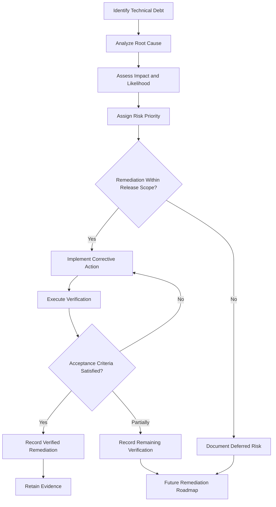

---

## 5. Technical Debt Status Definitions

| Status | Meaning |
|---|---|
| Identified | Technical debt has been documented |
| Remediation Drafted | Corrective implementation has been prepared |
| Verification Pending | Implementation requires additional verification |
| Partially Verified | Some acceptance criteria have supporting evidence |
| Verified | Defined release-scope acceptance criteria have supporting evidence |
| Deferred | Remediation remains planned for future development |
| Accepted | Residual risk has been explicitly accepted by an authorized decision-maker |

Verified status applies only to the documented
acceptance criteria and verification environment.

It does not establish that related risks have been
eliminated under every possible operating condition.

A technical debt item must not be marked Verified
solely because replacement source code has been written.

Verification requires appropriate test or operational evidence.

Deferred items are not considered resolved.

---

## 6. Alpha Release Peer Review

Peer reviewer: Jose Rodriguez-Stahr.

The peer review examined the Alpha Release application,
asset management interface, REST API implementation,
and automated testing.

The reviewer reported successful execution of the
eight existing automated tests and successful basic
asset management operations.

The review also identified several opportunities
for engineering refinement.

### 6.1 Assignment Preservation

The reviewer identified that editing an asset could
unintentionally remove an existing employee assignment.

The frontend did not include the assigned employee
value during ordinary asset edits.

The backend replaced the existing assignment with
the incoming value even when that value was absent.

This finding resulted in a targeted regression test
and a redesign of employee assignment persistence.

### 6.2 Server-Side Validation

The reviewer recommended enforcing required fields
and valid asset statuses on the server.

Client-side validation alone cannot protect an API
from malformed or unauthorized direct requests.

The Final Release introduces request DTOs,
validation constraints, and service-level business rules.

### 6.3 Authorization

The reviewer recommended restricting asset modification
and deletion operations to authorized users.

The Final Release introduces Spring Security,
administrator authentication, authorization,
session management, and CSRF protection.

### 6.4 Scalability

The reviewer recommended pagination rather than
repeatedly retrieving the entire inventory.

The Final Release introduces paginated asset and
employee retrieval, search, filtering, and page-size limits.

### 6.5 Installation Documentation

The reviewer recommended improving MySQL configuration
and installation instructions.

The Final Release expands environment configuration,
database initialization, native execution, and
Docker deployment documentation.

### 6.6 Peer Review Traceability

| Peer Review Finding | Related Debt | Corrective Action |
|---|---|---|
| Assignment information overwritten | TD-004, TD-008, TD-015 | Relational employee association and preservation logic |
| Missing backend validation | TD-001, TD-003 | Request validation and status enumeration |
| Unrestricted modification | TD-010, TD-023 | Authentication, authorization, and CSRF protection |
| Full inventory retrieval | TD-009, TD-014 | Pagination and filtering |
| Incomplete database instructions | TD-019, TD-022 | Expanded installation and environment documentation |

Peer review findings informed implementation priorities.

The assignment preservation finding was independently
reproduced through regression testing.

---

## 7. Technical Debt Register

The following register retains the original 34 debt
identifiers and introduces two additional maintenance
concerns discovered during Final Release verification.

The status classifications distinguish verified
release-scope improvements from incomplete
verification and deferred work.

| ID | Technical Debt | Impact | Likelihood | Score | Priority | Status |
|---|---|---:|---:|---:|---|---|
| TD-001 | Missing server-side asset validation | 4 | 4 | 16 | High | Verified |
| TD-002 | Duplicate asset serial numbers | 4 | 4 | 16 | High | Verified |
| TD-003 | Unrestricted asset status values | 4 | 4 | 16 | High | Verified |
| TD-004 | Missing relational employee association | 4 | 4 | 16 | High | Verified |
| TD-005 | Missing employee field validation | 4 | 3 | 12 | High | Verified |
| TD-006 | Duplicate employee email addresses | 4 | 3 | 12 | High | Verified |
| TD-007 | Invalid employee email formats | 3 | 3 | 9 | Medium | Verified |
| TD-008 | Existing employee assignment overwritten | 5 | 5 | 25 | Critical | Verified |
| TD-009 | Unpaginated asset inventory | 3 | 4 | 12 | High | Verified |
| TD-010 | Missing authentication and authorization | 5 | 5 | 25 | Critical | Verified |
| TD-011 | Missing employee existence validation | 4 | 4 | 16 | High | Verified |
| TD-012 | Missing deletion safeguards | 5 | 4 | 20 | Critical | Verified |
| TD-013 | Inconsistent API response status codes | 2 | 3 | 6 | Medium | Verified |
| TD-014 | Unpaginated employee directory | 3 | 3 | 9 | Medium | Verified |
| TD-015 | Stale employee names in asset records | 4 | 3 | 12 | High | Verified |
| TD-016 | Limited automated test coverage | 4 | 4 | 16 | High | Verified |
| TD-017 | Missing code coverage measurement | 3 | 4 | 12 | High | Verified |
| TD-018 | Missing automated deployment verification | 4 | 3 | 12 | High | Verified |
| TD-019 | Incomplete installation documentation | 3 | 4 | 12 | High | Partially Verified |
| TD-020 | Incomplete functional AI integration | 4 | 4 | 16 | High | Verified |
| TD-021 | Missing centralized exception handling | 3 | 4 | 12 | High | Verified |
| TD-022 | Insufficient configuration and credential isolation | 5 | 3 | 15 | High | Partially Verified |
| TD-023 | Missing CSRF protection | 5 | 4 | 20 | Critical | Verified |
| TD-024 | Missing database migration management | 5 | 3 | 15 | High | Deferred |
| TD-025 | Missing persistent identity management | 4 | 3 | 12 | High | Deferred |
| TD-026 | Missing security audit logging | 4 | 3 | 12 | High | Deferred |
| TD-027 | Missing application rate limiting | 4 | 3 | 12 | High | Deferred |
| TD-028 | Concurrent asset allocation risk | 5 | 3 | 15 | High | Deferred |
| TD-029 | Additional employee assignment count queries | 3 | 3 | 9 | Medium | Deferred |
| TD-030 | Missing comprehensive performance benchmarks | 4 | 3 | 12 | High | Partially Verified |
| TD-031 | Unbounded employee selection retrieval | 3 | 3 | 9 | Medium | Deferred |
| TD-032 | Limited AI output quality evaluation | 4 | 3 | 12 | High | Partially Verified |
| TD-033 | Missing production HTTPS deployment | 5 | 3 | 15 | High | Deferred |
| TD-034 | Incomplete AI request and output resource governance | 4 | 3 | 12 | High | Deferred |
| TD-035 | Unstable pagination serialization contract | 3 | 3 | 9 | Medium | Deferred |
| TD-036 | Deprecated GitHub Actions runtime dependencies | 2 | 3 | 6 | Medium | Deferred |

The two additional risk scores are proposed engineering
assessments rather than measured failure probabilities.

---

## 8. Detailed Technical Debt Analysis

### TD-001: Missing Server-Side Asset Validation

Root cause:

The Alpha Release relied primarily on frontend
required-field validation.

Impact:

Incomplete or invalid asset records could be
submitted directly to the REST API.

Corrective action:

- Introduce AssetRequest data transfer objects.
- Apply Jakarta Bean Validation constraints.
- Enforce required fields and maximum lengths.
- Validate controller requests.
- Apply additional business rules in the service layer.

Affected components:

- Asset.java
- AssetRequest.java
- AssetController.java
- AssetService.java
- GlobalExceptionHandler.java

Acceptance criteria:

- Blank asset names are rejected.
- Blank categories are rejected.
- Missing serial numbers are rejected.
- Invalid field lengths are rejected.
- Invalid requests return HTTP 400.

Verification:

Asset controller validation tests are included
in the successful Final Release automated test suite.

Residual risk:

Validation rules may require extension as new
organizational inventory requirements are introduced.

Status: Verified.

---

### TD-002: Duplicate Asset Serial Numbers

Root cause:

The Alpha Release did not comprehensively enforce
asset serial number uniqueness.

Impact:

Duplicate inventory records could reduce equipment
traceability and reporting accuracy.

Corrective action:

- Normalize serial numbers.
- Apply case-insensitive duplicate checks.
- Enforce database uniqueness constraints.
- Return HTTP 409 for duplicate records.

Affected components:

- Asset.java
- AssetRepository.java
- AssetService.java
- AssetControllerTest.java

Acceptance criteria:

- Duplicate serial numbers are rejected.
- Case variations cannot bypass duplicate checks.
- An asset may retain its own existing serial number
  during an update.

Verification:

Duplicate serial number handling is covered by
automated asset management tests.

Residual risk:

Concurrent duplicate creation should also be evaluated
under representative MySQL workloads.

Status: Verified.

---

### TD-003: Unrestricted Asset Status Values

Root cause:

Asset status was originally represented using
an unrestricted string.

Impact:

Unsupported status values could produce inconsistent
inventory records and inaccurate statistics.

Corrective action:

Introduce the AssetStatus enumeration.

Supported values:

- AVAILABLE
- ASSIGNED
- MAINTENANCE
- RETIRED

Acceptance criteria:

- Unsupported status values are rejected.
- Missing statuses are rejected.
- Retired assets cannot return to active service.

Verification:

Status validation and business rule scenarios
are included in the asset management test suite.

Residual risk:

Future lifecycle requirements may require additional
status transitions and corresponding tests.

Status: Verified.

---

### TD-004: Missing Relational Employee Association

Root cause:

Employee assignments were represented using
a string field rather than a relational association.

Impact:

Assets could reference employees without a corresponding
employee record.

Corrective action:

- Introduce a ManyToOne entity relationship.
- Store employee identifiers as foreign keys.
- Retrieve employee information through the relationship.
- Maintain assignment consistency in the service layer.

Affected components:

- Asset.java
- Employee.java
- AssetRepository.java
- AssetService.java
- EmployeeService.java

Acceptance criteria:

- An employee may receive multiple assets.
- An asset may reference only one employee.
- Assigned assets reference existing employees.
- Unassigned assets do not retain employee associations.

Verification:

The expanded automated test suite exercises
employee and asset integration.

Residual risk:

Concurrent assignment behavior requires additional
database-level verification under TD-028.

Status: Verified.

---

### TD-005: Missing Employee Field Validation

Root cause:

Employee registration lacked comprehensive
required-field and length constraints.

Impact:

Incomplete employee records could reduce
equipment assignment reliability.

Corrective action:

- Introduce EmployeeRequest.
- Apply required-field validation.
- Enforce maximum field lengths.
- Validate employee creation and update requests.

Acceptance criteria:

- Blank employee names are rejected.
- Missing departments are rejected.
- Invalid field lengths return HTTP 400.

Verification:

Employee validation tests are included in the
successful Final Release test suite.

Status: Verified.

---

### TD-006: Duplicate Employee Email Addresses

Root cause:

Employee email uniqueness was not comprehensively enforced.

Impact:

Duplicate employee identities could create
ambiguity during equipment allocation.

Corrective action:

- Normalize email addresses to lowercase.
- Introduce repository uniqueness checks.
- Enforce database uniqueness constraints.

Acceptance criteria:

- Duplicate employee emails are rejected.
- Case variations cannot bypass duplicate checks.
- An employee may retain an existing email during an update.

Verification:

Employee duplicate handling is covered by
automated employee management tests.

Residual risk:

Concurrent duplicate creation should be evaluated
using representative MySQL integration tests.

Status: Verified.

---

### TD-007: Invalid Employee Email Formats

Root cause:

Employee email fields lacked format validation.

Impact:

Invalid contact information could reduce
employee record quality.

Corrective action:

Apply Jakarta Bean Validation email constraints.

Acceptance criteria:

- Malformed email addresses return HTTP 400.
- Valid email addresses are accepted.

Verification:

Email validation scenarios are included in
EmployeeControllerTest.

Residual risk:

Format validation does not establish that an
email address belongs to an actual employee.

Status: Verified.

---

### TD-008: Existing Employee Assignment Overwritten

Priority: Critical.

#### Root Cause

The Alpha Release asset controller unconditionally
copied the incoming assignedTo field into the
existing asset.

The frontend did not submit this field during
ordinary asset edits.

Original implementation:

```java
existingAsset.setAssignedTo(
    updatedAsset.getAssignedTo()
);
```

When the incoming assignment was absent, the
existing assignment could be replaced with null.

#### Operational Impact

- Loss of employee assignment information.
- Reduced inventory accountability.
- Inconsistent asset and employee relationships.
- Potential equipment tracking errors.
- Additional administrative reconciliation work.

#### Initial Risk Assessment

| Factor | Value |
|---|---:|
| Impact | 5 |
| Likelihood | 5 |
| Risk score | 25 |
| Priority | Critical |

#### Regression Test

A targeted Alpha Release regression test was introduced:

```java
updateAssetPreservesExistingEmployeeAssignment()
```

The test created an asset associated with John Smith
and attempted to update the asset without supplying
the existing employee assignment.

#### Observed Alpha Release Failure

| Metric | Result |
|---|---|
| Expected employee assignment | John Smith |
| Actual employee assignment | null |
| Tests executed | 9 |
| Passed | 8 |
| Failures | 1 |
| Errors | 0 |
| Skipped | 0 |
| Build duration | 2.978 seconds |
| Build result | BUILD FAILURE |

The failure was reproduced on November 24, 2026.

This result established that the original implementation
contained a reproducible data integrity defect.

The previously successful eight-test suite had
not detected this behavior.

#### Corrective Engineering Action

The Final Release replaces string-based employee
assignments with relational employee associations.

The revised update operation preserves the existing
employee identifier when:

- The asset remains assigned.
- No replacement employee identifier is supplied.
- An existing employee association is present.

Illustrative preservation logic:

```java
if (request.status() == AssetStatus.ASSIGNED
        && employeeId == null
        && existingAsset.getAssignedEmployee() != null) {

    employeeId = existingAsset
            .getAssignedEmployee()
            .getId();
}
```

This snippet illustrates the preservation mechanism.

The employee identifier is subsequently validated
and persisted through the service layer.

#### Corrected Assignment Workflow

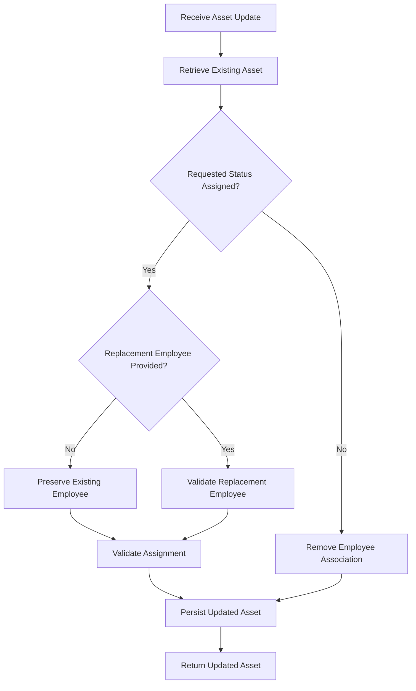

#### Acceptance Criteria

- Create an employee.
- Create an asset assigned to that employee.
- Update the asset name without supplying employeeId.
- Retain ASSIGNED status.
- Preserve the original employee association.
- Retrieve the updated record.
- Confirm that the employee relationship remains intact.

#### Final Release Verification

The Final Release incorporates automated regression
coverage for assignment preservation.

The complete Final Release automated test suite
completed successfully.

| Metric | Alpha Regression Run | Final Release |
|---|---|---|
| Assignment preservation behavior | Defect reproduced | Corrective regression coverage |
| Total automated tests | 9 | 138 |
| Failures | 1 | 0 |
| Errors | 0 | 0 |
| Build result | BUILD FAILURE | BUILD SUCCESS |

The final implementation is included in commit f85eb30.

Supporting verification is retained through
Maven Surefire reports and GitHub Actions artifacts.

#### Residual Risk

Sequential assignment preservation does not establish
correctness under simultaneous conflicting updates.

Concurrent allocation remains tracked under TD-028.

Status: Verified within the automated regression scope.

---

### TD-009: Unpaginated Asset Inventory

Root cause:

The Alpha Release retrieved the entire asset inventory
during inventory refresh operations.

Impact:

Increasing inventory size could increase response
payloads, database workload, and frontend rendering costs.

Corrective action:

- Introduce Spring Data pagination.
- Apply a default page size of ten.
- Limit requested page size to 100.
- Add keyword search and status filtering.
- Add frontend pagination controls.

Acceptance criteria:

- Asset retrieval returns paginated results.
- Page size limits are enforced.
- Search and status filters return matching records.
- Page navigation supports bounded result retrieval.

Verification:

Pagination and search scenarios are covered
by automated asset management tests.

The local asset collection benchmark recorded
an average response time of 3.957 ms.

Residual risk:

The benchmark does not establish performance
with large datasets or concurrent requests.

The pagination response serialization warning
is separately tracked under TD-035.

Status: Verified for functional pagination.

---

### TD-010: Missing Authentication and Authorization

Priority: Critical.

Root cause:

The Alpha Release did not enforce administrator
authentication and authorization.

Impact:

Unauthorized users could potentially retrieve,
modify, or delete organizational records.

Corrective action:

- Integrate Spring Security.
- Configure administrator authentication.
- Apply BCrypt password encoding.
- Restrict protected resources to administrator access.
- Introduce session-based authentication.
- Protect asset, employee, and AI endpoints.
- Invalidate sessions during logout.

Acceptance criteria:

- Unauthenticated API requests return HTTP 401.
- Unauthorized access is rejected.
- Valid administrator credentials permit authentication.
- Invalid credentials are rejected.
- Logout terminates authenticated access.

Verification:

SecurityTest covers authentication, authorization,
session behavior, and protected operations.

The final Docker deployment verification recorded:

| Protected Resource | Observed Result |
|---|---|
| Asset API | HTTP 401 |
| Employee API | HTTP 401 |
| AI API | HTTP 401 |
| Public login page | HTTP 200 |

Administrator login was also verified through
local browser execution.

Residual risk:

Persistent identity management, audit logging,
rate limiting, and production HTTPS remain deferred.

Status: Verified within the current administrator-only scope.

---

### TD-011: Missing Employee Existence Validation

Root cause:

String-based assignments did not require an
existing employee record.

Impact:

Assets could reference nonexistent employees.

Corrective action:

Validate employee identifiers through EmployeeRepository
before creating or modifying assignments.

Acceptance criteria:

- Assignment to an existing employee succeeds.
- Assignment to a nonexistent employee is rejected.
- Invalid employee identifiers are rejected.

Verification:

Employee existence and assignment validation
scenarios are included in the automated tests.

Status: Verified.

---

### TD-012: Missing Deletion Safeguards

Priority: Critical.

Root cause:

Deletion operations did not comprehensively enforce
equipment assignment dependencies.

Impact:

Deleting assigned assets or employees could remove
important operational relationships.

Corrective action:

- Prevent deletion of assigned assets.
- Prevent deletion of employees with assigned assets.
- Require equipment return before deletion.
- Maintain relational database integrity.

Acceptance criteria:

- Assigned asset deletion returns HTTP 409.
- Employee deletion with assigned equipment returns HTTP 409.
- Eligible deletion succeeds after assignment removal.

Verification:

Deletion safeguards are covered by asset and
employee management tests.

Residual risk:

The application does not provide a complete
historical assignment audit trail.

Status: Verified.

---

### TD-013: Inconsistent API Response Status Codes

Root cause:

The Alpha Release used different response conventions
across application endpoints.

Impact:

Inconsistent API behavior increased client
integration complexity.

Corrective action:

Standardize HTTP response conventions.

| HTTP Status | Purpose |
|---|---|
| 200 | Successful retrieval or update |
| 201 | Successful resource creation |
| 204 | Successful deletion |
| 400 | Invalid request |
| 401 | Authentication required |
| 403 | Access forbidden |
| 404 | Resource not found |
| 409 | Business or data integrity conflict |
| 502 | AI provider communication failure |
| 503 | AI service unavailable |

Acceptance criteria:

Automated tests verify expected HTTP response
statuses for supported operations and error conditions.

Verification:

HTTP response assertions are included across
controller and security tests.

Residual risk:

Future API changes should be accompanied by
versioned contract tests.

Status: Verified.

---

### TD-014: Unpaginated Employee Directory

Root cause:

Employee retrieval did not support paginated responses.

Impact:

Large employee directories could increase database
and frontend processing requirements.

Corrective action:

- Introduce paginated employee retrieval.
- Add keyword search.
- Add department filtering.
- Add frontend page navigation.

Acceptance criteria:

- Employee retrieval supports page and size parameters.
- Page size limits are enforced.
- Department filtering returns matching records.

Verification:

Employee pagination and filtering scenarios
are included in the automated test suite.

The local employee collection benchmark recorded
an average response time of 3.808 ms.

Residual risk:

Employee selection retrieval and additional
assignment count queries remain outstanding.

Status: Verified for functional pagination.

---

### TD-015: Stale Employee Names in Asset Records

Root cause:

Employee names stored independently in asset records
could become outdated when employee information changed.

Impact:

Inventory records could display inconsistent
employee information.

Corrective action:

Retrieve the assigned employee name through
the relational employee association.

Acceptance criteria:

- Rename an employee with assigned equipment.
- Retrieve the associated asset.
- Verify that the updated employee name is displayed.
- Preserve the employee identifier.

Verification:

Employee and asset relationship behavior is
covered by the expanded automated test suite.

Residual risk:

Historical employee names are not maintained
through a dedicated assignment history module.

Status: Verified.

---

### TD-016: Limited Automated Test Coverage

Root cause:

The Alpha Release contained eight automated tests
focused primarily on asset functionality.

Impact:

Employee integration, security, AI communication,
and additional failure scenarios lacked sufficient
automated verification.

Corrective action:

Expand automated testing across five test classes:

- AssetControllerTest
- EmployeeControllerTest
- AiRecommendationServiceTest
- SecurityTest
- AssetmanagementApplicationTests

Acceptance criteria:

- All test classes compile.
- The complete test suite executes.
- No unexpected failures or errors remain.
- Actual test reports are retained.

Verification:

| Metric | Alpha Release | Final Release |
|---|---:|---:|
| Automated tests | 8 | 138 |
| Passed tests | 8 | 138 |
| Failures | 0 | 0 |
| Errors | 0 | 0 |
| Skipped | 0 | 0 |

Additional automated tests:

138 - 8 = 130

Percentage increase:

(138 - 8) / 8 x 100 = 1,625%

Test suite expansion factor:

138 / 8 = 17.25

The Final Release contains 17.25 times as many
automated tests as the original Alpha Release.

The final CI test report recorded 9.62 seconds
of test execution time.

Residual risk:

The automated test suite does not establish
complete browser coverage, concurrent workload
correctness, or production-scale reliability.

Status: Verified.

---

### TD-017: Missing Code Coverage Measurement

Root cause:

The Alpha Release did not include a dedicated
code coverage reporting mechanism.

Impact:

The extent of automated source-code execution
could not be quantitatively evaluated.

Corrective action:

Integrate JaCoCo into the Maven build lifecycle.

Acceptance criteria:

- Maven verification generates a coverage report.
- Instruction coverage is recorded.
- Branch coverage is recorded.
- Line coverage is recorded.
- Remaining coverage gaps are documented.

Verification:

| Coverage Category | Final Release |
|---|---:|
| Instructions | 91.43% |
| Branches | 70.83% |
| Lines | 91.32% |
| Complexity | 71.37% |
| Methods | 92.03% |
| Classes | 100.00% |

Coverage evidence is retained in the
jacoco-coverage-report GitHub Actions artifact.

Residual coverage gaps:

| Category | Uncovered Percentage |
|---|---:|
| Instructions | 8.57% |
| Branches | 29.17% |
| Lines | 8.68% |
| Complexity | 28.63% |
| Methods | 7.97% |

Branch coverage represents the largest remaining
percentage gap among the reported coverage categories.

Future testing should prioritize uncovered
business-rule branches and exceptional conditions.

Proposed future targets:

- Maintain Java line coverage above 90%.
- Increase branch coverage toward 85%.
- Prioritize critical business-rule and security branches.

These targets are proposed engineering objectives,
not achieved Final Release results.

Status: Verified for coverage measurement.

---

### TD-018: Missing Automated Deployment Verification

Root cause:

The Alpha Release CI workflow compiled and tested
the application but did not verify a deployed
MySQL-backed environment.

Impact:

Successful compilation did not establish successful
application deployment.

Corrective action:

- Introduce a multi-stage Dockerfile.
- Introduce Docker Compose.
- Configure MySQL health checks.
- Extend GitHub Actions with deployment verification.
- Collect application health and security evidence.
- Retain deployment artifacts.

Acceptance criteria:

- Application image builds successfully.
- MySQL starts successfully.
- Spring Boot starts successfully.
- Application health reports UP.
- Protected APIs reject unauthenticated requests.
- Deployment evidence is retained.

Verification:

| Deployment Check | Result |
|---|---|
| Docker image construction | Passed |
| MySQL-backed application startup | Passed |
| Application health | UP |
| Login page | HTTP 200 |
| Protected asset API | HTTP 401 |
| Protected employee API | HTTP 401 |
| Protected AI API | HTTP 401 |
| Deployment evidence artifact | Generated |
| Final GitHub Actions workflow | Successful |

Final CI/CD workflow:

https://github.com/ilerioluwaa/ai-it-asset-management-system/actions/runs/45769400901

Commit:

f85eb30

Total workflow duration:

1 minute 43 seconds.

Residual risk:

The verified deployment is local and isolated CI
deployment rather than permanent public hosting.

Live AI generation was verified separately using
native application execution.

Post-restart application health was verified locally.
Persistence of the specific registered test asset
after restart has not been independently established
by the retained evidence reviewed for this document.

Status: Verified for automated deployment verification.

---

### TD-019: Incomplete Installation Documentation

Root cause:

The Alpha Release required additional MySQL
configuration and installation instructions.

Impact:

Independent reviewers could encounter difficulties
reproducing the application environment.

Corrective action:

Expand the project documentation:

- README.md
- API.md
- INSTALLATION.md
- USER_MANUAL.md
- TECHNICAL_DEBT.md
- PERFORMANCE.md

Acceptance criteria:

- Installation prerequisites are documented.
- Database setup instructions are provided.
- Environment configuration is explained.
- Native execution instructions are provided.
- Docker deployment instructions are provided.
- Application usage instructions are provided.
- An independent reviewer reproduces installation.

Verification:

Native execution and Docker deployment have
been successfully demonstrated.

Installation and operational documentation have
been expanded for the Final Release.

Remaining verification:

An independent reviewer should follow the complete
Final Release installation guide from a clean environment.

Status: Partially Verified.

---

### TD-020: Incomplete Functional AI Integration

Root cause:

Live AI recommendation generation was not independently
demonstrated in the Alpha Release baseline.

Impact:

The application could not establish the intended
AI-assisted operational decision-support capability.

Corrective action:

- Introduce AiRecommendationService.
- Introduce AiController.
- Configure a compatible AI provider.
- Generate prompts from aggregate inventory statistics.
- Add an AI recommendation interface.
- Implement provider communication and error handling.
- Maintain administrator oversight.

Acceptance criteria:

- A configured provider completes live recommendation generation.
- Recommendations use aggregate inventory statistics.
- Individual employee information is excluded from the intended prompt.
- Provider failures produce controlled error responses.
- AI recommendations do not directly modify inventory.

Verification:

Automated AI integration tests are included
in the successful Final Release test suite.

Two native AI recommendation generation operations
were recorded successfully.

| Execution | Recorded Response Time |
|---|---:|
| Recommendation 1 | 4,879 ms |
| Recommendation 2 | 5,250 ms |
| Mean | 5,064.5 ms |

The recorded mean is approximately 5.06 seconds.

Residual risk:

Successful recommendation generation does not
establish factual accuracy, fairness, or usefulness
across all inventory conditions.

Output quality evaluation remains tracked under TD-032.

The verified Docker and CI deployment operates
with AI disabled.

Status: Verified for functional native AI generation.

---

### TD-021: Missing Centralized Exception Handling

Root cause:

The Alpha Release lacked comprehensive centralized
exception handling across application modules.

Impact:

Error responses could be inconsistent or expose
unnecessary implementation details.

Corrective action:

Introduce GlobalExceptionHandler to manage:

- Request validation failures.
- Invalid request bodies.
- Invalid request parameters.
- Missing resources.
- Business conflicts.
- Database integrity violations.

Acceptance criteria:

- Errors return appropriate HTTP status codes.
- Validation errors provide useful field information.
- Database errors do not expose unnecessary SQL details.
- Sensitive implementation information is not returned.

Verification:

Error response and validation scenarios are included
in the automated controller test suite.

Residual risk:

Unexpected production exceptions require additional
monitoring and security-focused review.

Status: Verified within the tested error scenarios.

---

### TD-022: Configuration and Credential Isolation

Root cause:

Application configuration required stronger separation
between source code and environment-specific credentials.

Impact:

Improper credential management could expose database,
administrator, or AI provider authentication information.

Corrective action:

- Externalize credentials through environment variables.
- Separate application and test configuration.
- Exclude local environment files from version control.
- Exclude sensitive files from Docker build context.
- Provide a sanitized environment configuration example.
- Use disposable credentials for automated testing.

Affected components:

- application.properties
- application-test.properties
- .env.example
- .gitignore
- .dockerignore
- compose.yaml
- GitHub Actions workflow

Acceptance criteria:

- Local environment files are ignored by Git.
- Sensitive configuration is excluded from the Docker build context.
- Automated tests use disposable credentials.
- Application credentials are externally configurable.
- Repository history is reviewed for exposed secrets.

Verification:

The following Git checks were performed:

```bash
git check-ignore -v .env
```

Observed result:

The .env file was matched by the Git ignore rule.

```bash
git ls-files -- .env
```

Observed result:

No tracked .env file was returned.

```bash
git log --all --oneline -- .env
```

Observed result:

No commit history for the .env path was returned.

Staged filenames and credential-related configuration
references were also reviewed before the final push.

Remaining verification:

These checks do not establish that every repository
file and historical commit is free of secrets.

A dedicated secret-scanning tool should be introduced
and executed against the repository and its history.

Proposed acceptance criteria:

- Complete an automated repository secret scan.
- Investigate all reported findings.
- Rotate any confirmed exposed credentials.
- Integrate secret scanning into continuous integration.

Status: Partially Verified.

---

### TD-023: Missing CSRF Protection

Priority: Critical.

Root cause:

The Alpha Release did not implement CSRF protection
for authenticated state-changing operations.

Impact:

A session-authenticated application without CSRF
protection could permit unauthorized state-changing
requests through an administrator's browser session.

Corrective action:

- Enable Spring Security CSRF protection.
- Provide CSRF token retrieval endpoints.
- Include CSRF tokens in frontend write requests.
- Protect authentication and logout workflows.
- Test missing and invalid CSRF tokens.

Acceptance criteria:

- State-changing requests without valid CSRF tokens are rejected.
- Invalid CSRF tokens are rejected.
- Valid authenticated requests can proceed.
- Logout requires appropriate CSRF protection.

Verification:

CSRF scenarios are included in SecurityTest
and the successful Final Release test suite.

Residual risk:

CSRF protection does not replace input validation,
authorization, HTTPS, or browser security controls.

Status: Verified.

---

### TD-024: Missing Database Migration Management

Root cause:

The application uses Hibernate schema update behavior
rather than version-controlled migration scripts.

Impact:

Schema changes may fail or produce incompatible
records when applied to existing databases.

The transition from string-based assignments to
relational employee associations introduces a
specific migration requirement.

Current mitigation:

Use a separate database for Final Release verification
while preserving the existing Alpha Release database.

Proposed remediation:

- Introduce Flyway or Liquibase.
- Establish version-controlled migration scripts.
- Migrate legacy employee assignment values.
- Normalize historical asset status values.
- Establish database backup and recovery procedures.
- Validate migrations against representative historical data.

Proposed acceptance criteria:

- Migration completes successfully on a copy of the Alpha database.
- Valid existing records are preserved.
- Invalid or ambiguous historical assignments are reported.
- Record counts are reconciled before and after migration.
- Recovery procedures are tested.
- Migration scripts execute through a reproducible process.

Status: Deferred.

---

### TD-025: Missing Persistent Identity Management

Root cause:

Administrator authentication uses an in-memory
user configuration.

Impact:

The system does not support comprehensive user
account management or granular administrative roles.

Current mitigation:

Administrator credentials are externally configured
and protected through password encoding and
session-based authentication.

Proposed remediation:

- Introduce persistent user accounts.
- Establish role and permission entities.
- Implement account lifecycle management.
- Introduce account recovery procedures.
- Evaluate multi-factor authentication.

Proposed acceptance criteria:

- User accounts persist across application restarts.
- Administrators can manage authorized accounts.
- Disabled accounts cannot authenticate.
- Role restrictions are covered by automated tests.
- Passwords are never stored in plaintext.
- Account lifecycle operations are audited.

Status: Deferred.

---

### TD-026: Missing Security Audit Logging

Root cause:

The application does not maintain a dedicated
audit history for administrative actions.

Impact:

Investigating unauthorized or accidental modifications
may be difficult.

Proposed remediation:

Record security-relevant events, including:

- Authentication attempts.
- Asset creation and modification.
- Equipment assignment and return.
- Record deletion.
- AI recommendation requests.
- Administrative account changes.

Audit records should contain appropriate timestamps,
actor identifiers, operation details, and outcomes.

Sensitive information must not be recorded unnecessarily.

Proposed acceptance criteria:

- Administrative write operations generate audit records.
- Audit records identify the operation and actor.
- Failed authentication events are recorded.
- Unauthorized users cannot modify audit records.
- Passwords, API keys, and session tokens are excluded.
- Audit records remain available according to retention policy.

Status: Deferred.

---

### TD-027: Missing Application Rate Limiting

Root cause:

The application does not comprehensively enforce
request frequency limits.

Impact:

Repeated authentication attempts or AI requests
could increase security exposure and resource consumption.

Current mitigation:

Protected endpoints require administrator authentication.

AI provider communication includes timeout handling.

Proposed remediation:

- Introduce authentication throttling.
- Apply AI endpoint request limits.
- Establish configurable request quotas.
- Monitor repeated authentication failures.
- Evaluate reverse proxy or application-level rate limiting.

Proposed acceptance criteria:

- Excessive authentication attempts are throttled.
- AI request frequency is bounded.
- Requests exceeding configured limits receive controlled responses.
- Legitimate requests remain functional.
- Rate limiting behavior is covered by automated tests.

Status: Deferred.

---

### TD-028: Concurrent Asset Allocation Risk

Root cause:

Assignment operations use transactional business logic
without explicitly established concurrency controls
for conflicting simultaneous allocations.

Impact:

Concurrent requests could attempt to assign the
same available asset to different employees.

The exact behavior requires concurrent integration testing.

Current mitigation:

The service layer validates asset status and
employee relationships during assignment operations.

This mitigation establishes ordinary sequential
business-rule behavior but does not eliminate
all possible concurrent update conflicts.

Proposed remediation:

- Introduce optimistic locking using JPA Version.
- Evaluate pessimistic locking where appropriate.
- Implement concurrent assignment tests.
- Return controlled conflict responses.
- Verify transactional behavior using MySQL.

Proposed acceptance criteria:

- Two concurrent requests attempt to assign the same asset.
- Only one conflicting assignment succeeds.
- The unsuccessful request receives a controlled conflict response.
- The final asset references exactly one employee.
- No inconsistent assignment records remain.
- Repeated concurrent tests produce consistent results.

Status: Deferred.

---

### TD-029: Additional Employee Assignment Count Queries

Root cause:

Employee response construction retrieves assigned
asset counts for individual employee records.

Impact:

Retrieving multiple employees may introduce additional
database queries and increase response latency.

This represents a potential N+1-style query pattern.

The actual query count has not been measured.

Current mitigation:

Employee collection retrieval uses pagination.

Proposed remediation:

- Introduce aggregate database queries.
- Evaluate projection-based employee responses.
- Evaluate query execution plans.
- Measure database query counts.
- Compare response latency before and after optimization.

Proposed acceptance criteria:

- Establish a reproducible query-count baseline.
- Reduce per-employee assignment count queries.
- Verify assignment count accuracy.
- Compare performance using the same dataset.
- Preserve existing API response behavior.

Status: Deferred.

---

### TD-030: Missing Comprehensive Performance Benchmarks

Root cause:

The Alpha Release did not establish comprehensive
repeatable performance measurements.

Impact:

Application performance and scalability could
not be quantitatively evaluated.

Corrective action:

Collect performance measurements for:

- Asset collection retrieval.
- Employee collection retrieval.
- Dashboard statistics retrieval.
- AI recommendation generation.
- Application startup.
- Automated test execution.
- CI/CD deployment execution.

Verification:

| Endpoint | Requests | Average | Minimum | Maximum |
|---|---:|---:|---:|---:|
| /api/assets | 20 | 3.957 ms | 3.355 ms | 5.030 ms |
| /api/employees | 20 | 3.808 ms | 3.183 ms | 4.871 ms |
| /api/assets/statistics | 20 | 3.091 ms | 2.437 ms | 7.494 ms |

Total measured inventory API requests:

60

Successful HTTP 200 responses:

60

Observed request success rate:

100%

Combined mean response time:

(3.957 + 3.808 + 3.091) / 3

Approximately 3.619 ms.

Additional recorded measurements:

| Measurement | Result |
|---|---:|
| Native application startup | 2.087 seconds |
| Final CI automated test duration | 9.62 seconds |
| Local Docker build | 25.9 seconds |
| Final CI/CD workflow | 103 seconds |
| Mean AI recommendation latency | 5,064.5 ms |

Remaining verification:

- Document representative benchmark dataset sizes.
- Establish controlled repeatable benchmark environments.
- Measure concurrent request performance.
- Record percentile response times.
- Measure memory and CPU utilization.
- Evaluate database query performance.
- Establish production-oriented workload requirements.

The existing measurements provide a local baseline.

They do not establish production capacity,
maximum throughput, or statistically representative
long-term service availability.

See PERFORMANCE.md for the detailed evaluation.

Status: Partially Verified.

---

### TD-031: Unbounded Employee Selection Retrieval

Root cause:

The frontend retrieves employee records across
multiple pages to populate equipment assignment controls.

Although each API page is bounded, retrieving all
pages can produce an unbounded total result size.

Impact:

Large employee directories could increase frontend
initialization time and network requests.

Proposed remediation:

- Introduce searchable employee selection.
- Retrieve matching employees on demand.
- Limit selection result sizes.
- Introduce input debouncing.
- Evaluate caching where appropriate.

Proposed acceptance criteria:

- Employee selection does not require downloading the entire directory.
- Search results are bounded.
- Employees can be selected using name or other supported identifiers.
- Existing assignment behavior remains correct.
- Large-directory performance is measured.

Status: Deferred.

---

### TD-032: Limited AI Output Quality Evaluation

Root cause:

Automated provider communication tests and successful
live recommendation generation do not establish
the factual accuracy or usefulness of AI recommendations.

Impact:

Recommendations may contain unsupported assumptions,
inaccuracies, or unsuitable operational advice.

Current mitigation:

- Use aggregate inventory statistics.
- Restrict the intended AI analysis scope.
- Require administrator review.
- Prevent direct AI modification of inventory records.
- Handle provider communication failures.

Verification:

Two successful live recommendation generation
operations were recorded.

The automated test suite also exercises AI
integration behavior.

These results establish functional generation,
not comprehensive output quality.

Proposed evaluation methodology:

| Evaluation Dimension | Assessment |
|---|---|
| Numerical consistency | Compare reported values with inventory statistics |
| Factual grounding | Identify unsupported inventory claims |
| Relevance | Determine whether recommendations address actual conditions |
| Actionability | Determine whether proposed actions are operationally useful |
| Privacy | Confirm that unnecessary personal information is excluded |
| Fairness | Identify inappropriate or discriminatory recommendations |
| Human oversight | Confirm that recommendations remain advisory |

Proposed evaluation scenarios:

| Scenario | Expected Evaluation Focus |
|---|---|
| Empty inventory | Avoid unsupported equipment availability claims |
| High assignment utilization | Identify possible allocation constraints |
| High maintenance inventory | Consider equipment restoration opportunities |
| Excess available inventory | Consider resource utilization |
| Retired equipment | Distinguish active and retired inventory |
| Limited employee records | Avoid unsupported employee-level assumptions |
| Provider unavailable | Return a controlled application error |

Remaining acceptance criteria:

- Retain actual live recommendation outputs.
- Compare each output with its source statistics.
- Document incorrect or unsupported claims.
- Record evaluator judgments.
- Evaluate representative inventory conditions.
- Confirm that recommendations do not modify records.

No numerical AI accuracy score is claimed because
a complete evaluation dataset and scoring exercise
have not been established.

Status: Partially Verified.

---

### TD-033: Missing Production HTTPS Deployment

Root cause:

The current deployment configuration is intended
for local development and isolated CI verification.

Impact:

Exposing the application remotely over plain HTTP
could compromise credentials and session information.

Current mitigation:

The verified Docker application port is bound
to localhost.

Proposed remediation:

- Configure HTTPS through a reverse proxy.
- Establish certificate management.
- Enable secure session cookies.
- Validate remote deployment security.
- Introduce production monitoring.
- Establish secure network access policies.

Proposed acceptance criteria:

- Remote application traffic uses HTTPS.
- Valid TLS certificates are configured.
- Session cookies use appropriate secure attributes.
- Plain HTTP access is redirected or disabled.
- Protected endpoints remain authenticated.
- Deployment configuration undergoes security review.

Status: Deferred.

---

### TD-034: Incomplete AI Request and Output Resource Governance

Root cause:

Comprehensive production-level governance of AI
request frequency, response size, resource consumption,
and provider expenditure has not been established.

Impact:

Large responses or repeated requests could increase
memory consumption, latency, or provider costs.

Current mitigation:

AI provider communication includes connection and
response timeout handling.

AI functionality can be disabled when unavailable
or unnecessary.

Proposed remediation:

- Review existing request and response constraints.
- Configure provider-specific output token limits.
- Enforce maximum accepted response sizes.
- Introduce request quotas.
- Monitor provider usage and expenditure.
- Establish configurable operational resource limits.

Proposed acceptance criteria:

- AI request frequency is bounded.
- Oversized responses are handled safely.
- Provider timeouts return controlled errors.
- Configured usage limits are enforced.
- Resource consumption is measured.
- Core inventory management remains available
  when AI requests fail.

Status: Deferred.

---

### TD-035: Unstable Pagination Serialization Contract

Discovery:

A Spring Data pagination serialization warning
was observed during native application execution.

Root cause:

Direct serialization of PageImpl objects does not
guarantee a stable JSON response structure across
framework versions.

Impact:

Future Spring Data updates could alter the
pagination response structure and affect frontend
or external API consumers.

Current mitigation:

The application currently operates using its
documented framework version and existing
pagination response handling.

The warning did not prevent successful application
execution or automated test completion.

Proposed remediation:

- Introduce a dedicated paginated response DTO.
- Alternatively, evaluate Spring Data's supported
  stable pagination serialization mechanisms.
- Define a versioned pagination response contract.
- Update frontend pagination handling where necessary.
- Add API contract tests.

Proposed acceptance criteria:

- Asset and employee pagination use a stable response structure.
- Pagination metadata is explicitly documented.
- Frontend navigation remains functional.
- API contract tests verify the response schema.
- The direct PageImpl serialization warning is eliminated.

Priority: Medium.

Status: Deferred.

---

### TD-036: Deprecated GitHub Actions Runtime Dependencies

Discovery:

The successful Final Release GitHub Actions workflow
reported warnings associated with deprecated Node.js 20
action runtimes.

Affected workflow dependencies included:

- actions/checkout@v4
- actions/upload-artifact@v4

Root cause:

The workflow references action versions associated
with an older JavaScript runtime.

Impact:

Future GitHub Actions runtime changes may affect
workflow compatibility or dependency support.

Current mitigation:

The final workflow completed successfully despite
the non-blocking warnings.

The warnings did not invalidate the recorded
build, testing, coverage, or deployment results.

Proposed remediation:

- Review currently supported action versions.
- Upgrade affected workflow dependencies.
- Verify compatibility with the configured Java build.
- Repeat the complete CI/CD workflow.
- Confirm successful artifact generation.
- Establish periodic dependency review.

Proposed acceptance criteria:

- The affected deprecated runtime warnings no longer appear.
- Maven compilation and testing remain successful.
- JaCoCo reports are generated.
- Docker deployment verification remains successful.
- Required workflow artifacts remain available.

Priority: Medium.

Status: Deferred.

---

## 9. Technical Debt Prioritization

The remediation strategy prioritizes security,
data integrity, functional correctness, and
deployment reproducibility.

### 9.1 Priority 1: Critical Integrity and Security

| Debt ID | Concern | Final Status |
|---|---|---|
| TD-008 | Assignment preservation | Verified |
| TD-010 | Authentication and authorization | Verified |
| TD-012 | Deletion safeguards | Verified |
| TD-023 | CSRF protection | Verified |

All four originally classified critical debt items
have release-scope verification evidence.

This does not establish that the application is
free of undiscovered critical vulnerabilities.

### 9.2 Priority 2: Functional Integration and Validation

- TD-001: Asset validation.
- TD-002: Serial number uniqueness.
- TD-003: Asset status validation.
- TD-004: Relational employee association.
- TD-005: Employee validation.
- TD-006: Employee email uniqueness.
- TD-011: Employee existence validation.
- TD-015: Employee information consistency.
- TD-020: Functional AI integration.

These items establish the functional foundation
of the integrated Final Release.

### 9.3 Priority 3: Quality Assurance and Deployment

- TD-016: Automated testing.
- TD-017: Code coverage measurement.
- TD-018: Deployment verification.
- TD-019: Installation documentation.
- TD-021: Exception handling.
- TD-022: Credential isolation.
- TD-030: Performance benchmarks.
- TD-032: AI output evaluation.

Several items retain outstanding verification
requirements despite successful implementation.

### 9.4 Priority 4: Scalability and API Refinement

- TD-007: Email format validation.
- TD-009: Asset pagination.
- TD-013: API response consistency.
- TD-014: Employee pagination.
- TD-029: Database query optimization.
- TD-031: Employee selection optimization.
- TD-035: Stable pagination serialization.

Functional pagination has been verified.

Large-scale performance and response contract
stability require additional engineering work.

### 9.5 Priority 5: Production Enhancements

- TD-024: Database migrations.
- TD-025: Persistent identity management.
- TD-026: Audit logging.
- TD-027: Rate limiting.
- TD-028: Concurrent allocation controls.
- TD-033: Production HTTPS.
- TD-034: AI resource governance.
- TD-036: CI/CD dependency maintenance.

These items should be evaluated before broader
organizational deployment.

---

## 10. Architectural Refinement

### 10.1 Alpha Release Architecture

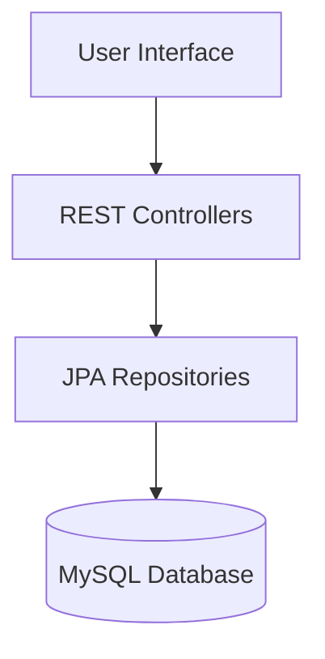

The Alpha Release established a functional
application foundation.

However, substantial application logic was
implemented directly within controller operations.

This increased coupling between HTTP request handling,
business rules, and persistence behavior.

### 10.2 Final Release Architecture

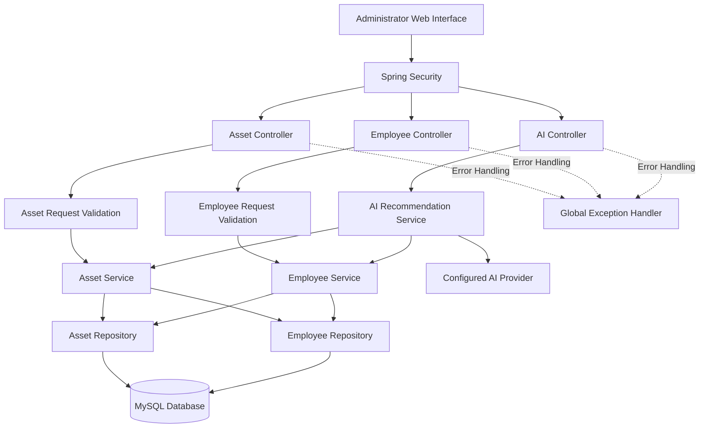

### 10.3 Architectural Improvements

| Concern | Alpha Release | Final Release |
|---|---|---|
| Business logic | Controller-oriented | Dedicated service layer |
| Request validation | Primarily frontend | Backend and frontend validation |
| Employee association | String-based | Relational entity association |
| Status management | Unrestricted strings | Controlled enumeration |
| Authentication | Not enforced | Spring Security |
| CSRF protection | Not implemented | Enabled |
| Error handling | Limited | Centralized |
| Inventory retrieval | Unpaginated | Paginated |
| AI integration | Not independently demonstrated | Live native generation verified |
| Automated testing | 8 tests | 138 tests |
| Code coverage | Not measured | JaCoCo reports |
| Deployment | Native application | Native and Docker deployment |
| CI/CD | Build and test | Build, test, coverage, and deployment verification |

### 10.4 Architectural Tradeoffs

The revised architecture improves separation
of concerns and testability.

However, additional layers introduce:

- More implementation components.
- Additional configuration requirements.
- More complex integration testing.
- Additional maintenance responsibilities.
- Dependency management requirements.

The service-oriented layered design was selected
because the application does not require the
operational complexity of distributed microservices.

The current architecture remains a modular
monolithic Spring Boot application.

This design provides a practical foundation
for future refinement without requiring distributed
service discovery, messaging infrastructure,
or independent service deployment.

---

## 11. Verification Traceability Matrix

The following evidence identifiers are used
throughout the verification register.

### 11.1 Evidence Register

| Evidence ID | Description |
|---|---|
| EV-001 | Alpha Release automated test baseline |
| EV-002 | Peer review feedback |
| EV-003 | Failed assignment preservation regression test |
| EV-004 | Final Release Maven Surefire reports |
| EV-005 | Final Release JaCoCo coverage report |
| EV-006 | Final GitHub Actions CI/CD workflow |
| EV-007 | Docker deployment verification evidence |
| EV-008 | Local inventory API performance measurements |
| EV-009 | Native AI recommendation execution logs |
| EV-010 | Git configuration and credential isolation checks |
| EV-011 | Native application startup logs |
| EV-012 | Local administrator login and application verification |
| EV-013 | Final Release documentation |
| EV-014 | Spring Data pagination serialization warning |
| EV-015 | GitHub Actions deprecated runtime warnings |

Evidence identifiers are documentation references.

They do not represent separate automated test cases.

### 11.2 Debt-to-Evidence Traceability

| Debt ID | Verification Method | Supporting Evidence |
|---|---|---|
| TD-001 | Asset validation tests | EV-004 |
| TD-002 | Duplicate serial handling | EV-004 |
| TD-003 | Invalid status and lifecycle tests | EV-004 |
| TD-004 | Assignment integration tests | EV-004 |
| TD-005 | Employee validation tests | EV-004 |
| TD-006 | Duplicate employee email tests | EV-004 |
| TD-007 | Email format validation | EV-004 |
| TD-008 | Assignment regression testing | EV-002, EV-003, EV-004 |
| TD-009 | Pagination and search tests | EV-004, EV-008 |
| TD-010 | Authentication and authorization | EV-004, EV-007, EV-012 |
| TD-011 | Employee existence validation | EV-004 |
| TD-012 | Deletion safeguard tests | EV-004 |
| TD-013 | HTTP response assertions | EV-004 |
| TD-014 | Employee pagination tests | EV-004, EV-008 |
| TD-015 | Employee relationship tests | EV-004 |
| TD-016 | Complete automated test execution | EV-001, EV-004, EV-006 |
| TD-017 | Code coverage measurement | EV-005 |
| TD-018 | Automated deployment verification | EV-006, EV-007 |
| TD-019 | Documentation and installation review | EV-007, EV-013 |
| TD-020 | AI integration and live generation | EV-004, EV-009 |
| TD-021 | API error response tests | EV-004 |
| TD-022 | Configuration and Git review | EV-010 |
| TD-023 | CSRF security tests | EV-004 |
| TD-030 | Local performance evaluation | EV-008, EV-009, EV-011 |
| TD-032 | Initial AI execution verification | EV-004, EV-009 |
| TD-035 | Runtime warning analysis | EV-014 |
| TD-036 | CI/CD dependency warning analysis | EV-015 |

The complete automated test report should be
consulted for individual test-case results.

A successful aggregate test count does not
independently establish that every possible
acceptance scenario was exercised.

### 11.3 Final Release CI/CD Artifacts

| Artifact | Reported Size | Purpose |
|---|---:|---|
| application-package | 54.1 MB | Executable application package |
| automated-test-reports | 25.7 KB | Maven Surefire reports |
| deployment-evidence | 3.69 KB | Deployment verification records |
| jacoco-coverage-report | 292 KB | Java code coverage reports |

Final workflow:

https://github.com/ilerioluwaa/ai-it-asset-management-system/actions/runs/45769400901

Repository:

https://github.com/ilerioluwaa/ai-it-asset-management-system

Implementation commit:

f85eb30

---

## 12. Quantitative Refinement Analysis

### 12.1 Automated Test Growth

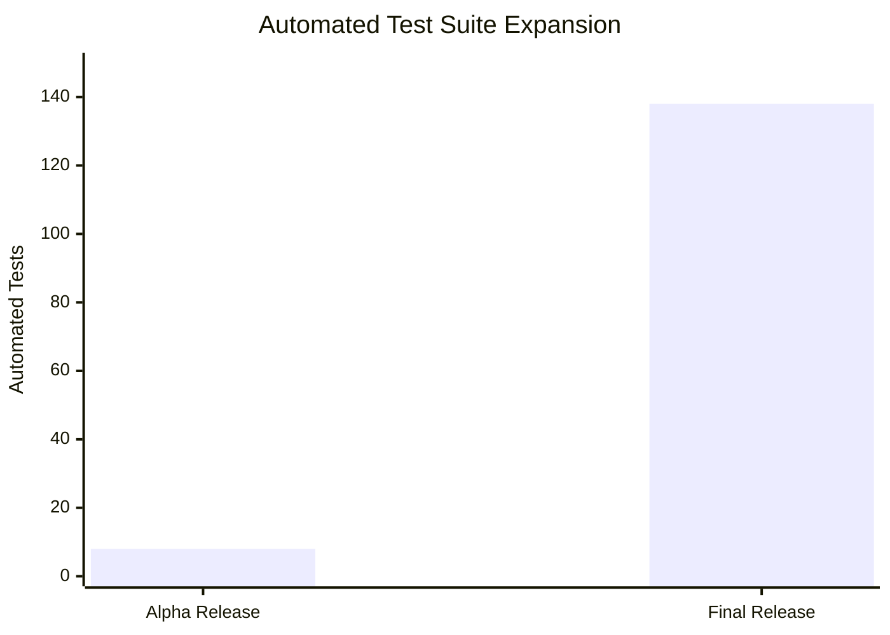

| Metric | Result |
|---|---:|
| Alpha automated tests | 8 |
| Final automated tests | 138 |
| Additional automated tests | 130 |
| Percentage increase | 1,625% |
| Expansion factor | 17.25 |

The increased test count reflects expanded
verification scope.

It does not establish a proportional increase
in application reliability.

### 12.2 Code Coverage Analysis

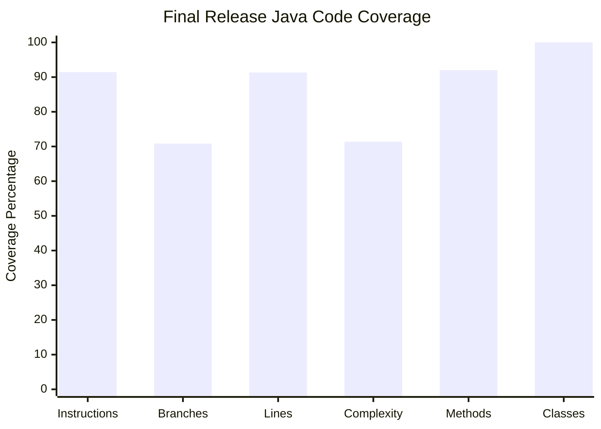

The coverage results establish substantial
execution of Java application code.

The 70.83% branch coverage result identifies
an important opportunity for additional
decision-path and exception testing.

No Alpha Release coverage percentage is available.

Consequently, a numerical coverage improvement
percentage cannot be calculated.

### 12.3 Local API Performance

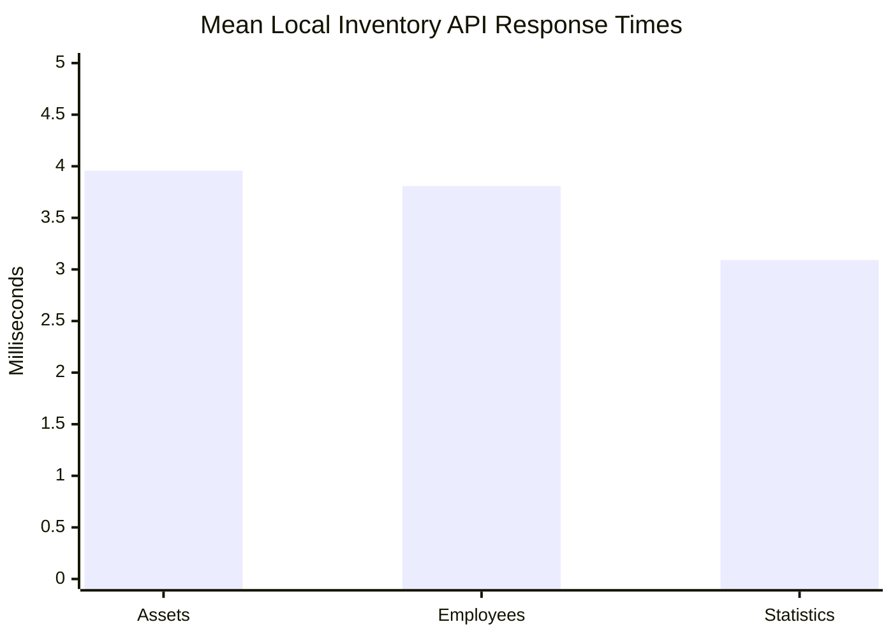

The measured inventory APIs completed 60 sequential
requests with no unsuccessful HTTP responses.

The combined mean was approximately 3.619 ms.

These measurements establish a local performance
baseline rather than a production capacity estimate.

No equivalent Alpha Release benchmark is available.

A percentage improvement in API latency is therefore
not claimed.

### 12.4 AI Recommendation Performance

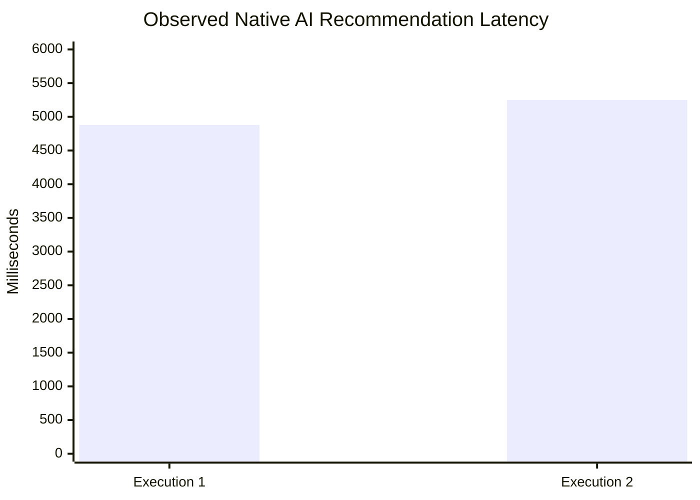

Observed mean:

5,064.5 ms.

AI recommendation generation requires substantially
more processing than ordinary inventory retrieval.

This difference supports maintaining AI as an
independent advisory capability rather than making
ordinary inventory operations dependent on AI availability.

The two recorded observations are insufficient
for statistically representative latency analysis.

### 12.5 CI/CD Evolution

| Capability | Alpha Release | Final Release |
|---|---|---|
| Automated compilation | Available | Available |
| Automated tests | Available | Expanded |
| Coverage reporting | Not available | Available |
| Executable artifact | Limited verification | Retained |
| Docker image construction | Not verified | Verified |
| MySQL-backed deployment | Not verified in CI | Verified |
| Health verification | Not included | Included |
| Protected API smoke tests | Not included | Included |
| Deployment evidence | Not included | Retained |

The Final Release pipeline extends continuous
integration into automated deployment verification.

It does not continuously publish the application
to a permanent production environment.

---

## 13. Security Risk Alignment

The technical debt assessment incorporates the
STRIDE threat classification model.

| STRIDE Category | Related Debt | Implemented Mitigation | Remaining Concern |
|---|---|---|---|
| Spoofing | TD-010, TD-025 | Administrator authentication | Persistent identity and MFA |
| Tampering | TD-008, TD-012, TD-023, TD-028 | Validation, authorization, CSRF, assignment safeguards | Concurrent updates |
| Repudiation | TD-026 | Limited application logging | Dedicated audit history |
| Information Disclosure | TD-010, TD-022, TD-033 | Access control and credential isolation | Secret scanning and production HTTPS |
| Denial of Service | TD-027, TD-034 | Authentication and provider timeout handling | Rate and resource limits |
| Elevation of Privilege | TD-010, TD-025 | Administrator access restrictions | Granular role management |

### 13.1 Security Verification Scope

Verified security controls include:

- Administrator authentication.
- Protected API access.
- Session-based authorization.
- CSRF protection.
- Controlled validation responses.
- Credential externalization.
- Local deployment network restrictions.

### 13.2 Outstanding Security Assurance

The following activities remain outside the
completed Final Release verification scope:

- Independent penetration testing.
- Comprehensive dependency vulnerability scanning.
- Full repository secret scanning.
- Production TLS configuration.
- Persistent identity management.
- Comprehensive security audit logging.
- Concurrent authorization and integrity testing.
- Long-duration resource exhaustion testing.

The application must not be described as
comprehensively security-certified.

---

## 14. Responsible AI Risk Management

The AI integration introduces additional risks
requiring explicit governance.

| Risk | Current Mitigation | Remaining Limitation |
|---|---|---|
| Employee information disclosure | Aggregate numerical inventory data | Provider retention policies require review |
| Unsupported recommendations | Structured instructions and human review | Accuracy is not guaranteed |
| Discriminatory recommendations | Restricted analysis scope | Representative fairness evaluation required |
| Unauthorized modifications | Advisory recommendation design | Human operational decisions require oversight |
| Provider unavailability | Timeout and error handling | No verified automatic provider failover |
| Excessive provider costs | Optional AI configuration | Comprehensive usage governance remains outstanding |
| Outdated recommendations | Current inventory snapshot | Inventory may change after generation |
| Excessive reliance on AI | Administrator review requirement | User judgment remains necessary |

### 14.1 Human Oversight

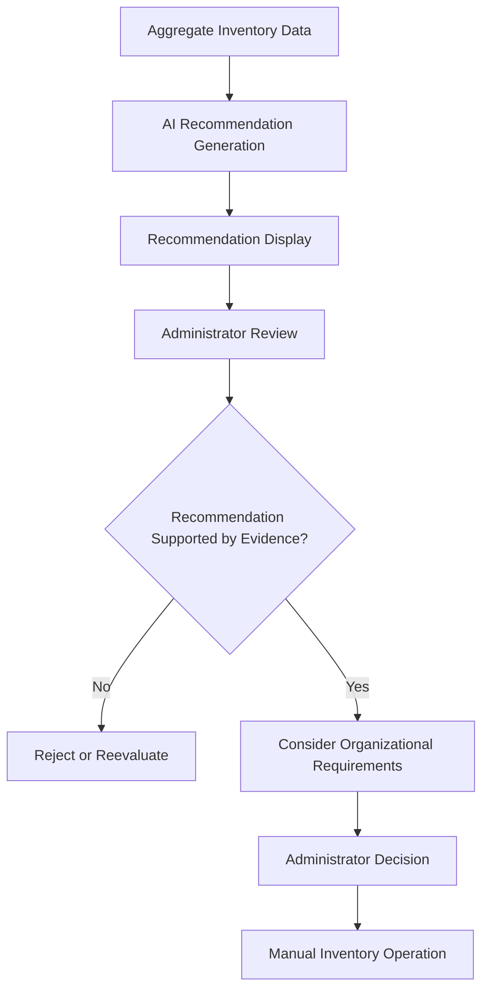

The AI service does not independently authorize
equipment assignments, deletions, retirement,
or procurement decisions.

Administrators remain responsible for operational actions.

### 14.2 AI Verification Distinctions

The project distinguishes:

- Functional AI integration.
- Provider communication reliability.
- Recommendation generation latency.
- Recommendation factual accuracy.
- Recommendation usefulness.
- Recommendation fairness.
- Production AI service availability.

Functional integration and initial live generation
have supporting verification evidence.

Comprehensive recommendation quality, fairness,
and production availability evaluation remain
outstanding.

---

## 15. Technical Debt Progress Summary

### 15.1 Original Register

The original Final Release Candidate register
contained 34 documented technical debt items.

| Status | Original Count |
|---|---:|
| Verification Pending | 25 |
| Deferred | 9 |
| Verified | 0 |
| Total | 34 |

### 15.2 Updated Final Release Register

Two additional maintenance concerns were identified
during Final Release verification.

The updated register contains 36 items.

| Status | Final Count |
|---|---:|
| Verified | 21 |
| Partially Verified | 4 |
| Deferred | 11 |
| Verification Pending | 0 |
| Total | 36 |

### 15.3 Verification Completion

Verification Completion =

Verified Items / Total Documented Items x 100

21 / 36 x 100 = 58.33%

### 15.4 Partial Verification Percentage

4 / 36 x 100 = 11.11%

### 15.5 Deferred Technical Debt Percentage

11 / 36 x 100 = 30.56%

### 15.6 Technical Debt Distribution

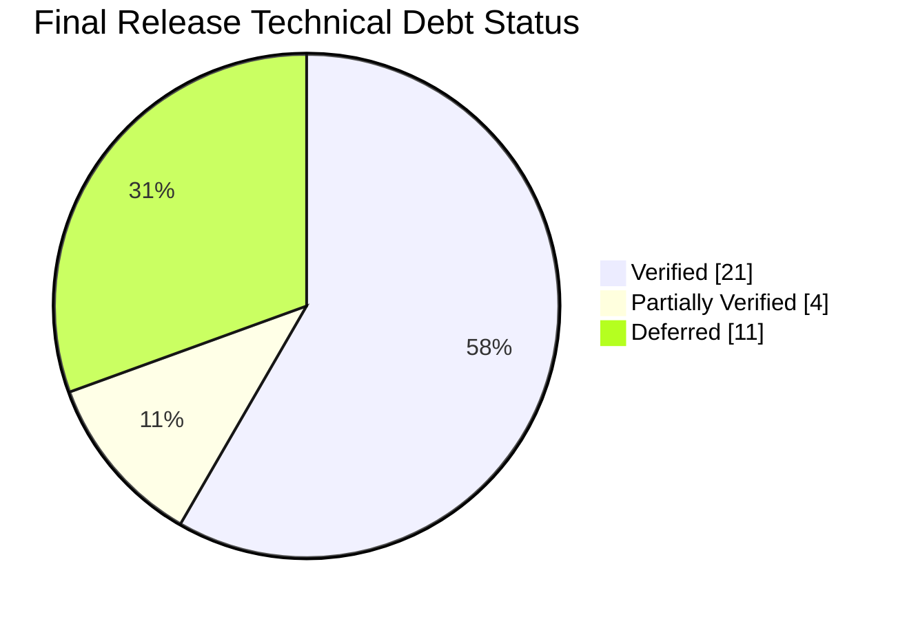

### 15.7 Original Register Comparison

Using only the original 34 debt identifiers:

| Status | Initial | Final |
|---|---:|---:|
| Verified | 0 | 21 |
| Partially Verified | 0 | 4 |
| Verification Pending | 25 | 0 |
| Deferred | 9 | 9 |
| Total | 34 | 34 |

Original-register verification completion:

21 / 34 x 100 = 61.76%

Of the original 25 verification-pending items:

- 21 have been classified as verified.
- 4 have been classified as partially verified.

Verification of original pending items:

21 / 25 x 100 = 84%

The remaining four items have implementation
or operational evidence but require additional
verification activities.

### 15.8 Critical Technical Debt Progress

| Critical Debt | Initial Status | Final Status |
|---|---|---|
| TD-008 | Verification Pending | Verified |
| TD-010 | Verification Pending | Verified |
| TD-012 | Verification Pending | Verified |
| TD-023 | Verification Pending | Verified |

Originally classified critical debt items
with release-scope verification:

4 / 4 x 100 = 100%

This percentage applies only to the four
identified critical items in the register.

It does not establish the absence of undiscovered
critical defects or vulnerabilities.

### 15.9 Interpretation

The Final Release demonstrates substantial
technical debt remediation while preserving
transparency regarding outstanding limitations.

The verification completion percentage is not
a measurement of total application functionality,
academic grade, or production readiness.

The remaining items represent future verification
and engineering obligations.

---

## 16. Outstanding Technical Debt Roadmap

The following roadmap represents proposed engineering
work after the academic Final Release.

It is not a committed production delivery schedule.

### 16.1 Proposed Remediation Schedule

| Timeframe | Debt ID | Planned Activity | Expected Outcome |
|---|---|---|---|
| Week 1 | TD-019 | Independent clean installation review | Reproducible installation |
| Week 1 | TD-022 | Automated repository secret scanning | Stronger credential assurance |
| Week 1 | TD-036 | Upgrade affected GitHub Actions dependencies | Remove runtime warnings |
| Weeks 1-2 | TD-024 | Version-controlled database migrations | Safe schema evolution |
| Weeks 1-2 | TD-035 | Stable pagination response DTO | Reliable API contract |
| Weeks 1-3 | TD-028 | Concurrent allocation controls | Prevent conflicting assignments |
| Weeks 2-3 | TD-032 | Structured AI quality evaluation | Evidence-based AI assessment |
| Weeks 2-4 | TD-026 | Security audit logging | Administrative accountability |
| Weeks 3-5 | TD-025 | Persistent identity management | Granular account administration |
| Weeks 3-5 | TD-027 | Authentication and API rate limiting | Improved resource protection |
| Weeks 4-6 | TD-029 | Database query optimization | Reduced database overhead |
| Weeks 4-6 | TD-031 | Searchable employee selection | Bounded selection retrieval |
| Weeks 4-6 | TD-030 | Concurrent and large-dataset benchmarks | Stronger performance evidence |
| Weeks 5-7 | TD-034 | AI resource governance | Controlled AI consumption |
| Weeks 6-8 | TD-033 | Secure production deployment | HTTPS-enabled deployment |

### 16.2 Proposed Roadmap Visualization

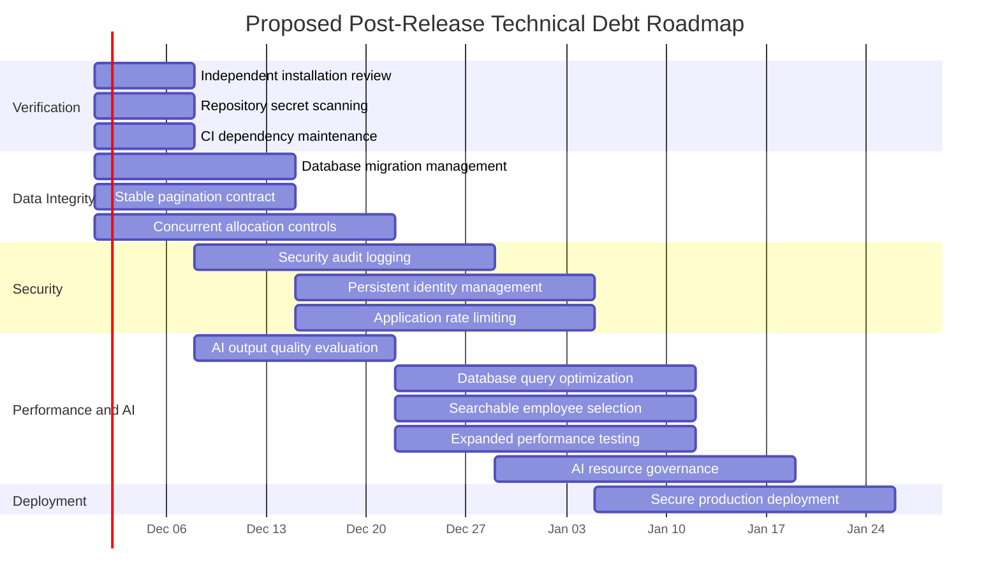

The calendar dates are illustrative planning dates.

Actual scheduling depends on development resources,
organizational requirements, and verification results.

### 16.3 Proposed Production Readiness Gates

Before broader organizational deployment, the
following gates should be evaluated:

| Gate | Required Outcome |
|---|---|
| Database migration | Existing records migrate safely |
| Concurrency | Conflicting assignments are handled correctly |
| Identity management | Authorized account lifecycle is supported |
| Audit logging | Administrative operations are traceable |
| Credential assurance | Repository secret scan is reviewed |
| Transport security | Remote application traffic uses HTTPS |
| Resource governance | Authentication and AI requests are bounded |
| Performance | Representative workload requirements are satisfied |
| AI quality | Recommendation outputs are systematically evaluated |
| Operational recovery | Backup and recovery procedures are tested |
| Dependency maintenance | Supported dependency versions are established |

These gates are proposed future release criteria.

They have not all been satisfied by the current release.

---

## 17. Technical Debt Review Process

Technical debt should be reviewed during each
development iteration.

Recommended review activities:

1. Identify newly discovered issues.
2. Assign a unique technical debt identifier.
3. Document the root cause.
4. Assess operational impact.
5. Evaluate likelihood.
6. Assign remediation priority.
7. Define measurable acceptance criteria.
8. Identify affected application components.
9. Implement approved corrective actions.
10. Execute appropriate verification activities.
11. Retain supporting evidence.
12. Document residual risks.
13. Update the technical debt status.
14. Reevaluate outstanding priorities.

### 17.1 Definition of Done

A technical debt item should be classified as
verified only when:

- The root cause is documented.
- Corrective action has been implemented.
- Relevant acceptance criteria are defined.
- Appropriate verification has been executed.
- Supporting evidence is retained.
- Remaining limitations are disclosed.
- The implementation is traceable through version control.

### 17.2 Technical Debt Closure Template

| Field | Required Information |
|---|---|
| Debt ID | Unique technical debt identifier |
| Root Cause | Explanation of the original weakness |
| Impact | Operational or engineering consequences |
| Corrective Action | Implemented remediation |
| Acceptance Criteria | Required verification outcomes |
| Evidence | Test reports, logs, or operational records |
| Commit | Relevant version control reference |
| Residual Risk | Remaining limitations |
| Status | Current verification classification |

New defects discovered during testing should
be added to the register rather than omitted
from reporting.

---

## 18. Evidence and Professional Integrity

Technical debt remediation must be supported
by reproducible engineering evidence.

Acceptable evidence includes:

- Automated test reports.
- Regression test results.
- Git commit history.
- Code coverage reports.
- API response verification.
- Application demonstrations.
- Database verification.
- Deployment logs.
- Performance measurements.
- Peer review feedback.
- Dependency and runtime warnings.

Screenshots supplement these records but do not
independently establish complete system functionality.

### 18.1 Evidence Classification

The project distinguishes:

| Classification | Meaning |
|---|---|
| Proposed | Engineering work has been planned |
| Implemented | Source-code or configuration changes exist |
| Tested | Relevant automated or manual verification has occurred |
| Verified | Defined release-scope acceptance criteria have supporting evidence |
| Deferred | Additional engineering work remains |
| Illustrative | Example data or expected outcomes rather than observed results |

### 18.2 AI-Assisted Development Disclosure

AI-assisted development was used to support:

- Technical analysis.
- Implementation refinement.
- Test design.
- Documentation development.
- Architectural evaluation.
- Technical debt identification.
- Risk assessment.

Generated implementation and documentation
require developer review and verification.

The project developer remains responsible for
the correctness of the submitted implementation,
reported measurements, and engineering conclusions.

### 18.3 Verification Limitations

The Final Release evidence does not establish:

- Exhaustive defect detection.
- Complete security assurance.
- Production-scale throughput.
- Long-term service availability.
- Complete frontend test coverage.
- Comprehensive AI output accuracy.
- Comprehensive AI fairness evaluation.
- Successful migration of historical Alpha Release data.
- Permanent public production deployment.
- Successful live AI generation inside the verified Docker environment.

These limitations are disclosed to maintain
professional and academic integrity.

---

## 19. Engineering Principles and Methodology Alignment

The technical debt refinement strategy reflects
established software engineering principles.

### 19.1 Separation of Concerns

The introduction of dedicated controllers,
services, repositories, DTOs, and exception
handling improves architectural separation.

Business rules are maintained independently
of direct HTTP request handling.

### 19.2 Regression Testing

The assignment preservation defect demonstrates
the importance of reproducing failures before
implementing corrective changes.

The regression test established a measurable
failure condition that informed the remediation.

### 19.3 Shift-Left Quality Assurance

Validation, security controls, and automated
testing are incorporated into the development
and continuous integration lifecycle.

This approach supports earlier identification
of defects rather than relying exclusively on
manual release verification.

### 19.4 Continuous Integration

The GitHub Actions workflow provides repeatable
build, test, coverage, and deployment verification.

This reduces reliance on isolated manual
verification procedures.

### 19.5 Defense in Depth

The application combines multiple safeguards:

- Request validation.
- Service-level business rules.
- Database constraints.
- Authentication.
- Authorization.
- CSRF protection.
- Credential isolation.
- Local deployment restrictions.

These controls provide complementary protection.

They do not eliminate the need for additional
security assurance.

### 19.6 Responsible AI

The AI recommendation module is designed as
an advisory capability.

Aggregate data processing and human oversight
reduce unnecessary exposure and autonomous
operational decision-making.

### 19.7 Continuous Improvement

Remaining technical debt is explicitly retained
in the engineering roadmap.

The release process recognizes that successful
delivery does not eliminate future maintenance
or verification responsibilities.

---

## 20. Engineering References

The following resources provide additional
guidance for the engineering practices and
future remediation activities described
in this document.

### Software Engineering Institute

Software Engineering Institute, Carnegie Mellon University.

https://www.sei.cmu.edu/

Relevant areas:

- Software architecture.
- Technical debt management.
- Software quality.
- Engineering risk assessment.

### IEEE Computer Society

Guide to the Software Engineering Body of Knowledge.

https://www.computer.org/education/bodies-of-knowledge/software-engineering

Relevant areas:

- Software design.
- Software construction.
- Software testing.
- Software maintenance.
- Software engineering quality.

### OWASP Foundation

OWASP Application Security Verification Standard.

https://owasp.org/www-project-application-security-verification-standard/

Relevant areas:

- Authentication.
- Access control.
- Input validation.
- Session management.
- Application security verification.

### National Institute of Standards and Technology

Artificial Intelligence Risk Management Framework.

https://www.nist.gov/itl/ai-risk-management-framework

Relevant areas:

- AI governance.
- AI risk identification.
- Measurement and evaluation.
- Human oversight.

### Spring Security

Official Spring Security reference documentation.

https://docs.spring.io/spring-security/reference/

Relevant areas:

- Authentication.
- Authorization.
- CSRF protection.
- Session management.

### Spring Data

Official Spring Data documentation.

https://docs.spring.io/spring-data/

Relevant areas:

- Repository abstractions.
- Pagination.
- Entity persistence.
- Stable response serialization.

### JaCoCo

Java Code Coverage Library.

https://www.jacoco.org/jacoco/

Relevant areas:

- Instruction coverage.
- Branch coverage.
- Line coverage.
- Maven integration.

### GitHub Actions

Official GitHub Actions documentation.

https://docs.github.com/en/actions

Relevant areas:

- Continuous integration.
- Workflow automation.
- Deployment verification.
- Artifact retention.
- Dependency maintenance.

These references provide methodological and
technical guidance.

The project does not claim formal certification
or complete compliance with every referenced
framework or standard.

---

## 21. Conclusion

The Alpha Release established the initial
foundation for the AI-Powered IT Asset
Management System.

Peer review, regression testing, and architectural
analysis identified weaknesses in assignment integrity,
validation, security, scalability, automated testing,
and deployment reproducibility.

The Final Release addresses these concerns through
a more structured architecture, expanded automated
verification, functional AI integration, and
containerized deployment.

Recorded engineering outcomes include:

- Expansion from 8 to 138 automated tests.
- Successful completion of all 138 tests.
- 91.32% Java line coverage.
- 70.83% Java branch coverage.
- Regression coverage for assignment preservation.
- Administrator authentication and authorization.
- Successful native AI recommendation generation.
- Successful Docker deployment verification.
- Successful GitHub Actions CI/CD execution.
- Quantitative local performance measurements.
- Expanded technical documentation.

The updated technical debt register contains
36 documented items.

Of these:

- 21 are classified as verified within the release scope.
- 4 are classified as partially verified.
- 11 remain deferred.

All four originally classified critical technical
debt items have release-scope verification evidence.

Remaining limitations are explicitly documented
to support responsible engineering decisions,
future maintenance, and additional verification.

The Final Release represents a substantial
improvement over the Alpha Release while
maintaining transparency regarding outstanding
production-readiness requirements.

---

AI-Powered IT Asset Management System

Version: 1.0.0 - Final Release

CMSC 495 - Computer Capstone Project

University of Maryland Global Campus

November 2026
