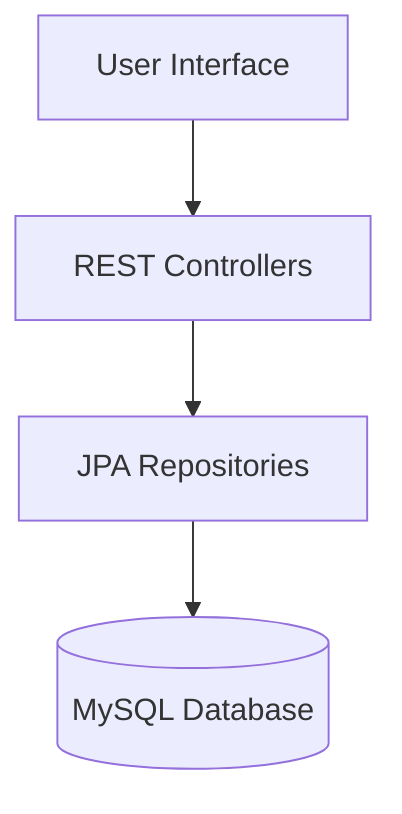
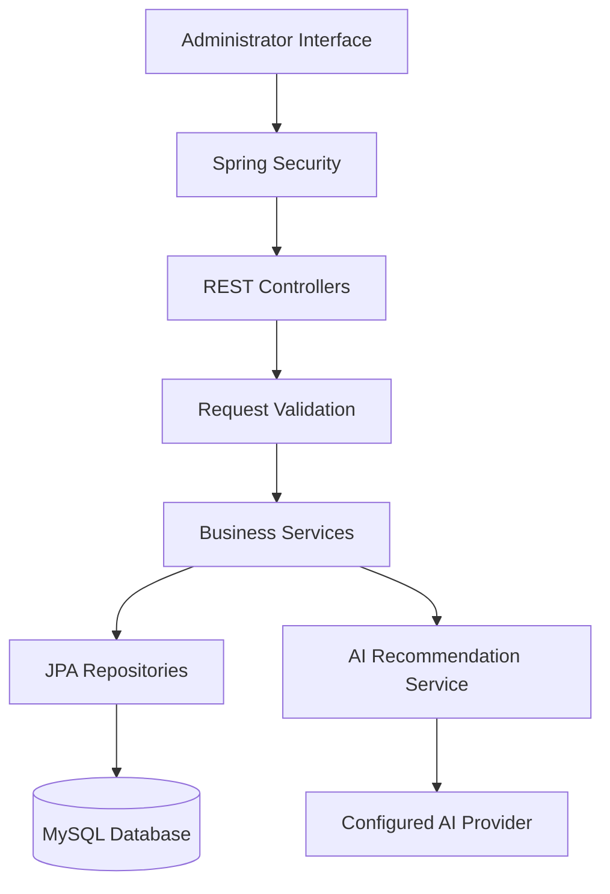

# Technical Debt and Refinement Register

AI-Powered IT Asset Management System

Version: 1.0.0 - Final Release Candidate

## 1. Purpose

This document identifies, evaluates, prioritizes, and tracks
technical debt associated with the development of the
AI-Powered IT Asset Management System.

Technical debt refers to implementation decisions, architectural
limitations, incomplete functionality, and deferred engineering
activities that may increase future maintenance costs or introduce
operational risks.

The purpose of this register is to:

- Identify technical weaknesses.
- Evaluate their operational consequences.
- Establish remediation priorities.
- Document refinement strategies.
- Define measurable acceptance criteria.
- Maintain transparency regarding unresolved limitations.
- Support continuous software quality improvement.

## 2. Alpha Release Baseline

The Alpha Release established the initial application foundation,
including:

- Spring Boot application architecture.
- MySQL database integration.
- Asset registration and management.
- REST API endpoints.
- Web-based inventory interface.
- Initial employee backend functionality.
- Automated asset API testing.
- GitHub Actions continuous integration.

The original automated test suite completed eight tests
with no failures, errors, or skipped tests.

Subsequent peer review and source-code analysis identified
opportunities to improve validation, data integrity, security,
module integration, scalability, and deployment reproducibility.

A targeted regression test also reproduced an asset assignment
preservation defect.

## 3. Technical Debt Assessment Methodology

Technical debt is evaluated using two factors:

### Impact

| Score | Classification | Description |
|---|---|---|
| 1 | Low | Minor inconvenience or maintenance concern |
| 2 | Moderate | Reduced usability or maintainability |
| 3 | Significant | Operational inefficiency or functional degradation |
| 4 | High | Major functional or data integrity risk |
| 5 | Critical | Severe security, reliability, or data integrity risk |

### Likelihood

| Score | Classification | Description |
|---|---|---|
| 1 | Rare | Unlikely under expected operating conditions |
| 2 | Unlikely | Possible under unusual conditions |
| 3 | Possible | May occur during normal operations |
| 4 | Likely | Expected to occur repeatedly |
| 5 | Frequent | Expected during routine use |

### Risk Score

Risk Score = Impact x Likelihood

### Priority Classification

| Risk Score | Priority |
|---|---|
| 20-25 | Critical |
| 12-19 | High |
| 6-11 | Medium |
| 1-5 | Low |

Risk scores represent engineering assessments rather than
statistically measured failure probabilities.

## 4. Technical Debt Status Definitions

| Status | Meaning |
|---|---|
| Identified | Technical debt has been documented |
| Remediation Drafted | Revised implementation has been prepared |
| Verification Pending | Remediation requires execution and testing |
| Verified | Acceptance criteria have been demonstrated |
| Deferred | Remediation is planned for future development |
| Accepted | Residual risk has been explicitly acknowledged |

A technical debt item must not be marked Verified solely
because replacement source code has been written.

Verification requires appropriate testing or operational evidence.

## 5. Alpha Release Peer Review

Peer reviewer: Jose Rodriguez-Stahr.

The peer review identified several opportunities for refinement.

### Assignment Preservation

The Alpha Release asset update operation could unintentionally
remove an existing employee assignment.

The frontend did not include the assigned employee value
when submitting an asset update.

The backend replaced the existing assignment with the
incoming value, even when that value was absent.

### Server-Side Validation

The reviewer recommended enforcing required fields and
valid asset statuses at the backend level.

Client-side validation alone does not protect the API
from invalid direct requests.

### Authorization

The reviewer recommended restricting asset modification
and deletion operations to authorized users.

### Scalability

The reviewer recommended pagination rather than repeatedly
retrieving the entire inventory after each modification.

### Documentation

The reviewer recommended improving MySQL configuration
and installation instructions.

These findings informed the Final Release refinement strategy.

## 6. Technical Debt Register

The following register summarizes the identified technical debt.

| ID | Technical Debt | Impact | Likelihood | Score | Priority | Status |
|---|---|---:|---:|---:|---|---|
| TD-001 | Missing server-side asset validation | 4 | 4 | 16 | High | Verification Pending |
| TD-002 | Duplicate asset serial numbers | 4 | 4 | 16 | High | Verification Pending |
| TD-003 | Unrestricted asset status values | 4 | 4 | 16 | High | Verification Pending |
| TD-004 | Missing relational employee association | 4 | 4 | 16 | High | Verification Pending |
| TD-005 | Missing employee field validation | 4 | 3 | 12 | High | Verification Pending |
| TD-006 | Duplicate employee email addresses | 4 | 3 | 12 | High | Verification Pending |
| TD-007 | Invalid employee email formats | 3 | 3 | 9 | Medium | Verification Pending |
| TD-008 | Existing employee assignment overwritten | 5 | 5 | 25 | Critical | Verification Pending |
| TD-009 | Unpaginated asset inventory | 3 | 4 | 12 | High | Verification Pending |
| TD-010 | Missing authentication and authorization | 5 | 5 | 25 | Critical | Verification Pending |
| TD-011 | Missing employee existence validation | 4 | 4 | 16 | High | Verification Pending |
| TD-012 | Missing deletion safeguards | 5 | 4 | 20 | Critical | Verification Pending |
| TD-013 | Inconsistent API response status codes | 2 | 3 | 6 | Medium | Verification Pending |
| TD-014 | Unpaginated employee directory | 3 | 3 | 9 | Medium | Verification Pending |
| TD-015 | Stale employee names in asset records | 4 | 3 | 12 | High | Verification Pending |
| TD-016 | Limited automated test coverage | 4 | 4 | 16 | High | Verification Pending |
| TD-017 | Missing code coverage measurement | 3 | 4 | 12 | High | Verification Pending |
| TD-018 | Missing automated deployment verification | 4 | 3 | 12 | High | Verification Pending |
| TD-019 | Incomplete installation documentation | 3 | 4 | 12 | High | Verification Pending |
| TD-020 | Incomplete functional AI integration | 4 | 4 | 16 | High | Verification Pending |
| TD-021 | Missing centralized exception handling | 3 | 4 | 12 | High | Verification Pending |
| TD-022 | Insufficient configuration and credential isolation | 5 | 3 | 15 | High | Verification Pending |
| TD-023 | Missing CSRF protection | 5 | 4 | 20 | Critical | Verification Pending |
| TD-024 | Missing database migration management | 5 | 3 | 15 | High | Deferred |
| TD-025 | Missing persistent identity management | 4 | 3 | 12 | High | Deferred |
| TD-026 | Missing security audit logging | 4 | 3 | 12 | High | Deferred |
| TD-027 | Missing application rate limiting | 4 | 3 | 12 | High | Deferred |
| TD-028 | Concurrent asset allocation risk | 5 | 3 | 15 | High | Deferred |
| TD-029 | Additional employee assignment count queries | 3 | 3 | 9 | Medium | Deferred |
| TD-030 | Missing comprehensive performance benchmarks | 4 | 3 | 12 | High | Verification Pending |
| TD-031 | Unbounded employee selection retrieval | 3 | 3 | 9 | Medium | Deferred |
| TD-032 | Limited AI output quality evaluation | 4 | 3 | 12 | High | Verification Pending |
| TD-033 | Missing production HTTPS deployment | 5 | 3 | 15 | High | Deferred |
| TD-034 | Missing AI request and output limits | 4 | 3 | 12 | High | Deferred |

## 7. Detailed Technical Debt Analysis

### TD-001: Missing Server-Side Asset Validation

Root cause:

The Alpha Release relied primarily on frontend required-field
validation without comprehensive backend validation constraints.

Impact:

Invalid or incomplete asset records could be submitted
directly to the REST API.

Remediation:

- Introduce AssetRequest data transfer objects.
- Apply Jakarta Bean Validation annotations.
- Enforce required fields and maximum field lengths.
- Validate requests using the controller's Valid annotation.

Affected components:

- Asset.java
- AssetRequest.java
- AssetController.java
- AssetService.java
- GlobalExceptionHandler.java

Acceptance criteria:

- Missing asset names are rejected.
- Blank categories are rejected.
- Invalid serial numbers are rejected.
- Excessive field lengths are rejected.
- Invalid requests return HTTP 400.

Status: Verification Pending.

### TD-002: Duplicate Asset Serial Numbers

Root cause:

The Alpha Release did not enforce serial number uniqueness
through comprehensive service and database constraints.

Impact:

Duplicate records could reduce inventory accuracy and
equipment traceability.

Remediation:

- Normalize serial numbers to uppercase.
- Check for existing serial numbers.
- Enforce database-level uniqueness.
- Return HTTP 409 for duplicate records.

Affected components:

- Asset.java
- AssetRepository.java
- AssetService.java
- AssetControllerTest.java

Acceptance criteria:

- Duplicate serial numbers are rejected.
- Case variations cannot bypass uniqueness checks.
- Updating an asset without changing its own serial number
  remains permitted.

Status: Verification Pending.

### TD-003: Unrestricted Asset Status Values

Root cause:

Asset status was represented using an unrestricted string.

Impact:

Unsupported status values could create inconsistent inventory
records and inaccurate dashboard statistics.

Remediation:

Introduce the AssetStatus enumeration.

Supported values:

- AVAILABLE
- ASSIGNED
- MAINTENANCE
- RETIRED

Affected components:

- AssetStatus.java
- Asset.java
- AssetRequest.java
- AssetService.java

Acceptance criteria:

- Unsupported status values are rejected.
- Missing statuses are rejected.
- Retired assets cannot return to active service.

Status: Verification Pending.

### TD-004: Missing Relational Employee Association

Root cause:

The Alpha Release represented assigned employees using
a string field instead of a relational association.

Impact:

Asset assignments were not reliably connected to existing
employee records.

Remediation:

- Introduce a ManyToOne relationship.
- Store the employee identifier as a foreign key.
- Retrieve employee information through the relationship.
- Maintain assignment consistency through service operations.

Affected components:

- Asset.java
- Employee.java
- AssetRepository.java
- AssetService.java
- EmployeeService.java

Acceptance criteria:

- An employee can receive multiple assets.
- An asset can reference only one employee.
- Assigned assets reference existing employees.
- Unassigned assets do not retain employee associations.

Status: Verification Pending.

### TD-005: Missing Employee Field Validation

Root cause:

Employee registration did not enforce comprehensive
required-field and length constraints.

Impact:

Incomplete employee records could reduce equipment
assignment reliability.

Remediation:

- Introduce EmployeeRequest.
- Apply required-field validation.
- Enforce maximum field lengths.
- Validate employee creation and update requests.

Acceptance criteria:

- Blank employee names are rejected.
- Missing departments are rejected.
- Invalid field lengths return HTTP 400.

Status: Verification Pending.

### TD-006: Duplicate Employee Email Addresses

Root cause:

Employee email uniqueness was not enforced.

Impact:

Duplicate employee identities could create ambiguity
during equipment allocation.

Remediation:

- Normalize email addresses to lowercase.
- Introduce repository uniqueness checks.
- Enforce database uniqueness constraints.

Acceptance criteria:

- Duplicate employee email addresses are rejected.
- Case variations cannot bypass duplicate checks.
- Updating an employee's existing email remains permitted.

Status: Verification Pending.

### TD-007: Invalid Employee Email Formats

Root cause:

Employee email fields did not enforce email format validation.

Impact:

Invalid contact information could reduce employee record
quality.

Remediation:

Apply Jakarta Bean Validation Email constraints.

Acceptance criteria:

- Malformed email addresses return HTTP 400.
- Valid email addresses are accepted.

Status: Verification Pending.

### TD-008: Existing Employee Assignment Overwritten

Root cause:

The Alpha Release asset controller unconditionally copied
the incoming assignedTo field into the existing asset.

The frontend did not submit that field when editing
ordinary asset information.

Original implementation:

```java
existingAsset.setAssignedTo(updatedAsset.getAssignedTo());
```

When the incoming value was absent, the existing employee
assignment could be replaced with null.

Impact:

- Loss of equipment assignment information.
- Reduced inventory accountability.
- Inconsistent asset status and employee records.
- Potential operational confusion.

Priority: Critical.

### Regression Evidence

A targeted Alpha Release regression test was introduced:

```java
updateAssetPreservesExistingEmployeeAssignment()
```

The test created an assigned asset associated with
John Smith and attempted to update the asset without
submitting the employee assignment.

Observed result:

| Metric | Result |
|---|---|
| Expected employee assignment | John Smith |
| Actual employee assignment | null |
| Total tests executed | 9 |
| Failures | 1 |
| Errors | 0 |
| Skipped | 0 |
| Build result | BUILD FAILURE |

The regression test demonstrated that the defect
was reproducible.

### Remediation

The Final Release design replaces string-based employee
assignments with a relational employee association.

The revised update operation preserves the existing employee
identifier when an assigned asset is updated without supplying
a replacement employee identifier.

Relevant implementation logic:

```java
if (request.status() == AssetStatus.ASSIGNED
        && employeeId == null
        && existingAsset.getAssignedEmployee() != null) {

    employeeId = existingAsset
            .getAssignedEmployee()
            .getId();
}
```

This snippet illustrates the intended preservation logic.

The revised assignment is then validated and persisted
through the service layer.

### Acceptance Criteria

- Create an employee.
- Create an asset assigned to that employee.
- Update the asset name without supplying employeeId.
- Retain ASSIGNED status.
- Verify that the original employee association remains.
- Retrieve the updated record from the API.
- Verify the employee relationship after persistence.

Expected result:

The updated asset retains its original employee association.

Verification evidence required:

- Successful revised regression test.
- Maven Surefire test report.
- Manual application verification.
- Git commit containing the remediation.

Status: Verification Pending.

### TD-009: Unpaginated Asset Inventory

Root cause:

The Alpha Release retrieved the entire asset inventory
during inventory refresh operations.

Impact:

Increasing inventory size could increase response payloads,
database workload, and frontend rendering costs.

Remediation:

- Introduce Spring Data pagination.
- Apply a default page size of ten.
- Limit requested page size to 100.
- Add search and status filtering.
- Add frontend pagination controls.

Acceptance criteria:

- The API returns paginated results.
- Page size limits are enforced.
- Search and status filters return matching records.
- Navigation between pages preserves correct results.

Status: Verification Pending.

### TD-010: Missing Authentication and Authorization

Root cause:

The Alpha Release API did not enforce administrator
authentication and authorization.

Impact:

Unauthorized users could potentially retrieve, modify,
or delete organizational records.

Priority: Critical.

Remediation:

- Integrate Spring Security.
- Configure administrator authentication.
- Apply BCrypt password hashing.
- Restrict application resources to administrator roles.
- Establish session-based authentication.
- Protect administrative API endpoints.

Acceptance criteria:

- Unauthenticated API retrieval returns HTTP 401.
- Unauthorized roles receive HTTP 403.
- Valid administrator credentials permit authentication.
- Invalid credentials are rejected.
- Logout terminates the authenticated session.

Status: Verification Pending.

### TD-011: Missing Employee Existence Validation

Root cause:

String-based assignments did not require an existing
employee record.

Impact:

Assets could reference nonexistent employees.

Remediation:

Validate employee identifiers through EmployeeRepository
before creating or updating assignments.

Acceptance criteria:

- Assignment to an existing employee succeeds.
- Assignment to a nonexistent employee returns HTTP 404.
- Invalid employee identifiers are rejected.

Status: Verification Pending.

### TD-012: Missing Deletion Safeguards

Root cause:

Deletion operations did not comprehensively enforce
equipment assignment dependencies.

Impact:

Deleting assigned assets or employees could remove
important operational relationships.

Remediation:

- Prevent deletion of assigned assets.
- Prevent deletion of employees with assigned assets.
- Require equipment return before deletion.
- Enforce relational database integrity.

Acceptance criteria:

- Assigned asset deletion returns HTTP 409.
- Employee deletion with assigned equipment returns HTTP 409.
- Eligible deletion succeeds after unassignment.

Status: Verification Pending.

### TD-013: Inconsistent API Response Status Codes

Root cause:

The Alpha Release used different response conventions
across asset and employee endpoints.

Impact:

Inconsistent API behavior increased client integration
complexity.

Remediation:

Standardize HTTP response conventions.

- HTTP 200 for retrieval and updates.
- HTTP 201 for resource creation.
- HTTP 204 for successful deletion.
- HTTP 400 for invalid input.
- HTTP 404 for missing resources.
- HTTP 409 for business conflicts.

Acceptance criteria:

Automated tests verify the expected HTTP status codes.

Status: Verification Pending.

### TD-014: Unpaginated Employee Directory

Root cause:

Employee retrieval did not support paginated responses.

Impact:

Large employee directories could increase database
and frontend processing requirements.

Remediation:

- Introduce paginated employee retrieval.
- Add keyword search.
- Add department filtering.
- Add frontend page navigation.

Acceptance criteria:

- Employee retrieval supports page and size parameters.
- Page size limits are enforced.
- Department filtering returns appropriate records.

Status: Verification Pending.

### TD-015: Stale Employee Names in Asset Records

Root cause:

Employee names stored independently in asset records
could become outdated after employee information changes.

Impact:

Inventory records could display inconsistent employee
information.

Remediation:

Retrieve the assigned employee name through the
relational employee association.

Acceptance criteria:

- Rename an employee with assigned equipment.
- Retrieve the assigned asset.
- Verify that the updated employee name is displayed.
- Confirm that the employee identifier remains unchanged.

Status: Verification Pending.

### TD-016: Limited Automated Test Coverage

Root cause:

The Alpha Release contained eight automated tests
focused primarily on asset functionality.

Impact:

Employee integration, security, AI communication,
and additional failure scenarios lacked comprehensive
automated verification.

Remediation:

Expand automated testing across five test classes:

- AssetControllerTest
- EmployeeControllerTest
- AiRecommendationServiceTest
- SecurityTest
- AssetmanagementApplicationTests

Acceptance criteria:

- All test classes compile.
- All required test scenarios execute.
- No unexpected test failures or errors remain.
- Actual test results are retained.

Status: Verification Pending.

### TD-017: Missing Code Coverage Measurement

Root cause:

The Alpha Release did not include a dedicated
code coverage reporting mechanism.

Impact:

The extent of automated source-code execution
could not be quantitatively evaluated.

Remediation:

Integrate JaCoCo into the Maven build lifecycle.

Acceptance criteria:

- Maven verification generates a coverage report.
- Instruction coverage is recorded.
- Branch coverage is recorded.
- Line coverage is recorded.
- Uncovered critical business logic is reviewed.

Coverage targets should be established after
reviewing the initial measured results.

Status: Verification Pending.

### TD-018: Missing Automated Deployment Verification

Root cause:

The Alpha Release continuous integration workflow
compiled and tested the application but did not
verify a deployed application environment.

Impact:

Successful compilation did not establish successful
MySQL-backed deployment.

Remediation:

- Introduce a multi-stage Dockerfile.
- Introduce Docker Compose.
- Configure MySQL health checks.
- Extend GitHub Actions with deployment verification.
- Collect application health and security smoke-test evidence.

Acceptance criteria:

- Application image builds successfully.
- MySQL starts successfully.
- Spring Boot starts successfully.
- Application health reports UP.
- Protected API endpoints reject unauthenticated access.
- Deployment evidence is retained.

Status: Verification Pending.

### TD-019: Incomplete Installation Documentation

Root cause:

The Alpha Release documentation required additional
database setup and deployment details.

Impact:

Independent reviewers could encounter difficulties
reproducing the application environment.

Remediation:

Create comprehensive documentation:

- README.md
- API.md
- INSTALLATION.md
- USER_MANUAL.md
- TECHNICAL_DEBT.md
- PERFORMANCE.md

Acceptance criteria:

- Installation prerequisites are documented.
- Database setup instructions are provided.
- Environment configuration is explained.
- Docker deployment instructions are provided.
- Application usage instructions are provided.
- Installation procedures are independently verified.

Status: Verification Pending.

### TD-020: Incomplete Functional AI Integration

Root cause:

Functional AI recommendation generation was not
independently demonstrated in the Alpha Release baseline.

Impact:

The application could not establish the intended
AI-assisted operational decision-making capability.

Remediation:

- Introduce AiRecommendationService.
- Introduce AiController.
- Configure an OpenAI-compatible provider.
- Generate structured prompts from aggregate statistics.
- Add an AI recommendation interface.
- Implement provider timeout and failure handling.

Acceptance criteria:

- A configured provider returns a live recommendation.
- Recommendations use current inventory statistics.
- Individual employee information is excluded.
- Provider failures produce controlled error responses.
- Recommendations do not directly modify records.

Status: Verification Pending.

### TD-021: Missing Centralized Exception Handling

Root cause:

The Alpha Release did not provide comprehensive
centralized exception handling across application modules.

Impact:

Error responses could be inconsistent or expose
unnecessary implementation information.

Remediation:

Introduce GlobalExceptionHandler to manage:

- Request validation failures.
- Invalid request bodies.
- Invalid request parameters.
- Missing resources.
- Business conflicts.
- Database integrity violations.

Acceptance criteria:

- Application errors return appropriate HTTP statuses.
- Validation errors contain useful field information.
- Database errors do not expose raw SQL details.
- Sensitive exception information is not returned.

Status: Verification Pending.

### TD-022: Configuration and Credential Isolation

Root cause:

Application configuration required stronger separation
between source code and environment-specific credentials.

Impact:

Improper credential management could expose database,
administrator, or AI provider authentication information.

Remediation:

- Externalize credentials through environment variables.
- Separate test and application configuration.
- Exclude local environment files from version control.
- Exclude sensitive files from Docker build context.
- Document secure configuration procedures.

Acceptance criteria:

- Production credentials are not embedded in source code.
- Local environment files are ignored by Git.
- Sensitive files are excluded from Docker build context.
- Automated tests use disposable credentials.
- Repository history is reviewed for exposed secrets.

Status: Verification Pending.

### TD-023: Missing CSRF Protection

Root cause:

The Alpha Release did not implement CSRF protection
for authenticated state-changing operations.

Impact:

A future session-authenticated implementation without
CSRF protection could permit unauthorized requests
through an administrator's browser session.

Remediation:

- Enable Spring Security CSRF protection.
- Provide a protected CSRF token endpoint.
- Include CSRF tokens in frontend write requests.
- Test missing and invalid CSRF tokens.

Acceptance criteria:

- State-changing requests without CSRF tokens are rejected.
- Invalid CSRF tokens are rejected.
- Valid authenticated requests can proceed.
- Logout requires a valid CSRF token.

Status: Verification Pending.

### TD-024: Missing Database Migration Management

Root cause:

The application uses Hibernate schema update behavior
rather than version-controlled migration scripts.

Impact:

Schema changes may fail or produce incompatible
records when applied to an existing database.

Proposed remediation:

- Introduce Flyway or Liquibase.
- Create version-controlled migration scripts.
- Establish migration rollback and recovery procedures.
- Validate migration using representative historical data.

Current mitigation:

Use a new database for Final Release verification
and preserve the existing Alpha Release database.

Status: Deferred.

### TD-025: Missing Persistent Identity Management

Root cause:

Administrator authentication uses an in-memory
user configuration.

Impact:

The system does not support comprehensive user
account management or granular administrative roles.

Proposed remediation:

- Introduce persistent user accounts.
- Establish role and permission entities.
- Implement account lifecycle management.
- Evaluate multi-factor authentication.

Status: Deferred.

### TD-026: Missing Security Audit Logging

Root cause:

The application does not maintain a dedicated
audit history for administrative actions.

Impact:

Investigating unauthorized or accidental modifications
may be difficult.

Proposed remediation:

Record security-relevant events, including:

- Authentication attempts.
- Asset creation and modification.
- Equipment assignment and return.
- Record deletion.
- AI recommendation requests.

Audit records should include appropriate timestamps,
actor identifiers, and operation details.

Sensitive information must not be recorded unnecessarily.

Status: Deferred.

### TD-027: Missing Application Rate Limiting

Root cause:

The application does not enforce request frequency
limits.

Impact:

Repeated authentication attempts or AI requests could
increase security exposure and resource consumption.

Proposed remediation:

- Introduce authentication throttling.
- Apply AI endpoint request limits.
- Establish request quotas.
- Monitor repeated failed authentication attempts.

Status: Deferred.

### TD-028: Concurrent Asset Allocation Risk

Root cause:

Assignment operations use transactional business logic
without explicit optimistic or pessimistic locking.

Impact:

Concurrent requests could attempt to assign the same
available asset to different employees.

The exact behavior requires concurrent integration testing.

Proposed remediation:

- Introduce optimistic locking using Version.
- Evaluate pessimistic locking where appropriate.
- Implement concurrent assignment tests.
- Return controlled conflict responses.

Status: Deferred.

### TD-029: Additional Employee Assignment Count Queries

Root cause:

Employee response construction retrieves assigned asset
counts for individual employee records.

Impact:

Retrieving multiple employees may introduce additional
database queries.

Proposed remediation:

- Use aggregate database queries.
- Introduce projection-based employee responses.
- Evaluate query execution plans.
- Compare database query counts before and after refinement.

Status: Deferred.

### TD-030: Missing Comprehensive Performance Benchmarks

Root cause:

The Alpha Release did not establish comprehensive
repeatable application performance measurements.

Impact:

Scalability and performance improvements could not
be quantitatively demonstrated.

Remediation:

Establish benchmark procedures for:

- Asset retrieval latency.
- Employee retrieval latency.
- Dashboard statistics latency.
- AI recommendation latency.
- Application startup duration.
- Automated test execution duration.

Acceptance criteria:

- Test environment is documented.
- Dataset size is documented.
- Repeated measurements are collected.
- Results are summarized quantitatively.
- Limitations are explicitly disclosed.

See PERFORMANCE.md.

Status: Verification Pending.

### TD-031: Unbounded Employee Selection Retrieval

Root cause:

The frontend retrieves employee records across
multiple pages to populate equipment assignment controls.

Impact:

Large employee directories could increase frontend
initialization time and network requests.

Proposed remediation:

- Introduce searchable employee selection.
- Retrieve matching employees on demand.
- Limit selection result sizes.
- Evaluate caching where appropriate.

Status: Deferred.

### TD-032: Limited AI Output Quality Evaluation

Root cause:

Automated provider communication tests do not establish
the factual accuracy or usefulness of live AI recommendations.

Impact:

Recommendations may contain unsupported assumptions,
inaccuracies, or unsuitable operational advice.

Remediation:

- Evaluate live recommendations against known inventory data.
- Use representative inventory scenarios.
- Check numerical consistency.
- Review recommendation relevance.
- Evaluate unsupported claims.
- Maintain mandatory human oversight.

Acceptance criteria:

- Live recommendations are collected.
- Recommendations are compared with source statistics.
- Incorrect or unsupported claims are documented.
- No automatic inventory modifications occur.

Status: Verification Pending.

### TD-033: Missing Production HTTPS Deployment

Root cause:

The current deployment configuration is intended
for local development and isolated CI verification.

Impact:

Exposing the application remotely over plain HTTP
could compromise credentials and session information.

Proposed remediation:

- Configure HTTPS through a reverse proxy.
- Establish certificate management.
- Enable secure session cookies.
- Validate remote deployment security.
- Introduce production monitoring.

Current mitigation:

Bind the Docker application port to localhost.

Status: Deferred.

### TD-034: Missing AI Request and Output Limits

Root cause:

The AI integration does not establish comprehensive
application-level limits on generated output size,
request frequency, or provider expenditure.

Impact:

Large responses or repeated requests could increase
memory consumption, latency, and provider costs.

Proposed remediation:

- Configure provider-specific output token limits.
- Enforce maximum accepted response sizes.
- Introduce request quotas.
- Monitor provider usage and expenditure.
- Establish configurable operational limits.

Current mitigation:

Connection and response timeouts are included in
the AI provider communication design.

Status: Deferred.

## 8. Technical Debt Prioritization

The remediation strategy prioritizes issues that
directly affect security, data integrity, and
core application functionality.

### Priority 1: Critical Integrity and Security

- TD-008: Assignment preservation.
- TD-010: Authentication and authorization.
- TD-012: Deletion safeguards.
- TD-023: CSRF protection.

### Priority 2: Functional Integration and Validation

- TD-001: Asset validation.
- TD-002: Serial number uniqueness.
- TD-003: Asset status validation.
- TD-004: Relational employee association.
- TD-005: Employee validation.
- TD-006: Email uniqueness.
- TD-011: Employee existence validation.
- TD-015: Employee information consistency.
- TD-020: Functional AI integration.

### Priority 3: Quality Assurance and Deployment

- TD-016: Automated testing.
- TD-017: Coverage measurement.
- TD-018: Deployment verification.
- TD-019: Installation documentation.
- TD-021: Exception handling.
- TD-022: Credential isolation.
- TD-030: Performance benchmarks.
- TD-032: AI output evaluation.

### Priority 4: Scalability and API Refinement

- TD-007: Email format validation.
- TD-009: Asset pagination.
- TD-013: API response consistency.
- TD-014: Employee pagination.

### Priority 5: Future Production Enhancements

- TD-024: Database migrations.
- TD-025: Persistent identity management.
- TD-026: Audit logging.
- TD-027: Rate limiting.
- TD-028: Concurrent allocation controls.
- TD-029: Database query optimization.
- TD-031: Employee selection optimization.
- TD-033: Production HTTPS.
- TD-034: AI resource limits.

Deferred items are not considered resolved.

## 9. Architectural Refinement

### Alpha Release Architecture



The Alpha Release established a functional foundation
but placed substantial application logic directly
within controller operations.

### Final Release Candidate Architecture



The revised architecture introduces:

- Separation of controller and business logic.
- Data transfer objects.
- Centralized validation.
- Relational entity associations.
- Centralized exception handling.
- Authentication and authorization.
- Configurable AI provider communication.
- Expanded automated testing.
- Container deployment configuration.

These changes are intended to improve maintainability,
testability, security, and extensibility.

## 10. Verification Traceability Matrix

| Debt ID | Verification Method | Evidence Required |
|---|---|---|
| TD-001 | Asset validation tests | Surefire report |
| TD-002 | Duplicate serial tests | Surefire report |
| TD-003 | Invalid status tests | Surefire report |
| TD-004 | Assignment integration tests | Test report and live demonstration |
| TD-005 | Employee validation tests | Surefire report |
| TD-006 | Duplicate email tests | Surefire report |
| TD-007 | Email validation tests | Surefire report |
| TD-008 | Assignment regression test | Before-and-after test evidence |
| TD-009 | Pagination and search tests | Test report and benchmark |
| TD-010 | Authentication and authorization tests | Security test report |
| TD-011 | Employee existence tests | Surefire report |
| TD-012 | Deletion safeguard tests | Test report and demonstration |
| TD-013 | HTTP response assertions | Surefire report |
| TD-014 | Employee pagination tests | Surefire report |
| TD-015 | Employee rename integration test | Test report and demonstration |
| TD-016 | Complete automated test execution | Maven build output |
| TD-017 | JaCoCo report generation | Coverage report |
| TD-018 | Docker deployment verification | GitHub Actions artifacts |
| TD-019 | Installation procedure verification | Installation checklist |
| TD-020 | Live AI provider execution | Actual recommendation response |
| TD-021 | Invalid request and conflict tests | API error responses |
| TD-022 | Configuration and repository review | Git and configuration evidence |
| TD-023 | CSRF security tests | Security test report |
| TD-030 | Repeated performance measurements | Performance benchmark results |
| TD-032 | Live AI recommendation evaluation | Evaluation records |

## 11. Security Risk Alignment

The technical debt assessment incorporates STRIDE
security threat categories.

| STRIDE Category | Related Technical Debt | Mitigation |
|---|---|---|
| Spoofing | TD-010, TD-025 | Administrator authentication |
| Tampering | TD-008, TD-012, TD-023 | Validation, authorization, CSRF protection |
| Repudiation | TD-026 | Proposed security audit logging |
| Information Disclosure | TD-010, TD-022, TD-033 | Restricted access and credential isolation |
| Denial of Service | TD-027, TD-034 | Proposed rate and resource limits |
| Elevation of Privilege | TD-010, TD-025 | Administrator role restrictions |

The current implementation does not fully mitigate
every STRIDE threat category.

Remaining security risks are documented as deferred
technical debt.

## 12. Responsible AI Risk Management

The AI integration introduces additional risks
requiring explicit governance.

| Risk | Current Mitigation | Remaining Limitation |
|---|---|---|
| Employee information disclosure | Aggregate numerical data | Provider retention policies require review |
| Unsupported recommendations | Structured instructions and human review | Output accuracy is not guaranteed |
| Discriminatory recommendations | Prompt restrictions and limited data | Requires live output evaluation |
| Unauthorized modifications | Read-only recommendation design | Human actions remain outside AI control |
| Provider unavailability | Timeout and error handling | No automatic provider failover |
| Excessive provider costs | Optional AI configuration | Request quotas remain outstanding |

AI-generated recommendations must be treated
as advisory information.

Human administrators remain responsible for
operational decisions.

## 13. Technical Debt Progress Summary

Total documented technical debt items: 34.

| Status | Number of Items |
|---|---:|
| Verification Pending | 25 |
| Deferred | 9 |
| Verified | 0 |
| Total | 34 |

The initial status reflects the Final Release Candidate
before consolidated verification.

Verification Pending does not indicate that an item
has been successfully resolved.

### Verification Completion Formula

    Verification Completion =
        Verified Items / Total Documented Items * 100

### Initial Verification Completion

    0 / 34 * 100 = 0%

The initial percentage represents verification status,
not the percentage of source-code implementation completed.

This section must be updated using actual verification
results before final submission.

## 14. Estimated Future Remediation Roadmap

The following timeline represents a proposed engineering
roadmap rather than a committed production schedule.

| Timeframe | Technical Debt | Planned Activity |
|---|---|---|
| Weeks 1-2 | TD-024 | Version-controlled database migrations |
| Weeks 1-3 | TD-028 | Concurrency controls and allocation testing |
| Weeks 2-4 | TD-026 | Security audit logging |
| Weeks 3-5 | TD-025 | Persistent identity management |
| Weeks 3-5 | TD-027 | Authentication and API rate limiting |
| Weeks 4-6 | TD-029 | Database query optimization |
| Weeks 4-6 | TD-031 | Searchable employee selection |
| Weeks 5-7 | TD-034 | AI resource and expenditure controls |
| Weeks 6-8 | TD-033 | Secure production deployment |

Actual implementation time depends on available
development resources and verification requirements.

## 15. Technical Debt Review Process

Technical debt should be reviewed during each
development iteration.

Recommended review activities:

1. Identify newly discovered issues.
2. Document root causes.
3. Assess operational impact.
4. Evaluate likelihood.
5. Assign remediation priorities.
6. Define acceptance criteria.
7. Implement approved refinements.
8. Execute verification activities.
9. Retain supporting evidence.
10. Update technical debt status.

An issue should only be closed when its acceptance
criteria have been satisfied.

New defects identified during testing should be added
to the register rather than omitted from reporting.

## 16. Evidence and Professional Integrity

Technical debt remediation must be supported by
reproducible evidence.

Acceptable evidence includes:

- Automated test reports.
- Regression test results.
- Git commit history.
- Code coverage reports.
- API response verification.
- Application demonstrations.
- Database verification.
- Deployment logs.
- Performance measurements.
- Peer review feedback.

Screenshots can supplement these records but do not
independently establish complete system functionality.

The project must distinguish between:

- Proposed remediation.
- Implemented source-code changes.
- Successfully verified functionality.
- Deferred technical debt.
- Remaining operational risks.

AI-assisted development was used to support technical
analysis, implementation, test design, and documentation.

All generated implementation and documentation require
developer review and verification.

## 17. Conclusion

The Alpha Release provided the initial foundation
for the IT asset management application.

Peer review, regression testing, and source-code
analysis identified weaknesses in assignment integrity,
validation, security, scalability, and deployment
reproducibility.

The Final Release Candidate introduces a more structured
architecture and expanded engineering controls intended
to address these weaknesses.

The technical debt register provides traceability between
identified problems, remediation strategies, acceptance
criteria, and verification evidence.

Remaining limitations are explicitly documented to
support responsible engineering decisions and future
development.

The release must not be represented as fully verified
until the required testing and deployment activities
have been completed.

---

AI-Powered IT Asset Management System

CMSC 495 - Computer Capstone Project

University of Maryland Global Campus
