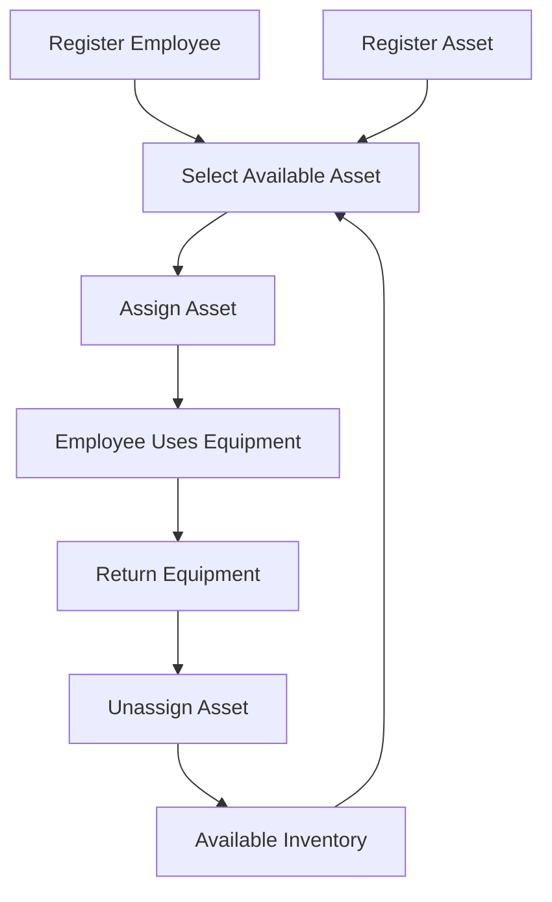

# User Manual

AI-Powered IT Asset Management System

Version: 1.0.0 - Final Release Candidate

## 1. Introduction

The AI-Powered IT Asset Management System provides a
centralized platform for managing organizational technology
assets, employee equipment assignments, inventory statistics,
and AI-assisted operational recommendations.

This manual explains how administrators can operate the
application through its web-based interface.

No programming knowledge is required to use the application.

## 2. Application Capabilities

The application supports the following operations:

- Register and manage IT assets.
- Register and manage employees.
- Assign equipment to employees.
- Return equipment to available inventory.
- Monitor equipment availability.
- Track equipment maintenance status.
- Retire outdated equipment.
- Search and filter inventory records.
- Review operational statistics.
- Generate AI-assisted recommendations.
- Securely authenticate and terminate user sessions.

## 3. Getting Started

### 3.1 Accessing the Application

Open a modern web browser.

Enter the application address:

http://localhost:8080

If the application has been deployed using a different
address or port, use the address provided by the
system administrator.

The application must be running before it can be accessed.

### 3.2 Administrator Login

The application requires administrator authentication.

To sign in:

1. Open the application.
2. Enter the administrator username.
3. Enter the administrator password.
4. Select the sign-in button.
5. Wait for the dashboard to load.

Administrator credentials are established during
application installation.

Contact the system administrator if login credentials
are unavailable.

### 3.3 Invalid Login Credentials

If authentication fails:

- Verify the username.
- Verify the password.
- Check whether Caps Lock is enabled.
- Confirm that browser cookies are enabled.
- Contact the system administrator if the issue persists.

Do not share administrator passwords with unauthorized users.

## 4. Application Navigation

The application contains three primary sections.

| Section | Purpose |
|---|---|
| Dashboard | Asset management and operational statistics |
| Employees | Employee registration and management |
| AI Recommendations | AI-assisted inventory analysis |

The navigation controls are located near the top
of the application interface.

Select the appropriate section to switch between
application modules.

## 5. Dashboard Overview

The dashboard provides an overview of organizational
technology assets and employee records.

### 5.1 Inventory Statistics

The dashboard displays the following metrics:

| Metric | Description |
|---|---|
| Total Assets | Number of registered assets |
| Available Assets | Assets available for allocation |
| Assigned Assets | Assets assigned to employees |
| Maintenance Assets | Assets undergoing maintenance |
| Retired Assets | Assets removed from active service |
| Total Employees | Number of registered employees |

These statistics are calculated from application
database records.

### 5.2 Refresh Dashboard

Select the dashboard refresh button to retrieve
updated operational statistics.

Dashboard statistics should reflect successful
asset and employee management operations.

### 5.3 Asset Utilization

Asset utilization represents the percentage of
non-retired assets currently assigned to employees.

The application calculates utilization using:

    Active Assets = Total Assets - Retired Assets

    Utilization = Assigned Assets / Active Assets * 100

For example:

- Total assets: 20
- Retired assets: 2
- Assigned assets: 12
- Active assets: 18
- Asset utilization: 66.67%

These figures are illustrative examples.

A high utilization percentage may indicate limited
equipment availability.

A low utilization percentage may indicate unused
equipment or opportunities for inventory optimization.

Utilization should be interpreted alongside maintenance
requirements and organizational needs.

### 5.4 Asset Category Distribution

The category breakdown displays the distribution of
registered equipment across asset categories.

Example categories include:

- Laptop
- Desktop
- Monitor
- Printer
- Server
- Networking Equipment
- Mobile Device
- Peripheral

Administrators should use consistent category names
to maintain accurate reporting.

### 5.5 Employee Department Distribution

The department breakdown displays employee counts
across organizational departments.

Example departments include:

- Information Technology
- Cybersecurity
- Finance
- Human Resources
- Operations
- Engineering

These categories are examples rather than mandatory
department values.

## 6. Asset Management

Asset management functionality is available within
the Dashboard section.

### 6.1 Register a New Asset

To register equipment:

1. Open the Dashboard.
2. Locate the asset registration form.
3. Enter the asset name.
4. Enter the asset category.
5. Enter the unique serial number.
6. Select the asset status.
7. Select an employee if the asset is being registered
   with ASSIGNED status.
8. Select the form submission button.
9. Confirm that the asset appears in the inventory.

Example asset information:

| Field | Example |
|---|---|
| Asset Name | Dell Latitude 5420 |
| Category | Laptop |
| Serial Number | LAPTOP-001 |
| Status | AVAILABLE |

Each asset must have a unique serial number.

Duplicate serial numbers are rejected.

### 6.2 Asset Status Definitions

| Status | Meaning |
|---|---|
| Available | Equipment is ready for allocation |
| Assigned | Equipment is allocated to an employee |
| Maintenance | Equipment is undergoing maintenance |
| Retired | Equipment has been removed from active service |

### 6.3 View Asset Inventory

The asset inventory table displays registered equipment.

Information includes:

- Asset identifier.
- Asset name.
- Category.
- Serial number.
- Operational status.
- Assigned employee.
- Available management actions.

The asset identifier is generated automatically
by the application.

### 6.4 Search Assets

To locate a specific asset:

1. Open the Dashboard.
2. Locate the asset search field.
3. Enter a name, category, or serial number.
4. Select the search button.
5. Review the matching records.

Example search terms:

- Dell
- Laptop
- LAPTOP-001

Search results depend on existing inventory records.

### 6.5 Filter Assets by Status

To display assets with a specific status:

1. Locate the asset status filter.
2. Select the desired status.
3. Apply the search or filter.
4. Review the displayed inventory.

For example, selecting AVAILABLE displays equipment
that may be assigned to employees.

Use the clear filters control to restore the
unfiltered inventory.

### 6.6 Navigate Inventory Pages

The application displays inventory records in pages.

Use the Previous and Next controls to navigate
between available pages.

The page information indicates the current position
within the inventory results.

The default page size is ten records.

### 6.7 Edit an Asset

To update an existing asset:

1. Locate the asset in the inventory table.
2. Select Edit.
3. Review the existing asset information.
4. Modify the required fields.
5. Select the form submission button.
6. Confirm that the updated information appears.

Example:

Original asset name:

    Dell Latitude 5420

Updated asset name:

    Dell Latitude 5420 - Updated

Editing an assigned asset while retaining its assigned
status should preserve the existing employee relationship
unless another employee is selected.

Changing an assigned asset to a non-assigned status
removes the existing employee association.

### 6.8 Cancel an Asset Edit

To discard unsaved modifications:

1. Select Edit on an existing asset.
2. Make any necessary changes.
3. Select Cancel.
4. Confirm that the form returns to registration mode.

Unsaved changes are not submitted to the database.

### 6.9 Delete an Asset

To remove an eligible asset:

1. Locate the asset.
2. Select Delete.
3. Review the confirmation message.
4. Confirm the deletion.
5. Verify that the asset is removed from the inventory.

Assigned assets cannot be deleted until their employee
association has been removed.

Deletion should be performed carefully because the
application does not provide an undo operation.

Retiring an asset may be preferable when its record
should remain available for organizational reference.

## 7. Employee Management

Select Employees from the application navigation
to access the employee management module.

### 7.1 Register an Employee

To register an employee:

1. Open the Employees section.
2. Locate the employee registration form.
3. Enter the employee's name.
4. Enter the employee's email address.
5. Enter the employee's department.
6. Select the form submission button.
7. Verify that the employee appears in the directory.

Example employee information:

| Field | Example |
|---|---|
| Name | John Smith |
| Email | john@example.com |
| Department | Information Technology |

The example employee is fictional and intended
for demonstration purposes.

Employee email addresses must be valid and unique.

### 7.2 View Employee Directory

The employee directory displays:

- Employee identifier.
- Employee name.
- Email address.
- Department.
- Assigned asset count.
- Available management actions.

The assigned asset count represents the number
of assets currently associated with an employee.

### 7.3 Search Employees

To locate an employee:

1. Enter a name, email address, or department
   in the employee search field.
2. Select the search button.
3. Review the matching employee records.

### 7.4 Filter Employees by Department

To display employees from a particular department:

1. Locate the department filter.
2. Select the desired department.
3. Apply the filter.
4. Review the matching employees.

Select the clear filters control to restore the
unfiltered employee directory.

### 7.5 Navigate Employee Pages

Use the Previous and Next controls to navigate
through the employee directory.

The default page size is ten employee records.

### 7.6 Edit Employee Information

To update an employee:

1. Locate the employee.
2. Select Edit.
3. Modify the required information.
4. Submit the updated employee record.
5. Confirm that the changes appear.

Updating an employee's name or department does
not require creating a new employee record.

Existing equipment assignments remain associated
with the employee's unique identifier.

### 7.7 Cancel an Employee Edit

Select Cancel to discard unsaved employee
modifications and return to registration mode.

### 7.8 Delete an Employee

To remove an eligible employee:

1. Locate the employee.
2. Verify that the assigned asset count is zero.
3. Select Delete.
4. Confirm the deletion.
5. Verify that the employee is removed.

Employees with assigned equipment cannot be deleted.

All associated equipment must first be returned
or otherwise have its assignment removed.

## 8. Equipment Allocation

The asset and employee modules work together to
maintain equipment assignment relationships.

### 8.1 Assignment Prerequisites

Before assigning equipment:

- The employee must be registered.
- The asset must be registered.
- The asset must have AVAILABLE status.

### 8.2 Assign an Asset

To allocate equipment:

1. Open the Dashboard.
2. Locate an available asset.
3. Select Assign.
4. Select the intended employee from the assignment dialog.
5. Confirm the assignment.
6. Verify that the asset status changes to ASSIGNED.
7. Verify that the employee name appears in the inventory.

The employee's assigned asset count should also
reflect the new assignment.

### 8.3 Return Assigned Equipment

To return equipment:

1. Locate an assigned asset.
2. Select Unassign.
3. Confirm the operation when prompted.
4. Verify that the asset status changes to AVAILABLE.
5. Verify that the assigned employee is removed.

The equipment can then be assigned to another employee
or moved into maintenance.

### 8.4 Transfer Equipment

The recommended equipment transfer procedure is:

1. Unassign the equipment from the current employee.
2. Confirm that the equipment is available.
3. Select Assign.
4. Select the new employee.
5. Confirm the new assignment.

This workflow provides a clear operational sequence
for equipment transfers.

### 8.5 Equipment Allocation Workflow

## 9. Maintenance and Retirement

### 9.1 Place Equipment Under Maintenance

To mark equipment for maintenance:

1. Locate the asset.
2. Return the equipment if it is currently assigned.
3. Select Edit.
4. Change the status to MAINTENANCE.
5. Submit the updated record.

Equipment under maintenance should not be allocated
through the standard assignment operation.

The maintenance status indicates operational
availability rather than a scheduled maintenance task.

### 9.2 Return Equipment to Service

After maintenance is completed:

1. Locate the maintenance asset.
2. Select Edit.
3. Change the status to AVAILABLE.
4. Submit the updated record.

The equipment is now eligible for assignment.

### 9.3 Retire Equipment

To remove equipment from active service:

1. Locate the asset.
2. Return assigned equipment where applicable.
3. Select Edit.
4. Change the status to RETIRED.
5. Submit the updated record.

Retired equipment remains visible in inventory
unless it is subsequently deleted.

Retired assets are excluded from the active asset
utilization calculation.

The current application does not permit retired
assets to return to an active status.

Administrators should verify that retirement is
appropriate before submitting the change.

## 10. AI Recommendations

The AI Recommendations section provides advisory
analysis of aggregate inventory statistics.

### 10.1 AI Service Requirements

The AI feature requires a configured AI provider.

The application administrator or technical support
team is responsible for provider configuration.

Core asset and employee management functions remain
available when AI functionality is disabled.

### 10.2 Check AI Service Status

To inspect the AI configuration:

1. Open the AI Recommendations section.
2. Select the status refresh control.
3. Review the displayed configuration status.
4. Review the configured model identifier.

A configured status indicates that the necessary
configuration values are present.

It does not guarantee that the provider is online
or that its credentials are valid.

### 10.3 Generate Recommendations

To generate AI-assisted analysis:

1. Ensure that representative inventory records exist.
2. Verify that the AI service is configured.
3. Open the AI Recommendations section.
4. Select Generate Recommendations.
5. Wait for the AI provider to return a response.
6. Review the generated recommendation.
7. Compare the recommendation with inventory statistics.

The response may take longer than ordinary asset
management operations because it depends on an
external or locally hosted AI model.

### 10.4 Review Recommendation Information

The recommendation interface displays information
such as:

- Generated recommendation text.
- Configured AI model.
- Generation timestamp.
- Response time.
- Aggregate inventory data.
- Human review requirements.

### 10.5 Example AI Analysis

Consider the following illustrative inventory:

| Metric | Example Value |
|---|---:|
| Total Assets | 20 |
| Available Assets | 5 |
| Assigned Assets | 10 |
| Maintenance Assets | 3 |
| Retired Assets | 2 |
| Total Employees | 12 |

An illustrative recommendation might state:

"Review the three assets currently under maintenance
and evaluate whether returning eligible equipment
to service would improve inventory availability.
Assess the five available assets against upcoming
employee equipment requirements before making
additional procurement decisions."

This example is not a recorded response from the
configured AI provider.

Actual recommendations depend on current inventory
data and the selected AI model.

### 10.6 Responsible Use of AI

AI recommendations are advisory.

Administrators must:

- Verify recommendations against actual records.
- Consider organizational requirements.
- Reject inaccurate or unsupported recommendations.
- Avoid discriminatory allocation decisions.
- Protect confidential organizational information.
- Obtain appropriate approval before making changes.

The AI service does not automatically assign,
delete, retire, or modify equipment.

Administrators remain responsible for operational
decisions.

### 10.7 AI Data Privacy

The AI service receives selected aggregate
inventory statistics.

Individual employee names, email addresses,
asset serial numbers, and employee assignment
records are not included in the intended AI
inventory prompt.

Do not enter unnecessary personal or confidential
information into application records.

Organizations should review the configured AI
provider's privacy and data retention policies.

## 11. Notifications and Error Messages

The application displays notifications when
operations succeed or fail.

### Successful Operations

Successful notifications may appear after:

- Asset registration.
- Asset updates.
- Asset deletion.
- Employee registration.
- Employee updates.
- Employee deletion.
- Equipment assignment.
- Equipment return.
- AI recommendation generation.

### Common Errors

| Error | Recommended Action |
|---|---|
| Required field missing | Complete the required information |
| Duplicate serial number | Enter a unique serial number |
| Invalid employee email | Enter a valid email address |
| Duplicate employee email | Use a unique email address |
| Employee not found | Select an existing employee |
| Asset unavailable | Verify the asset status |
| Assigned asset cannot be deleted | Unassign the equipment first |
| Employee has assigned assets | Return associated equipment |
| Unauthorized request | Sign in again |
| Access forbidden | Refresh the session or contact support |
| AI service unavailable | Contact the system administrator |
| AI provider failure | Retry after checking provider availability |

Exact notification wording may vary depending
on the operation and error condition.

## 12. Logging Out

To terminate an authenticated session:

1. Locate the Logout button.
2. Select Logout.
3. Confirm that the login page appears.

Always log out when using a shared or publicly
accessible computer.

Closing the browser should not be treated as a
substitute for explicitly logging out.

## 13. Recommended Operational Workflow

The following sequence demonstrates a typical
asset management process.

### Step 1: Register Employees

Create employee records for individuals who
require organizational equipment.

### Step 2: Register Equipment

Create asset records using accurate names,
categories, and unique serial numbers.

### Step 3: Allocate Equipment

Assign available assets to registered employees.

### Step 4: Monitor Inventory

Review dashboard statistics and employee
assignment counts.

### Step 5: Manage Equipment Returns

Unassign equipment when employees return it.

### Step 6: Manage Maintenance

Update equipment status when maintenance
is required or completed.

### Step 7: Review AI Recommendations

Generate advisory recommendations and verify
them against operational requirements.

### Step 8: Retire Outdated Equipment

Mark equipment as retired when it is no
longer suitable for active service.

## 14. Demonstration Scenario

The following fictional dataset can be used
during system demonstrations.

### Sample Employees

| Name | Email | Department |
|---|---|---|
| John Smith | john@example.com | Information Technology |
| Sarah Johnson | sarah@example.com | Cybersecurity |
| Michael Brown | michael@example.com | Operations |
| Emily Davis | emily@example.com | Finance |

### Sample Assets

| Asset Name | Category | Serial Number | Initial Status |
|---|---|---|---|
| Dell Latitude 5420 | Laptop | LAPTOP-001 | AVAILABLE |
| Lenovo ThinkPad T14 | Laptop | LAPTOP-002 | AVAILABLE |
| HP EliteBook 840 | Laptop | LAPTOP-003 | AVAILABLE |
| Dell OptiPlex 7010 | Desktop | DESKTOP-001 | AVAILABLE |
| HP EliteDesk 800 | Desktop | DESKTOP-002 | AVAILABLE |
| Dell UltraSharp 27 | Monitor | MONITOR-001 | AVAILABLE |
| Samsung 24 Monitor | Monitor | MONITOR-002 | AVAILABLE |
| Cisco Network Switch | Networking | NETWORK-001 | MAINTENANCE |
| HP LaserJet Pro | Printer | PRINTER-001 | MAINTENANCE |
| Legacy Dell Desktop | Desktop | DESKTOP-003 | RETIRED |

### Suggested Demonstration Assignments

| Asset | Employee |
|---|---|
| Dell Latitude 5420 | John Smith |
| Lenovo ThinkPad T14 | Sarah Johnson |
| Dell OptiPlex 7010 | Michael Brown |
| Dell UltraSharp 27 | Emily Davis |

After registering the sample records and completing
the four suggested assignments, the expected
statistics are:

| Metric | Expected Value |
|---|---:|
| Total Assets | 10 |
| Available Assets | 3 |
| Assigned Assets | 4 |
| Maintenance Assets | 2 |
| Retired Assets | 1 |
| Total Employees | 4 |
| Active Assets | 9 |
| Asset Utilization | 44.44% |

These values assume an initially empty database
and successful completion of every listed operation.

They are expected demonstration results rather
than verified application measurements.

### Suggested Demonstration Activities

1. Authenticate as an administrator.
2. Display the operational dashboard.
3. Register the sample employees.
4. Register the sample assets.
5. Assign four assets.
6. Search for a laptop.
7. Filter maintenance assets.
8. Edit an assigned asset without removing its assignment.
9. Rename an employee and verify the asset relationship.
10. Attempt to delete an employee with assigned equipment.
11. Confirm that the deletion is prevented.
12. Review the dashboard statistics.
13. Generate live AI recommendations.
14. Compare AI output with inventory statistics.
15. Return an assigned asset.
16. Log out.

Use fictional records during demonstrations rather
than real employee information.

## 15. Security Best Practices

Administrators should follow these practices:

- Use a strong and unique administrator password.
- Do not share authentication credentials.
- Log out after completing administrative activities.
- Avoid accessing the application from untrusted devices.
- Verify information before submitting changes.
- Avoid storing unnecessary personal information.
- Review AI recommendations before acting on them.
- Report unexpected application behavior.
- Maintain regular database backups.
- Use HTTPS when the application is deployed remotely.

## 16. Frequently Asked Questions

### Can the application operate without AI?

Yes. Asset management, employee management, allocation,
and dashboard functionality are designed to operate
independently of the AI provider.

### Can an employee receive multiple assets?

Yes. An employee may have multiple assigned assets.

### Can an asset be assigned to multiple employees?

No. An asset may be associated with only one employee
at a time.

### Can an assigned asset be deleted?

No. The equipment must first be unassigned.

### Can an employee with assigned equipment be deleted?

No. Existing equipment assignments must first be removed.

### Can a retired asset return to active service?

No. The current business rules prevent retired assets
from returning to an active status.

### Does AI automatically change inventory records?

No. AI recommendations require human review and
do not directly modify inventory.

### Are asset serial numbers case-sensitive?

The application is designed to prevent duplicate
serial numbers regardless of letter case.

### Are employee email addresses unique?

Yes. The application is designed to prevent duplicate
employee email addresses.

### Does restarting the application delete records?

Normally, no. Records are stored in MySQL.

Containerized deployments use persistent database
storage unless the database volume is explicitly removed.

### Can employees log in using their registered email?

No. Employee records represent equipment recipients.

The current release uses a separately configured
administrator account for authentication.

### Can deleted records be recovered?

The application does not provide an end-user recovery
or undo feature.

Recovery may require a database backup.

## 17. Current Limitations

The current release candidate has the following
operational limitations:

- Administrator-only authentication.
- No employee self-service portal.
- No password recovery interface.
- No dedicated maintenance scheduling module.
- No asset assignment history interface.
- No automated procurement system.
- No undo operation for deleted records.
- No automatic execution of AI recommendations.
- AI functionality depends on provider availability.
- No production-grade audit logging.
- No dedicated mobile application.

The web interface is designed to support modern
desktop and mobile browsers, although responsive
behavior requires final verification.

## 18. Technical Support

For installation, configuration, or deployment issues,
refer to the following documentation:

- [Installation Guide](INSTALLATION.md)
- [Project Overview](README.md)
- [REST API Documentation](API.md)
- [Technical Debt Register](TECHNICAL_DEBT.md)
- [Performance Evaluation](PERFORMANCE.md)

Project repository:

https://github.com/ilerioluwaa/ai-it-asset-management-system

Report application defects through the project's
GitHub Issues section when appropriate.

Do not include passwords, API keys, database credentials,
or confidential employee information in issue reports.

## 19. Documentation Verification

This manual describes the intended operation of the
Final Release Candidate.

The procedures, interface controls, and expected
demonstration results must be verified against the
running application before final submission.

Actual application screenshots may be added after
successful system verification.

---

AI-Powered IT Asset Management System

CMSC 495 - Computer Capstone Project

University of Maryland Global Campus
