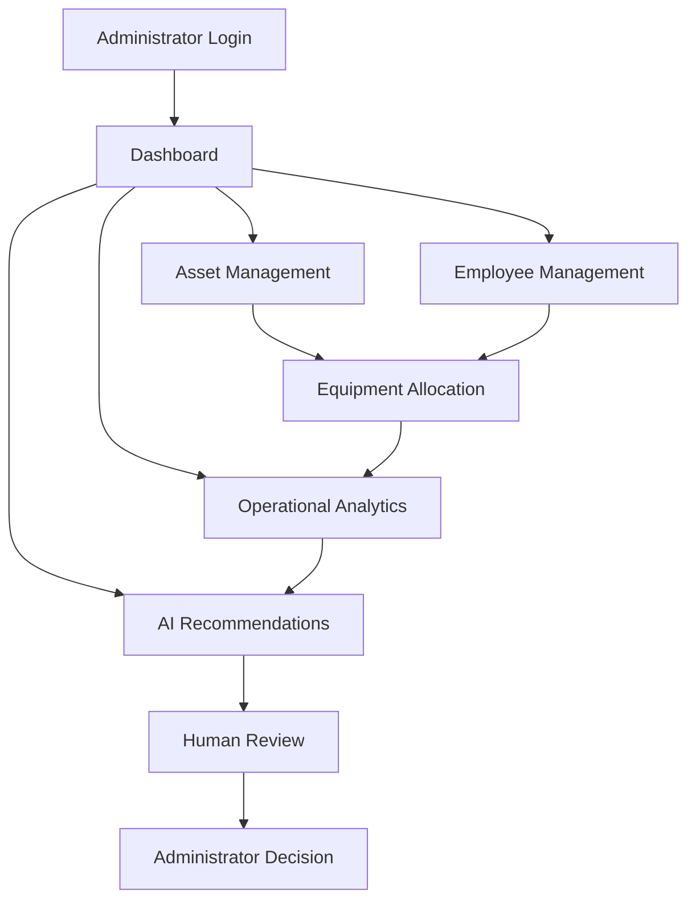
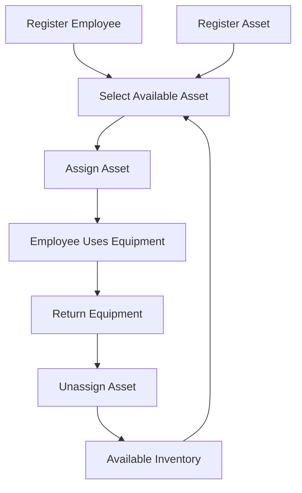
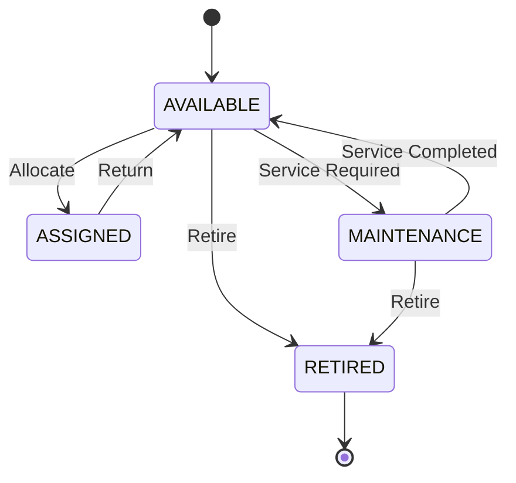
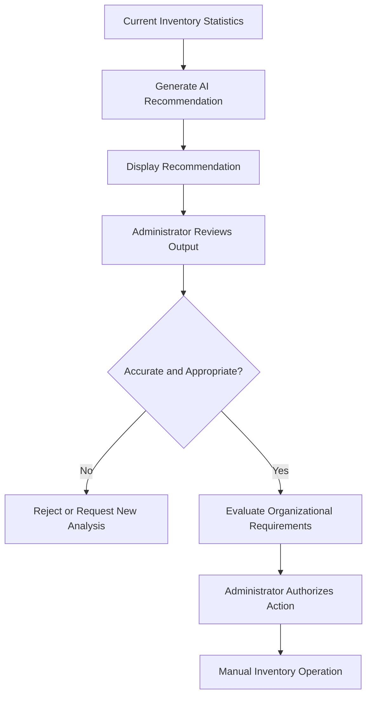

# User Manual

AI-Powered IT Asset Management System

Version: 1.0.0 - Final Release

CMSC 495 - Computer Capstone Project

University of Maryland Global Campus

November 2026

---

## 1. Introduction

The AI-Powered IT Asset Management System provides a
centralized platform for managing organizational technology
assets, employee equipment assignments, inventory statistics,
and AI-assisted operational recommendations.

The application addresses common organizational challenges
associated with manual inventory tracking, fragmented employee
equipment records, inefficient resource allocation, and
limited operational visibility.

This manual explains how administrators can operate the
application through its web-based interface.

No programming knowledge is required to use the application
after installation and configuration.

### 1.1 Intended Users

The application is intended for:

- IT asset administrators.
- Information technology departments.
- Equipment inventory managers.
- Technical support personnel.
- Organizational resource managers.
- Authorized system administrators.

The current release uses administrator-only authentication.

Employee records represent equipment recipients rather than
independent application user accounts.

### 1.2 Final Release Verification

The Final Release completed automated testing, local
application verification, AI recommendation generation,
and containerized deployment verification.

| Verification | Result |
|---|---|
| Automated tests | 138 of 138 passed |
| Automated test failures | 0 |
| Automated test errors | 0 |
| Java line coverage | 91.32% |
| Administrator authentication | Verified |
| Native AI recommendation generation | Verified |
| Docker deployment | Successful |
| Application health | UP |
| GitHub Actions CI/CD | Successful |

These results describe the documented verification
environment and do not guarantee defect-free operation
under every possible workload.

---

## 2. Application Capabilities

The application supports the following operations:

- Register and manage IT assets.
- Register and manage employees.
- Assign equipment to employees.
- Return equipment to available inventory.
- Monitor equipment availability.
- Track equipment maintenance status.
- Retire outdated equipment.
- Search and filter inventory records.
- Navigate paginated inventory results.
- Review operational statistics.
- Monitor employee equipment allocation.
- Generate AI-assisted recommendations.
- Securely authenticate and terminate user sessions.

### 2.1 Application Modules

| Module | Primary Function |
|---|---|
| Authentication | Restrict access to authorized administrators |
| Asset Management | Maintain technology inventory |
| Employee Management | Maintain equipment recipient records |
| Equipment Allocation | Associate assets with employees |
| Operational Analytics | Present inventory and employee statistics |
| AI Recommendations | Provide advisory inventory analysis |

### 2.2 Operational Benefits

The application is designed to provide:

- Centralized inventory visibility.
- Improved equipment accountability.
- Reduced duplicate inventory records.
- Improved employee assignment tracking.
- More informed equipment allocation decisions.
- Improved visibility into maintenance requirements.
- AI-assisted operational decision support.

These benefits describe the intended operational value.

Actual organizational cost savings and productivity
improvements have not been quantitatively measured.

---

## 3. Getting Started

### 3.1 Accessing the Application

Open a modern web browser.

Enter the application address:

http://localhost:8080

If the application has been deployed using a different
address or port, use the address provided by the
system administrator.

The application must be running before it can be accessed.

Refer to INSTALLATION.md if the application has not
yet been installed or started.

### 3.2 Administrator Login

The application requires administrator authentication.

To sign in:

1. Open the application.
2. Enter the administrator username.
3. Enter the administrator password.
4. Select the sign-in button.
5. Wait for the dashboard to load.

Administrator credentials are established during
application installation.

Contact the system administrator if login credentials
are unavailable.

The application does not provide public account
registration or employee self-service authentication.

### 3.3 Password Visibility

The login interface provides a password visibility control.

Use this control when necessary to verify that the
password has been entered correctly.

Avoid displaying passwords when other individuals
can observe the screen.

### 3.4 Invalid Login Credentials

If authentication fails:

- Verify the username.
- Verify the password.
- Check whether Caps Lock is enabled.
- Confirm that browser cookies are enabled.
- Confirm that the correct application environment is open.
- Contact the system administrator if the issue persists.

Do not share administrator passwords with unauthorized users.

### 3.5 Session Expiration

The application uses session-based authentication.

An inactive session may expire after the configured
30-minute inactivity period.

If the session expires:

1. Return to the login page.
2. Authenticate again.
3. Repeat the interrupted operation if necessary.

Unsaved changes may need to be entered again.

---

## 4. Application Navigation

The application contains three primary sections.

| Section | Purpose |
|---|---|
| Dashboard | Asset management and operational statistics |
| Employees | Employee registration and management |
| AI Recommendations | AI-assisted inventory analysis |

The navigation controls are located near the top
of the application interface.

Select the appropriate section to switch between
application modules.

### 4.1 Application Workflow



The AI recommendation module provides advisory information.

Operational changes remain under administrator control.

---

## 5. Dashboard Overview

The dashboard provides an overview of organizational
technology assets and employee records.

### 5.1 Inventory Statistics

The dashboard displays the following metrics:

| Metric | Description |
|---|---|
| Total Assets | Number of registered assets |
| Available Assets | Assets available for allocation |
| Assigned Assets | Assets assigned to employees |
| Maintenance Assets | Assets undergoing maintenance |
| Retired Assets | Assets removed from active service |
| Total Employees | Number of registered employees |

These statistics are calculated from application
database records.

The total asset count includes available, assigned,
maintenance, and retired equipment.

### 5.2 Refresh Dashboard

Select the dashboard refresh button to retrieve
updated operational statistics.

Dashboard statistics should reflect successful
asset and employee management operations.

If statistics appear outdated, refresh the dashboard
before making operational decisions.

### 5.3 Asset Utilization

Asset utilization represents the percentage of
non-retired assets currently assigned to employees.

The application calculates utilization using:

```text
Active Assets = Total Assets - Retired Assets

Utilization = (Assigned Assets / Active Assets) * 100
```

For example:

| Metric | Example Value |
|---|---:|
| Total Assets | 20 |
| Retired Assets | 2 |
| Assigned Assets | 12 |
| Active Assets | 18 |
| Asset Utilization | 66.67% |

These figures are illustrative examples.

When there are no active assets, utilization is
displayed as zero.

A high utilization percentage may indicate limited
equipment availability.

A low utilization percentage may indicate unused
equipment or opportunities for inventory optimization.

Utilization should be interpreted alongside maintenance
requirements and organizational needs.

The utilization percentage measures equipment allocation,
not the amount of time individual devices are actively used.

### 5.4 Asset Category Distribution

The category breakdown displays the distribution of
registered equipment across asset categories.

Example categories include:

- Laptop
- Desktop
- Monitor
- Printer
- Server
- Networking Equipment
- Mobile Device
- Peripheral

Administrators should use consistent category names
to maintain meaningful reporting.

For example, using both Laptop and Laptops may create
separate category entries.

### 5.5 Employee Department Distribution

The department breakdown displays employee counts
across organizational departments.

Example departments include:

- Information Technology
- Cybersecurity
- Finance
- Human Resources
- Operations
- Engineering

These categories are examples rather than mandatory
department values.

Consistent department naming improves the usefulness
of organizational reporting.

---

## 6. Asset Management

Asset management functionality is available within
the Dashboard section.

### 6.1 Register a New Asset

To register equipment:

1. Open the Dashboard.
2. Locate the asset registration form.
3. Enter the asset name.
4. Enter the asset category.
5. Enter the unique serial number.
6. Select the asset status.
7. Select an employee if the asset is being registered
   with ASSIGNED status.
8. Select the form submission button.
9. Confirm that the asset appears in the inventory.

Example asset information:

| Field | Example |
|---|---|
| Asset Name | Dell Latitude 5420 |
| Category | Laptop |
| Serial Number | LAPTOP-001 |
| Status | AVAILABLE |

Each asset must have a unique serial number.

Duplicate serial numbers are rejected.

### 6.2 Asset Field Requirements

| Field | Requirement |
|---|---|
| Asset Name | Required, maximum 150 characters |
| Category | Required, maximum 100 characters |
| Serial Number | Required, unique, maximum 100 characters |
| Status | Required, supported status |
| Assigned Employee | Required when registering assigned equipment |

Serial numbers are normalized to uppercase.

Required fields cannot be left blank.

### 6.3 Asset Status Definitions

| Status | Meaning |
|---|---|
| Available | Equipment is ready for allocation |
| Assigned | Equipment is allocated to an employee |
| Maintenance | Equipment is undergoing maintenance |
| Retired | Equipment has been removed from active service |

The application uses the following internal status values:

- AVAILABLE
- ASSIGNED
- MAINTENANCE
- RETIRED

### 6.4 View Asset Inventory

The asset inventory table displays registered equipment.

Information includes:

- Asset identifier.
- Asset name.
- Category.
- Serial number.
- Operational status.
- Assigned employee.
- Available management actions.

The asset identifier is generated automatically
by the application.

The identifier and serial number serve different purposes.

The identifier is an internal database reference.

The serial number identifies the physical equipment.

### 6.5 Search Assets

To locate a specific asset:

1. Open the Dashboard.
2. Locate the asset search field.
3. Enter a name, category, or serial number.
4. Select the search button.
5. Review the matching records.

Example search terms:

- Dell
- Laptop
- LAPTOP-001

Search results depend on existing inventory records.

Search matching is designed to be case-insensitive.

### 6.6 Filter Assets by Status

To display assets with a specific status:

1. Locate the asset status filter.
2. Select the desired status.
3. Apply the search or filter.
4. Review the displayed inventory.

For example, selecting AVAILABLE displays equipment
that may be assigned to employees.

Use the clear filters control to restore the
unfiltered inventory.

### 6.7 Navigate Inventory Pages

The application displays inventory records in pages.

Use the Previous and Next controls to navigate
between available pages.

The page information indicates the current position
within the inventory results.

The default page size is ten records.

Pagination reduces the number of records returned
during each inventory retrieval operation.

### 6.8 Edit an Asset

To update an existing asset:

1. Locate the asset in the inventory table.
2. Select Edit.
3. Review the existing asset information.
4. Modify the required fields.
5. Select the form submission button.
6. Confirm that the updated information appears.

Example:

Original asset name:

```text
Dell Latitude 5420
```

Updated asset name:

```text
Dell Latitude 5420 - Updated
```

Editing an assigned asset while retaining its assigned
status preserves the existing employee relationship
unless another employee is selected.

Changing an assigned asset to a non-assigned status
removes the existing employee association.

### 6.9 Assignment Preservation

The Final Release addresses an assignment preservation
defect identified during Alpha Release peer review.

In the Alpha Release, editing an assigned asset could
unintentionally remove the existing employee assignment.

The Final Release preserves the existing employee
relationship when the asset remains assigned and no
replacement employee is provided.

Example:

| Field | Before Edit | After Edit |
|---|---|---|
| Asset Name | Dell Latitude | Dell Latitude - Updated |
| Serial Number | LAPTOP-001 | LAPTOP-001 |
| Status | ASSIGNED | ASSIGNED |
| Assigned Employee | John Smith | John Smith |

The employee association remains intact.

This behavior is covered by automated regression testing.

Administrators should still verify assignment information
after completing asset modifications.

### 6.10 Cancel an Asset Edit

To discard unsaved modifications:

1. Select Edit on an existing asset.
2. Make any necessary changes.
3. Select Cancel.
4. Confirm that the form returns to registration mode.

Unsaved changes are not submitted to the database.

### 6.11 Delete an Asset

To remove an eligible asset:

1. Locate the asset.
2. Select Delete.
3. Review the confirmation message.
4. Confirm the deletion.
5. Verify that the asset is removed from the inventory.

Assigned assets cannot be deleted until their employee
association has been removed.

Deletion should be performed carefully because the
application does not provide an undo operation.

Retiring an asset may be preferable when its record
should remain available for organizational reference.

---

## 7. Employee Management

Select Employees from the application navigation
to access the employee management module.

### 7.1 Register an Employee

To register an employee:

1. Open the Employees section.
2. Locate the employee registration form.
3. Enter the employee's name.
4. Enter the employee's email address.
5. Enter the employee's department.
6. Select the form submission button.
7. Verify that the employee appears in the directory.

Example employee information:

| Field | Example |
|---|---|
| Name | John Smith |
| Email | john@example.com |
| Department | Information Technology |

The example employee is fictional and intended
for demonstration purposes.

Employee email addresses must be valid and unique.

### 7.2 Employee Field Requirements

| Field | Requirement |
|---|---|
| Name | Required, maximum 150 characters |
| Email | Required, valid format, unique, maximum 254 characters |
| Department | Required, maximum 100 characters |

Employee email addresses are normalized to lowercase.

Duplicate employee email addresses are rejected.

### 7.3 View Employee Directory

The employee directory displays:

- Employee identifier.
- Employee name.
- Email address.
- Department.
- Assigned asset count.
- Available management actions.

The assigned asset count represents the number
of assets currently associated with an employee.

### 7.4 Search Employees

To locate an employee:

1. Enter a name, email address, or department
   in the employee search field.
2. Select the search button.
3. Review the matching employee records.

### 7.5 Filter Employees by Department

To display employees from a particular department:

1. Locate the department filter.
2. Select the desired department.
3. Apply the filter.
4. Review the matching employees.

Select the clear filters control to restore the
unfiltered employee directory.

### 7.6 Navigate Employee Pages

Use the Previous and Next controls to navigate
through the employee directory.

The default page size is ten employee records.

### 7.7 Edit Employee Information

To update an employee:

1. Locate the employee.
2. Select Edit.
3. Modify the required information.
4. Submit the updated employee record.
5. Confirm that the changes appear.

Updating an employee's name or department does
not require creating a new employee record.

Existing equipment assignments remain associated
with the employee's unique identifier.

When an employee's name changes, associated asset
records reflect the updated employee information.

### 7.8 Cancel an Employee Edit

Select Cancel to discard unsaved employee
modifications and return to registration mode.

### 7.9 Delete an Employee

To remove an eligible employee:

1. Locate the employee.
2. Verify that the assigned asset count is zero.
3. Select Delete.
4. Confirm the deletion.
5. Verify that the employee is removed.

Employees with assigned equipment cannot be deleted.

All associated equipment must first be returned
or otherwise have its assignment removed.

This safeguard prevents equipment from retaining
invalid employee relationships.

---

## 8. Equipment Allocation

The asset and employee modules work together to
maintain equipment assignment relationships.

### 8.1 Assignment Prerequisites

Before assigning equipment:

- The employee must be registered.
- The asset must be registered.
- The asset must have AVAILABLE status.

### 8.2 Assign an Asset

To allocate equipment:

1. Open the Dashboard.
2. Locate an available asset.
3. Select Assign.
4. Select the intended employee from the assignment dialog.
5. Confirm the assignment.
6. Verify that the asset status changes to ASSIGNED.
7. Verify that the employee name appears in the inventory.

The employee's assigned asset count should also
reflect the new assignment.

### 8.3 Return Assigned Equipment

To return equipment:

1. Locate an assigned asset.
2. Select Unassign.
3. Confirm the operation when prompted.
4. Verify that the asset status changes to AVAILABLE.
5. Verify that the assigned employee is removed.

The equipment can then be assigned to another employee
or moved into maintenance.

### 8.4 Transfer Equipment

The recommended equipment transfer procedure is:

1. Unassign the equipment from the current employee.
2. Confirm that the equipment is available.
3. Select Assign.
4. Select the new employee.
5. Confirm the new assignment.

This workflow provides a clear operational sequence
for equipment transfers.

### 8.5 Equipment Allocation Workflow



### 8.6 Allocation Business Rules

| Rule | Application Behavior |
|---|---|
| Assign available equipment | Permitted |
| Assign equipment already assigned | Rejected by standard assignment operation |
| Assign maintenance equipment | Rejected by standard assignment operation |
| Assign retired equipment | Rejected |
| Delete assigned equipment | Rejected |
| Delete employee with assigned equipment | Rejected |
| Return assigned equipment | Permitted |
| Preserve assignment during ordinary edits | Supported |

An employee may receive multiple assets.

An individual asset may be associated with only one
employee at a time.

These rules improve inventory consistency and
equipment accountability.

---

## 9. Maintenance and Retirement

### 9.1 Place Equipment Under Maintenance

To mark equipment for maintenance:

1. Locate the asset.
2. Return the equipment if it is currently assigned.
3. Select Edit.
4. Change the status to MAINTENANCE.
5. Submit the updated record.

Equipment under maintenance cannot be allocated
through the standard assignment operation.

The maintenance status indicates operational
availability rather than a scheduled maintenance task.

### 9.2 Return Equipment to Service

After maintenance is completed:

1. Locate the maintenance asset.
2. Select Edit.
3. Change the status to AVAILABLE.
4. Submit the updated record.

The equipment is now eligible for assignment.

### 9.3 Retire Equipment

To remove equipment from active service:

1. Locate the asset.
2. Return assigned equipment where applicable.
3. Select Edit.
4. Change the status to RETIRED.
5. Submit the updated record.

Retired equipment remains visible in inventory
unless it is subsequently deleted.

Retired assets are excluded from the active asset
utilization calculation.

The current application does not permit retired
assets to return to an active status.

Administrators should verify that retirement is
appropriate before submitting the change.

### 9.4 Equipment Lifecycle



This diagram represents the recommended operational
equipment lifecycle.

Additional permitted status changes are governed by
application business rules.

Retirement does not automatically delete the asset record.

---

## 10. AI Recommendations

The AI Recommendations section provides advisory
analysis of aggregate inventory statistics.

The AI integration extends conventional inventory
management by generating natural-language analysis
of operational conditions.

### 10.1 AI Service Requirements

The AI feature requires a configured AI provider.

The application administrator or technical support
team is responsible for provider configuration.

Core asset and employee management functions remain
available when AI functionality is disabled.

The native AI configuration is described in
INSTALLATION.md.

### 10.2 Check AI Service Status

To inspect the AI configuration:

1. Open the AI Recommendations section.
2. Select the status refresh control.
3. Review the displayed configuration status.
4. Review the configured model identifier.

A configured status indicates that the necessary
configuration values are present.

It does not guarantee that the provider is online
or that its credentials are valid.

### 10.3 Generate Recommendations

To generate AI-assisted analysis:

1. Ensure that representative inventory records exist.
2. Verify that the AI service is configured.
3. Open the AI Recommendations section.
4. Select Generate Recommendations.
5. Wait for the AI provider to return a response.
6. Review the generated recommendation.
7. Compare the recommendation with inventory statistics.

The response may take longer than ordinary asset
management operations because it depends on an
external or locally hosted AI model.

Avoid repeatedly submitting recommendation requests
while an existing request is being processed.

### 10.4 Review Recommendation Information

The recommendation interface displays information
such as:

- Generated recommendation text.
- Configured AI model.
- Generation timestamp.
- Response time.
- Aggregate inventory data.
- Human review requirements.

The displayed inventory data represents the information
used to generate the recommendation.

Inventory conditions may change after a recommendation
has been generated.

Administrators should refresh operational statistics
and generate a new recommendation when appropriate.

### 10.5 Operational Uses of AI

AI recommendations may assist administrators with:

| Area | Potential Value |
|---|---|
| Inventory availability | Identify equipment availability concerns |
| Equipment allocation | Evaluate existing allocation levels |
| Maintenance | Identify maintenance-related inventory constraints |
| Procurement planning | Evaluate available inventory before purchasing |
| Resource utilization | Identify potential underutilization |
| Operational planning | Summarize inventory conditions for review |

The AI feature does not independently determine
organizational requirements or authorize purchases.

### 10.6 Example AI Analysis

Consider the following illustrative inventory:

| Metric | Example Value |
|---|---:|
| Total Assets | 20 |
| Available Assets | 5 |
| Assigned Assets | 10 |
| Maintenance Assets | 3 |
| Retired Assets | 2 |
| Total Employees | 12 |

An illustrative recommendation might state:

> Review the three assets currently under maintenance
> and evaluate whether returning eligible equipment
> to service would improve inventory availability.
> Assess the five available assets against upcoming
> employee equipment requirements before making
> additional procurement decisions.

This example is not a recorded response from the
configured AI provider.

Actual recommendations depend on current inventory
data and the selected AI model.

### 10.7 Verified AI Recommendation Execution

During native application verification, two AI
recommendation generation operations completed
successfully.

| Execution | Recorded Response Time |
|---|---:|
| Recommendation 1 | 4,879 ms |
| Recommendation 2 | 5,250 ms |
| Mean observed response time | 5,064.5 ms |

The observed mean response time was approximately
5.06 seconds.

These measurements represent two recorded operations
in the local development environment.

Actual response times may vary depending on:

- AI model selection.
- Available system resources.
- Model initialization.
- Provider availability.
- Network latency.
- Provider workload.

These results do not establish production-scale
AI throughput or comprehensive recommendation accuracy.

### 10.8 Responsible Use of AI

AI recommendations are advisory.

Administrators must:

- Verify recommendations against actual records.
- Consider organizational requirements.
- Reject inaccurate or unsupported recommendations.
- Avoid discriminatory allocation decisions.
- Protect confidential organizational information.
- Obtain appropriate approval before making changes.

The AI service does not automatically assign,
delete, retire, or modify equipment.

Administrators remain responsible for operational
decisions.

AI-generated text should not be treated as an
authoritative organizational policy.

### 10.9 AI Data Privacy

The AI service receives selected aggregate
inventory statistics.

Individual employee names, email addresses,
asset serial numbers, and employee assignment
records are excluded from the intended AI
inventory prompt.

The AI provider does not receive direct access
to the application database.

Do not enter unnecessary personal or confidential
information into application records.

Organizations should review the configured AI
provider's privacy and data retention policies.

### 10.10 Human Oversight Workflow



AI recommendations do not directly initiate
inventory modifications.

### 10.11 AI Availability in Docker

The verified Docker deployment operates with AI
functionality disabled.

The live AI recommendation feature was verified
separately using native application execution.

Administrators using the baseline Docker deployment
can still access asset management, employee management,
equipment allocation, and operational analytics.

A compatible AI provider must be configured and
independently verified before generating live AI
recommendations from a containerized deployment.

---

## 11. Notifications and Error Messages

The application displays notifications when
operations succeed or fail.

### 11.1 Successful Operations

Successful notifications may appear after:

- Asset registration.
- Asset updates.
- Asset deletion.
- Employee registration.
- Employee updates.
- Employee deletion.
- Equipment assignment.
- Equipment return.
- AI recommendation generation.

After a successful operation, verify that the
displayed records reflect the intended changes.

### 11.2 Common Errors

| Error | Recommended Action |
|---|---|
| Required field missing | Complete the required information |
| Duplicate serial number | Enter a unique serial number |
| Invalid employee email | Enter a valid email address |
| Duplicate employee email | Use a unique email address |
| Employee not found | Select an existing employee |
| Asset unavailable | Verify the asset status |
| Assigned asset cannot be deleted | Unassign the equipment first |
| Employee has assigned assets | Return associated equipment |
| Invalid retirement transition | Verify the intended equipment status |
| Unauthorized request | Sign in again |
| Access forbidden | Refresh the session or contact support |
| AI service unavailable | Contact the system administrator |
| AI provider failure | Retry after checking provider availability |

Exact notification wording may vary depending
on the operation and error condition.

### 11.3 Application Error Categories

| HTTP Status | Meaning |
|---|---|
| 400 | Invalid request information |
| 401 | Authentication required |
| 403 | Request not authorized or invalid security token |
| 404 | Requested record does not exist |
| 409 | Duplicate record or business rule conflict |
| 500 | Unexpected application failure |
| 502 | AI provider communication failure |
| 503 | AI service unavailable or disabled |

These status codes are primarily useful when
communicating with technical support.

Administrators normally interact with the
application's displayed notifications rather
than raw API responses.

### 11.4 Unexpected Application Errors

If an unexpected error occurs:

1. Record the operation being performed.
2. Record the displayed error message.
3. Verify whether the requested change was completed.
4. Refresh the relevant application section.
5. Sign in again if necessary.
6. Contact technical support if the problem persists.

Avoid repeatedly submitting an operation without
confirming whether the previous request succeeded.

---

## 12. Logging Out

To terminate an authenticated session:

1. Locate the Logout button.
2. Select Logout.
3. Confirm that the login page appears.

Always log out when using a shared or publicly
accessible computer.

Closing the browser should not be treated as a
substitute for explicitly logging out.

The application invalidates the authenticated
session during successful logout.

---

## 13. Recommended Operational Workflow

The following sequence demonstrates a typical
asset management process.

### Step 1: Register Employees

Create employee records for individuals who
require organizational equipment.

### Step 2: Register Equipment

Create asset records using accurate names,
categories, and unique serial numbers.

### Step 3: Allocate Equipment

Assign available assets to registered employees.

### Step 4: Monitor Inventory

Review dashboard statistics and employee
assignment counts.

### Step 5: Manage Equipment Returns

Unassign equipment when employees return it.

### Step 6: Manage Maintenance

Update equipment status when maintenance
is required or completed.

### Step 7: Review AI Recommendations

Generate advisory recommendations and verify
them against operational requirements.

### Step 8: Retire Outdated Equipment

Mark equipment as retired when it is no
longer suitable for active service.

### Step 9: Verify Operational Records

Review inventory and employee records to ensure
that completed operations are accurately reflected.

### Step 10: Log Out

Terminate the administrator session after
completing operational activities.

---

## 14. Demonstration Scenario

The following fictional dataset can be used
during system demonstrations and stakeholder evaluation.

### 14.1 Sample Employees

| Name | Email | Department |
|---|---|---|
| John Smith | john@example.com | Information Technology |
| Sarah Johnson | sarah@example.com | Cybersecurity |
| Michael Brown | michael@example.com | Operations |
| Emily Davis | emily@example.com | Finance |

### 14.2 Sample Assets

| Asset Name | Category | Serial Number | Initial Status |
|---|---|---|---|
| Dell Latitude 5420 | Laptop | LAPTOP-001 | AVAILABLE |
| Lenovo ThinkPad T14 | Laptop | LAPTOP-002 | AVAILABLE |
| HP EliteBook 840 | Laptop | LAPTOP-003 | AVAILABLE |
| Dell OptiPlex 7010 | Desktop | DESKTOP-001 | AVAILABLE |
| HP EliteDesk 800 | Desktop | DESKTOP-002 | AVAILABLE |
| Dell UltraSharp 27 | Monitor | MONITOR-001 | AVAILABLE |
| Samsung 24 Monitor | Monitor | MONITOR-002 | AVAILABLE |
| Cisco Network Switch | Networking | NETWORK-001 | MAINTENANCE |
| HP LaserJet Pro | Printer | PRINTER-001 | MAINTENANCE |
| Legacy Dell Desktop | Desktop | DESKTOP-003 | RETIRED |

### 14.3 Suggested Demonstration Assignments

| Asset | Employee |
|---|---|
| Dell Latitude 5420 | John Smith |
| Lenovo ThinkPad T14 | Sarah Johnson |
| Dell OptiPlex 7010 | Michael Brown |
| Dell UltraSharp 27 | Emily Davis |

### 14.4 Expected Demonstration Statistics

After registering the sample records and completing
the four suggested assignments, the expected
statistics are:

| Metric | Expected Value |
|---|---:|
| Total Assets | 10 |
| Available Assets | 3 |
| Assigned Assets | 4 |
| Maintenance Assets | 2 |
| Retired Assets | 1 |
| Total Employees | 4 |
| Active Assets | 9 |
| Asset Utilization | 44.44% |

Utilization calculation:

```text
Active Assets = 10 - 1

Active Assets = 9

Utilization = (4 / 9) * 100

Utilization = 44.44%
```

These values assume an initially empty database
and successful completion of every listed operation.

They are expected demonstration results rather
than recorded application measurements.

Existing records will change the displayed totals.

Use different unique serial numbers and email
addresses if the sample records already exist.

### 14.5 Suggested Demonstration Activities

1. Authenticate as an administrator.
2. Display the operational dashboard.
3. Register the sample employees.
4. Register the sample assets.
5. Assign four assets.
6. Search for a laptop.
7. Filter maintenance assets.
8. Edit an assigned asset without removing its assignment.
9. Rename an employee and verify the asset relationship.
10. Attempt to delete an employee with assigned equipment.
11. Confirm that the deletion is prevented.
12. Review the dashboard statistics.
13. Generate live AI recommendations.
14. Compare AI output with inventory statistics.
15. Return an assigned asset.
16. Log out.

Use fictional records during demonstrations rather
than real employee information.

### 14.6 Stakeholder Demonstration Checklist

| Activity | Expected Outcome |
|---|---|
| Administrator login | Dashboard becomes accessible |
| Asset registration | New asset appears |
| Employee registration | New employee appears |
| Equipment assignment | Employee association is displayed |
| Assignment preservation | Existing assignment remains intact |
| Duplicate record prevention | Invalid duplicate is rejected |
| Protected deletion | Assigned record cannot be deleted |
| Search and filtering | Relevant records are displayed |
| Dashboard analytics | Statistics reflect inventory |
| AI recommendation generation | Advisory output is displayed |
| Human oversight | No autonomous inventory modification |
| Equipment return | Asset becomes available |
| Logout | Authenticated session ends |

This checklist defines recommended demonstration
activities.

It is not a claim that every listed activity has
been independently recorded in a stakeholder video.

---

## 15. Security Best Practices

Administrators should follow these practices:

- Use a strong and unique administrator password.
- Do not share authentication credentials.
- Log out after completing administrative activities.
- Avoid accessing the application from untrusted devices.
- Verify information before submitting changes.
- Avoid storing unnecessary personal information.
- Review AI recommendations before acting on them.
- Report unexpected application behavior.
- Maintain regular database backups.
- Use HTTPS when the application is deployed remotely.

### 15.1 Authentication Security

The application incorporates:

- Administrator authentication.
- BCrypt password encoding.
- Session-based access control.
- Cross-Site Request Forgery protection.
- Session fixation protection.
- Session expiration.
- Session invalidation during logout.

Administrators should not attempt to bypass
authentication or browser security protections.

### 15.2 Data Protection

Employee records may contain personally identifiable
information.

Access should be restricted to authorized individuals.

Administrators should:

- Collect only necessary employee information.
- Avoid storing passwords in employee records.
- Avoid storing confidential information in asset names.
- Protect database backups.
- Follow applicable organizational privacy requirements.

### 15.3 AI Security

Do not enter sensitive organizational information
into application records for the purpose of influencing
AI recommendations.

AI-generated recommendations should be reviewed
before operational decisions are made.

The application does not guarantee that every AI
recommendation will be accurate, complete, or unbiased.

---

## 16. Frequently Asked Questions

### Can the application operate without AI?

Yes. Asset management, employee management, allocation,
and dashboard functionality are designed to operate
independently of the AI provider.

### Can an employee receive multiple assets?

Yes. An employee may have multiple assigned assets.

### Can an asset be assigned to multiple employees?

No. An asset may be associated with only one employee
at a time.

### Can an assigned asset be deleted?

No. The equipment must first be unassigned.

### Can an employee with assigned equipment be deleted?

No. Existing equipment assignments must first be removed.

### Can a retired asset return to active service?

No. The current business rules prevent retired assets
from returning to an active status.

### Does AI automatically change inventory records?

No. AI recommendations require human review and
do not directly modify inventory.

### Are asset serial numbers case-sensitive?

The application is designed to prevent duplicate
serial numbers regardless of letter case.

### Are employee email addresses unique?

Yes. The application is designed to prevent duplicate
employee email addresses.

### Does editing an assigned asset remove its assignment?

Not when the asset remains assigned and no replacement
employee is provided.

The Final Release preserves the existing employee
relationship under these conditions.

### Does changing an employee's name remove equipment assignments?

No. Equipment relationships are maintained using
the employee's unique identifier.

### Does restarting the application delete records?

Normally, no. Records are stored in MySQL.

Containerized deployments use persistent database
storage unless the database volume is removed or
the storage configuration is changed.

### Why is the Docker dashboard empty?

Native and containerized deployments may use
separate databases.

A newly initialized Docker database may contain
no existing assets or employees.

### Can employees log in using their registered email?

No. Employee records represent equipment recipients.

The current release uses a separately configured
administrator account for authentication.

### Can deleted records be recovered?

The application does not provide an end-user recovery
or undo feature.

Recovery may require a database backup.

### Why does AI take longer than ordinary inventory operations?

AI recommendations require communication with a
configured model and generation of natural-language
output.

This requires additional processing compared with
ordinary database retrieval operations.

### Does a configured AI status guarantee successful recommendations?

No. The provider must also be available, correctly
configured, and capable of processing the request.

### Does the application support public account registration?

No. Administrator credentials are configured during
installation.

### Is the application publicly hosted?

The verified release supports native execution and
Docker deployment.

Permanent public production hosting is not included
in the verified deployment scope.

---

## 17. Troubleshooting

### 17.1 Application Does Not Open

Verify that:

- The application is running.
- The correct address and port are being used.
- The browser has network access to the application.
- Docker Desktop is running when using Docker deployment.

Refer to INSTALLATION.md for startup procedures.

### 17.2 Dashboard Does Not Update

Refresh the dashboard.

Verify that the previous operation completed
successfully.

Check whether search or filter settings are
restricting the displayed records.

### 17.3 Employee Does Not Appear in Assignment Dialog

Verify that the employee has been registered.

Refresh the relevant application information.

If the problem persists, contact technical support.

### 17.4 Asset Cannot Be Assigned

Verify that the asset has AVAILABLE status.

Equipment that is already assigned, undergoing
maintenance, or retired cannot be allocated through
the standard assignment operation.

### 17.5 Employee Cannot Be Deleted

Review the employee's assigned asset count.

Return or remove all equipment assignments before
attempting deletion again.

### 17.6 AI Recommendations Are Unavailable

Verify the displayed AI configuration status.

Contact the system administrator to confirm:

- AI functionality is enabled.
- The provider is running.
- The configured model is available.
- Required credentials are valid.
- The provider endpoint is reachable.

Core inventory management remains available
when AI is disabled.

### 17.7 AI Recommendation Appears Inaccurate

Compare the recommendation with current inventory
statistics.

Reject unsupported recommendations.

Refresh the inventory information and generate
another recommendation if appropriate.

Do not perform an operational change solely because
the AI service recommended it.

### 17.8 Authentication Session Expired

Return to the login page and authenticate again.

Repeat the interrupted operation after verifying
whether the original request succeeded.

### 17.9 Browser Display Problems

Refresh the page.

Verify that JavaScript is enabled.

Use a modern supported browser.

Some interface styling depends on external
frontend resources being available.

Comprehensive cross-browser and mobile compatibility
testing remains a future improvement.

---

## 18. Current Limitations

The Final Release has the following operational
limitations:

| Limitation | Operational Impact |
|---|---|
| Administrator-only authentication | No independent employee accounts |
| No employee self-service portal | Administrators manage equipment records |
| No password recovery interface | Credential changes require technical support |
| No maintenance scheduling module | Maintenance is represented by asset status |
| No assignment history interface | Historical allocation tracking is limited |
| No automated procurement system | Purchasing decisions remain manual |
| No undo operation | Deleted records may require backup recovery |
| No autonomous AI operations | Administrators authorize inventory changes |
| AI provider dependency | Recommendations require provider availability |
| No production-grade audit logging | Detailed administrative history is limited |
| No dedicated mobile application | Access occurs through a web browser |
| Limited cross-browser verification | Compatibility requires additional testing |
| No permanent public deployment | Application requires a configured environment |

The web interface is designed to support modern
desktop and mobile browsers.

Comprehensive responsive interface verification
has not been completed.

These limitations are documented to support
professional transparency and future development.

See TECHNICAL_DEBT.md for additional engineering
limitations and proposed mitigation strategies.

---

## 19. Technical Support

For installation, configuration, or deployment issues,
refer to the following documentation:

| Document | Purpose |
|---|---|
| README.md | Project overview |
| API.md | REST API reference |
| INSTALLATION.md | Installation and deployment procedures |
| USER_MANUAL.md | Application operating instructions |
| TECHNICAL_DEBT.md | Engineering limitations and mitigation |
| PERFORMANCE.md | Testing and performance evaluation |

### 19.1 Project Repository

https://github.com/ilerioluwaa/ai-it-asset-management-system

### 19.2 GitHub Actions

https://github.com/ilerioluwaa/ai-it-asset-management-system/actions

### 19.3 Final Release Verification

https://github.com/ilerioluwaa/ai-it-asset-management-system/actions/runs/45769400901

### 19.4 Reporting Application Defects

Report application defects through the project's
GitHub Issues section when appropriate.

A useful defect report should include:

- Application version.
- Operating system.
- Browser information.
- Deployment method.
- Steps required to reproduce the issue.
- Expected behavior.
- Actual behavior.
- Relevant error messages.
- Screenshots with sensitive information removed.

Do not include:

- Administrator passwords.
- AI provider API keys.
- Database credentials.
- Session identifiers.
- Confidential employee information.
- Private environment configuration files.

---

## 20. Final Release Verification

### 20.1 Automated Quality Verification

The Final Release completed the following automated
verification activities.

| Metric | Verified Result |
|---|---:|
| Automated tests | 138 |
| Passed | 138 |
| Failures | 0 |
| Errors | 0 |
| Skipped | 0 |
| Test pass rate | 100% |
| Reported test duration | 9.62 seconds |
| Java instruction coverage | 91.43% |
| Java branch coverage | 70.83% |
| Java line coverage | 91.32% |
| Java complexity coverage | 71.37% |
| Java method coverage | 92.03% |
| Java class coverage | 100.00% |

The automated test suite covers application
initialization, asset operations, employee operations,
assignment relationships, validation, security,
and AI integration behavior.

Java code coverage does not establish complete
frontend or end-to-end browser test coverage.

### 20.2 Verified Deployment Results

| Verification | Result |
|---|---|
| Docker image construction | Passed |
| MySQL-backed application startup | Passed |
| Application health | UP |
| Administrator login page | HTTP 200 |
| Unauthenticated asset API access | HTTP 401 |
| Unauthenticated employee API access | HTTP 401 |
| Unauthenticated AI API access | HTTP 401 |
| GitHub Actions workflow | Success |

HTTP 401 responses are expected security responses
for unauthenticated requests to protected endpoints.

### 20.3 Verified Local Performance

| Operation | Average Observed Response Time |
|---|---:|
| Asset collection API | 3.957 ms |
| Employee collection API | 3.808 ms |
| Dashboard statistics API | 3.091 ms |
| AI recommendation generation | 5,064.5 ms |

The three inventory API measurements were obtained
using 20 sequential requests per endpoint.

All 60 measured inventory API requests returned
successful HTTP 200 responses.

The AI mean represents two recorded recommendation
generation operations.

These measurements represent the local development
environment and do not establish production-scale
performance or concurrent workload capacity.

### 20.4 Continuous Integration and Deployment

The Final Release GitHub Actions workflow completed
successfully.

| Property | Verified Result |
|---|---|
| Workflow run | 7 |
| Commit | f85eb30 |
| Workflow duration | 1 minute 43 seconds |
| Build and test verification | Passed |
| Docker deployment verification | Passed |
| Generated artifacts | 4 |

The generated artifacts include:

- Executable application package.
- Automated test reports.
- JaCoCo code coverage reports.
- Deployment verification evidence.

### 20.5 Verification Scope

The recorded results establish successful application
verification within the documented environments.

Live AI recommendation generation was verified
through native application execution.

Automated Docker deployment verification was performed
with AI disabled.

Permanent production hosting, comprehensive load
testing, and exhaustive cross-platform testing
remain outside the completed verification scope.

---

## 21. Glossary

| Term | Definition |
|---|---|
| Asset | Registered organizational technology equipment |
| Asset Identifier | Automatically generated internal record identifier |
| Serial Number | Unique equipment identification value |
| Employee | Registered recipient of organizational equipment |
| Allocation | Assignment of equipment to an employee |
| Unassignment | Removal of an existing equipment assignment |
| Utilization | Percentage of non-retired assets currently assigned |
| Maintenance | Status indicating equipment requires servicing |
| Retirement | Removal of equipment from active service |
| Dashboard | Interface presenting inventory and operational information |
| AI Recommendation | Model-generated advisory inventory analysis |
| Human Oversight | Administrator review and authorization of decisions |
| Authentication | Verification of administrator identity |
| Authorization | Control over permitted application operations |
| Session | Temporary authenticated application access |
| Pagination | Division of inventory results into manageable pages |
| MySQL | Relational database used for persistent records |
| Docker | Containerization technology used for deployment |
| CI/CD | Automated integration and deployment verification |
| Regression Testing | Testing intended to prevent previously corrected defects from returning |

---

## 22. Documentation Verification

This manual describes the AI-Powered IT Asset
Management System version 1.0.0 Final Release.

The documented workflows correspond to the
application's implemented functional modules.

Recorded automated testing, code coverage, local
AI execution, performance measurements, and
deployment results are identified separately from
illustrative records and expected demonstration
outcomes.

The fictional demonstration dataset is provided
to support reproducible stakeholder demonstrations
and independent application evaluation.

The application has successfully completed the
documented Final Release verification activities.

Remaining limitations are recorded in this manual
and the supporting technical debt documentation.

---

AI-Powered IT Asset Management System

Version: 1.0.0 - Final Release

CMSC 495 - Computer Capstone Project

University of Maryland Global Campus

November 2026
